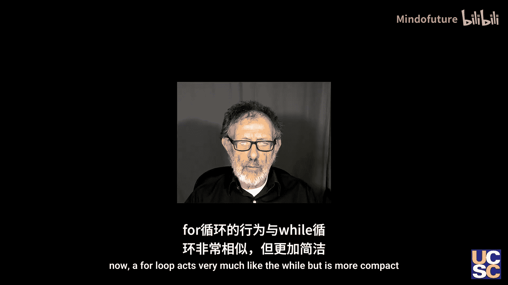
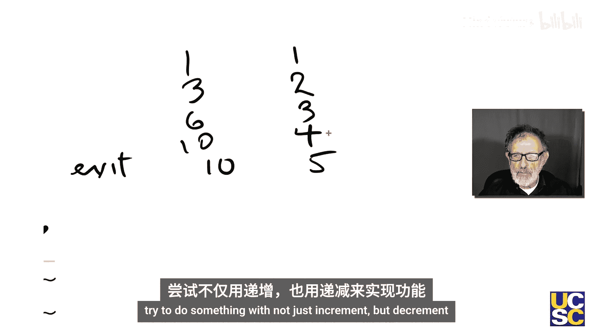
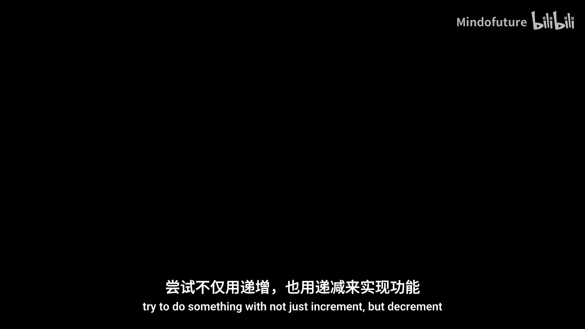

# 【加州大学】C语言编程基础-｜-C-For-Everyone-p27-P27_for语句及其while模拟_03_03_01--BV1Fqe7zDEVT_p27-

🎼TheYeah。Okay， we have been through while loops and now we're going to go to a slightly more sophisticated looping statement called the for loop。

Now。A for loop。Acts very much like the while， but is more compact。

And。You can visualize it as。Enter the loop， do a test。If you get a zero value。

 you exit and do a next statement， otherwise you execute the looping statement， go back test， loop。

 test until you get the zero value and exit。Here's a simple example of what the for loop looks like。

4。Prenheses， so this is a key word。Prenheses， I replaced by one semicolon。I。

Less than or equal5 semicolon， I plus plus。So it's an auto increment。

Clsose parent rent so they're going to be three。What are expressions sitting inside？This parentheses。

And then you have the statement you're executing in this case， we're going to say print， count。

The integer， shape and go to a new line， and that's what's going to be done。Throughout。And again。

 it's conceptually simple， basically the sop starts where I is one。And we test is I yet 5。

 if P isn't yet5。 We do。 We execute this。 So the first time through。

 we're going to say count one sheep。And then we're going to， at the end。Just before we retestask。

 we do this。Atter increment， so I becomes two。We would do a new test。

 we don't go back to this statement， it's only done。One time on entry。This is done each time。

 this is done each time through the loop。So what are we going to see？

We're going to see count one sheep， count two sheep， and the exit condition is when I is five。

When eye is greater than five， so we will go up to count five sheep and then we won't at I equals6。

 we will skip and then we'll have to do the next statement。Okay。

 so that was a simple force statement now let's look at the general syntax of that force statement。

Keyword 4。Expression one， semicolon， expression two， semicolon。And then expression 3。是。And then。

The statement that's being executed， which frequently is a compound statement again or a block。

Namely， some series of statements that are enclosed in braces。

E1 is most typically used as an initializer just like an more simple example。 E2 is typically， well。

 it's always a terminating condition。So。If it's going to work and it's going to be over a finite number of times。

 then this has to terminate。 That's where you can make some interesting mistakes and get what's called an infinite loop。

 So this has to be tested。 E 3 is typically， again， the salt typical。 The typical use。

 is either incrnt or decrement。So the terminating condition frequently involves mostly an integer expression or variable。

 and then incrementing that integer or decrementing it leads to a termination condition。

And that's how you typically write or use a force statement。The equivalent in the while。

So keep you should be able to do this mapping is expression one gets executed as a statement。

Don't forget that was typically your initial statement like I equals one， I assigned one。

Then you have vi of the expression， so that's why the expression。

The test expression for the loop is E2。Then you execute your statement and then you do what's typically your increment or decrement E3 inside a compound statement。

So you can see why a four statement is simpler， it combines all these elements into that one statement。

So something that would be multiple statements becomes syntactically easier to write。

Using the forest state。But either statement can replace the other。Okay。

 let's do a more detailed example。We're going to assign to a summing variable a sum of0。

 we're going to assign to some。Condition for termination and equals5。

So we could see if we change this or if we use scanf to get this。

 we can get a general number here and then we're going to say for I equal 1 sine 1。The test is。

 is I less than5。This is less than， not less than or equal。At auto increment eye。

So we're going to start with one。We're going to of course， count up to five。

 so this is going to fail at five。So we don't have to worry about。An infinite loop。

 And then internally， we're going to do a sum sum is going to replace by。S plus I。

And you should know that this can be done as well with。Plus。Assign I。Keep that in mind。

And then after the loop， this is not under the loop。And we can show that with this。Non indentations。

 so these are at the same level will print our answer at that point。Now。

 what will you see executing this？What you're going to see is you will wind up with sum equals 10。

 i equals 5。Internally， as you go through the loop。First time some becomes one， I is one。

 Second time some becomes 3。 I is 2。 third time some becomes 6。 I is 3。 The fourth time I becomes 10。

 sum is 4。 And then when I turns into 5 doesn't get it at in。 that's the。Test conditions。

 so we would exit。 and that's what we print。Okay， so you should practice with this。

 maybe take this very loop， write it inside a real program。Place print statements， modify it。

 try to do something with not just incrment， but decrement。

🎼。