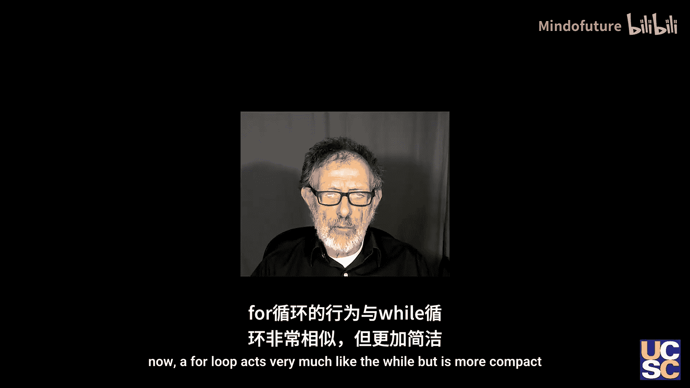
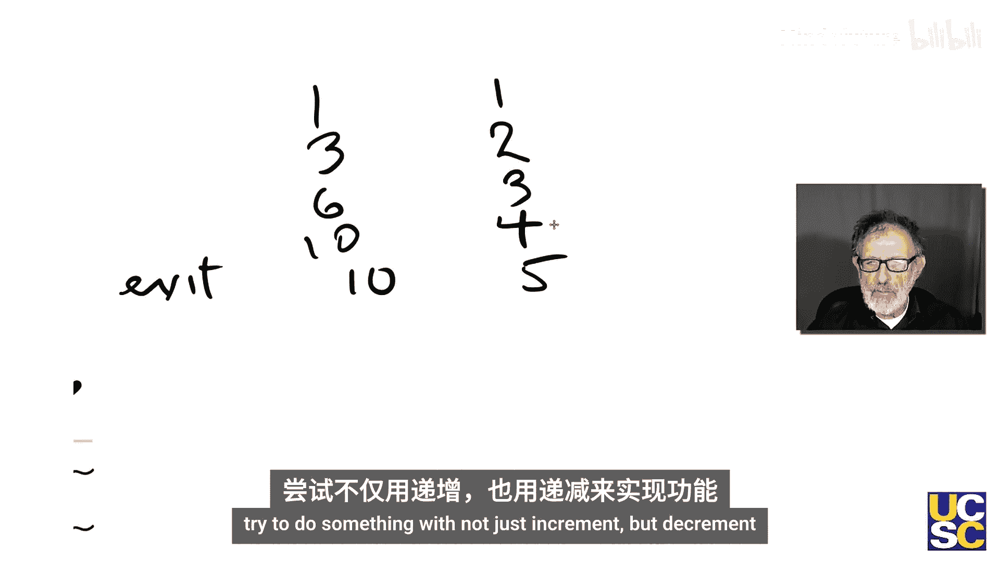
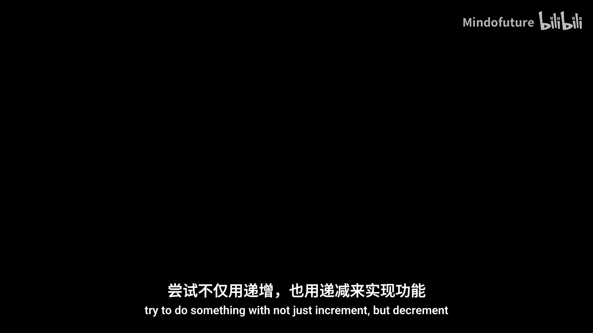

# C语言编程基础：P27：for语句及其while模拟



## 概述
在本节课中，我们将要学习C语言中的`for`循环语句。我们将了解`for`循环的基本语法和工作原理，并将其与之前学过的`while`循环进行比较，理解两者之间的等价关系。

## for循环简介
上一节我们介绍了`while`循环，本节中我们来看看一个更紧凑的循环语句——`for`循环。

`for`循环的行为与`while`循环非常相似，但语法更简洁。你可以将其流程理解为：进入循环，执行测试。如果测试结果为假（零值），则退出循环并执行下一条语句；否则，执行循环体内的语句，然后返回并再次测试，如此循环，直到测试结果为假时退出。

## for循环示例
以下是一个简单的`for`循环示例：

```c
for (i = 1; i <= 5; i++) {
    printf("count %d sheep\n", i);
}
```

关键字`for`后面跟着括号，括号内由三个用分号分隔的表达式组成。在本例中，循环体会执行打印语句。其概念很简单：循环开始时`i`被初始化为1。然后测试`i`是否小于等于5。如果条件为真，则执行循环体，打印“count 1 sheep”。在循环体执行完毕后、下一次测试之前，会执行第三个表达式`i++`，将`i`增加为2。接着进行新的测试。第一个初始化表达式只在进入循环时执行一次，而测试和增量表达式则在每次循环迭代时都会执行。

因此，我们将看到输出：count 1 sheep, count 2 sheep... 直到count 5 sheep。当`i`等于6时，测试条件`i <= 5`为假，循环终止，程序继续执行后面的语句。

## for循环的通用语法
现在让我们看看`for`语句的通用语法。

```c
for (E1; E2; E3) {
    statement;
}
```

关键字`for`后面是表达式1（E1）、分号、表达式2（E2）、分号、表达式3（E3）。然后是要执行的语句，通常是一个用花括号括起来的复合语句块。

*   **E1** 最常用作初始化器，就像简单示例中的`i = 1`。
*   **E2** 始终是循环终止条件。如果循环需要在有限次数内结束，这个条件最终必须为假，否则会导致“无限循环”。
*   **E3** 通常是增量或减量操作。终止条件通常涉及一个整数变量，通过递增或递减该变量来最终满足终止条件。

## for循环与while循环的等价关系
理解`for`循环如何映射到`while`循环非常重要。

`for`循环的等价`while`形式如下：

```c
E1;
while (E2) {
    statement;
    E3;
}
```

以下是映射关系：
*   表达式E1作为单独的语句首先执行（通常是初始化）。
*   while循环的测试条件是E2。
*   执行循环体语句。
*   在循环体内部（通常作为复合语句的一部分）执行E3（通常是增量/减量操作）。

由此可见，`for`语句更简洁，它将所有相关元素组合到了一个语句中。原本需要多条语句完成的事情，用`for`语句写起来语法上更简单。但两种语句可以互相替代。

## 详细示例分析
让我们做一个更详细的例子。

```c
int sum = 0;
int n = 5;
for (i = 1; i < n; i++) {
    sum = sum + i; // 也可写作 sum += i;
}
printf("sum = %d\n", sum);
```

我们将求和变量`sum`初始化为0，将终止条件变量`n`设为5。`for`循环从`i=1`开始，测试条件是`i < n`（注意是小于，不是小于等于），每次循环`i`自动递增。

循环将从1开始，递增到5时条件`i < 5`为假，因此不会导致无限循环。循环内部，`sum`被替换为`sum + i`。请注意，这也可以使用复合赋值运算符`sum += i`来完成。

循环结束后（注意`printf`语句没有缩进，与`for`处于同一层级），我们将打印结果。

执行此代码，你将看到最终`sum`等于10，`i`等于5。循环内部过程如下：
*   第一次：`sum`变为1（`i=1`）。
*   第二次：`sum`变为3（`i=2`）。
*   第三次：`sum`变为6（`i=3`）。
*   第四次：`sum`变为10（`i=4`）。
*   当`i`变为5时，不满足测试条件`i < 5`，循环退出。

## 练习建议
你应该练习使用`for`循环。可以尝试以下操作：
*   将上面这个循环写成一个真正的程序。
*   在循环内外添加打印语句来观察变量变化。
*   修改循环，尝试使用递减操作而不是递增。





## 总结
本节课中我们一起学习了C语言的`for`循环。我们了解了`for`循环的语法结构，包括初始化、测试和增量三个表达式。我们通过示例分析了其执行流程，并掌握了`for`循环与`while`循环之间的等价转换关系。`for`循环提供了一种更紧凑的方式来编写具有明确初始化、条件和更新步骤的循环。