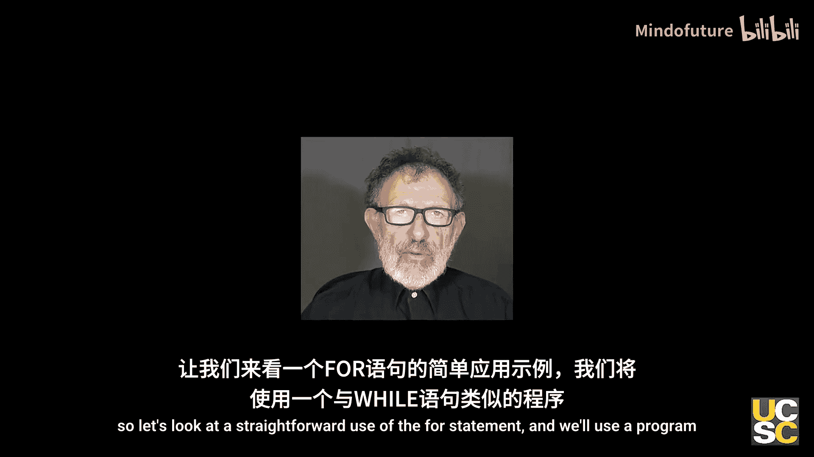
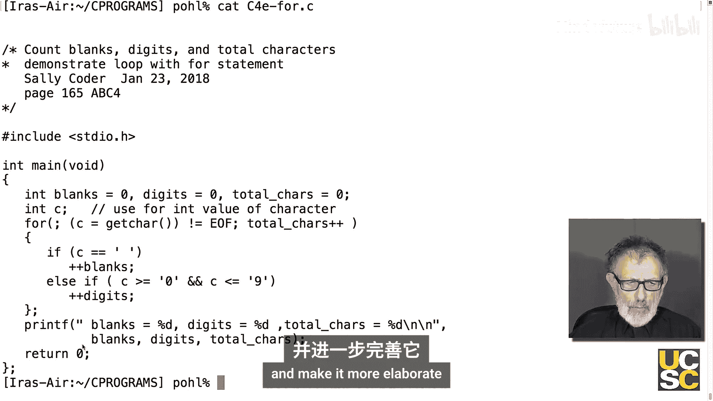
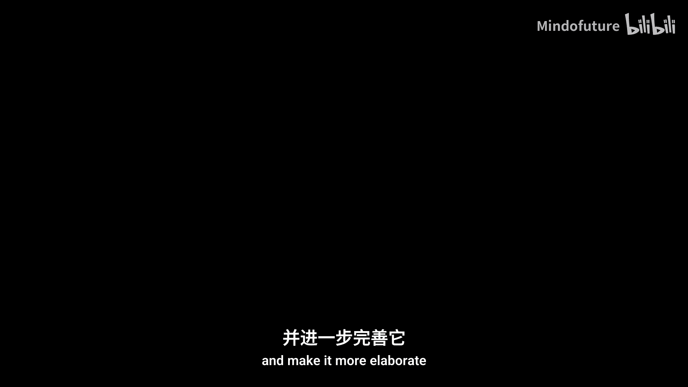

# 【加州大学】C语言编程基础-｜-C-For-Everyone-p28-P28_for语句代码示例_03_03_02--BV1Fqe7zDEVT_p28-

🎼TheYeah。So let's look at a straightforward use of the four statement。

And we'll use a program similar to one we wrote。For the wild statement， and in this program。

 we're going to try to count。Some of the characters。

Distinguish some of the characters in a file again later we're going to use redirection。So。

I'm going to count blanks。And we'll actually apply this to this particular file。呃。

So anything that's blank is something like that would be a blank。Right there。That would be a blank。

And we have a lot of blanks just because we like a good layout of the program。Now。

We're going to count blanks， digits， total characters。

 and then again we're going to use the integer variable C to store the next character we select out of the file。

And。Here's some interesting syntax for a foresstatement。We leave。Expression  one empty。

 Express 1 would be right there。 So all you're seeing is a semicolon。When expression1 is empty。

 there is no initialization。We don't need initialization because。

We've already initialized effectively total characters as what is going to be what's counted。

And it's not going to be involved in。Determination。

 The determination is going to work in the same way。As it did for the wild statement， namely。

C calls this routine out of the Standard I O Library。

That routine is a get character that normally returns one of the ASI values。However。

 there's special value for the end of file normally defined as minus1。

So as long as it doesn't see the end of file。It doesn't exit。

And then at the end of each loop on this， total characters would be incremented， having started at 0。

So we'll test for blank， there's our blank character。Otherwise we'll test for digits。

And we could do our tests if we did before， so I'll leave it up to you if you want to make this a more elaborate program。

And it wasn't necessary。But I did just because。呃。It makes it clearer。 I made this single。

 This is indeed a single statement。This is an if L single statement。

 so it would not need to be encapsulated as a compound statement。

But sometimes that's just good practice。 make sure you're aligned。 Not that。

Since there's an inter loop here， I use typically three spaces， though people use 4 or 5。

 and frequently， they use the tab character， and they end then to show the level of flow of control。

 So the fourth statement is controlling the if statement。 The if statement is。

Controlling this substatement that increments blanks。

 and the Elsif is controlling the substatement that increments digits。When we exit the loop。

 namely when we achieve an end of the file。Then we can print out。Our totals。So。

Let's show that this works。I'm going to。I say redirect。The file that I just type， which was。

 I believe， if I've got this right。C，4。And sure enough。There are 141 characters， 16 blanks。

 and total characters were 543。呃。If you want， we can go back and look at that program。

But we said there were 16 digits。 Maybe we should just check that to make sure。

We didn't make a mistake。不。嗯。Okay， so there was one digit， two digits，3 digits，4 digits，5 digits。

6 digits，7，8，9，10。11，12，13。14。1560。So indeed， our program seemed to have worked correctly。Okay。

 so I would suggest that you try and write this program for yourself。And make it more elaborate。

🎼。