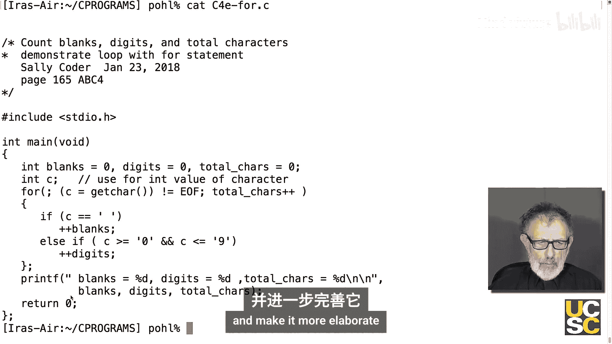

# C语言编程基础：P28：for语句代码示例


## 概述
在本节课中，我们将学习一个使用`for`循环语句的简单程序。这个程序会读取一个文件，并统计其中的空格、数字以及字符总数。我们将通过重定向功能来运行这个程序，并详细解析`for`循环的语法结构。

## 一个简单的for循环程序
我们将编写一个与之前`while`循环类似的程序。这个程序的目标是统计文件中特定字符的数量。

以下是程序的核心逻辑：
1.  统计空格数量。
2.  统计数字数量。
3.  统计字符总数。

我们将使用整型变量`c`来存储从文件中读取的每一个字符。

## for循环的语法细节
现在，我们来看看这个`for`循环中一个有趣的语法点。

```c
for ( ; (c = getchar()) != EOF; ++nc)
```
在这个`for`语句中，我们将**表达式1**留空了。你只能看到一个分号。当表达式1为空时，意味着没有初始化步骤。我们不需要在这里进行初始化，因为字符总数`nc`已经在循环外被初始化为0，并且它不参与循环条件的判断。

循环条件的判断方式与`while`语句相同：`getchar()`函数从标准I/O库中读取一个字符，通常返回其ASCII值。当遇到文件结束符（EOF，通常定义为-1）时，循环终止。

在每次循环的末尾，字符总数`nc`会自增1（从0开始计数）。

## 字符判断与计数逻辑
接下来，程序会判断读取到的字符类型。

以下是判断和计数的代码结构：
```c
if (c == ' ')
    ++nb;
else if (c >= '0' && c <= '9')
    ++nd;
```
我们首先测试字符是否为空格。如果不是空格，则测试它是否为数字（‘0’到‘9’之间）。这里的判断逻辑和之前一样，你可以根据需要扩展这个程序，使其更复杂。

虽然这里的`if`和`else if`各自只控制一条自增语句，不需要用花括号`{}`包裹成复合语句，但有时使用花括号是良好的编程习惯，可以使代码结构更清晰。

在代码格式上，我通常使用三个空格来缩进，以显示控制流的层级。有些人使用四个或五个空格，也经常使用制表符（Tab）。在这个例子中，`for`语句控制着`if`语句，而`if`语句控制着增加空格数的子语句，`else if`则控制着增加数字数的子语句。

## 输出结果与验证
当循环因到达文件末尾而退出时，我们就可以打印统计结果了。

让我们来演示一下程序是如何工作的。我将通过重定向功能，将我们刚才编写的源代码文件本身作为输入。

运行程序后，输出结果显示：共有141个字符，16个空格，字符总数为543。

为了验证数字统计的准确性，我们可以手动检查一下文件中的数字数量。经过清点，文件中确实有16个数字，这证明我们的程序运行正确。




## 总结
本节课我们一起学习了如何使用`for`循环语句来构建一个字符统计程序。我们分析了`for`循环中表达式留空的语法，实践了字符的条件判断与计数，并通过重定向验证了程序的正确性。建议你尝试自己编写这个程序，并可以进一步扩展其功能，例如增加对其他字符类型（如字母）的统计。