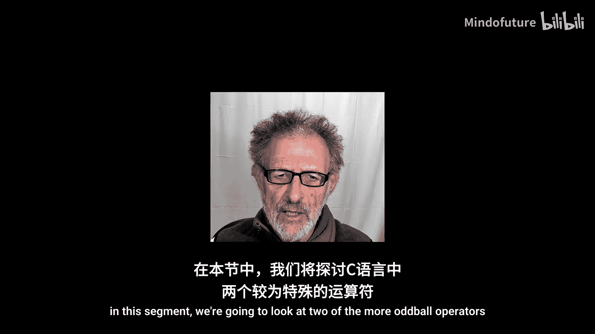
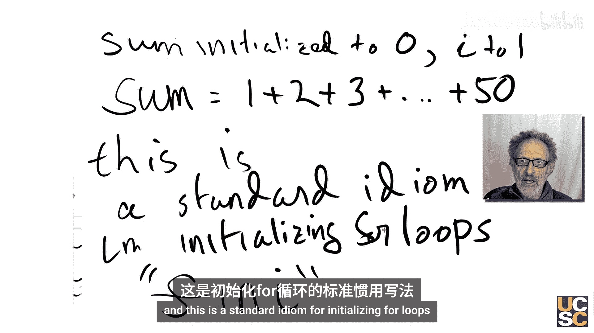
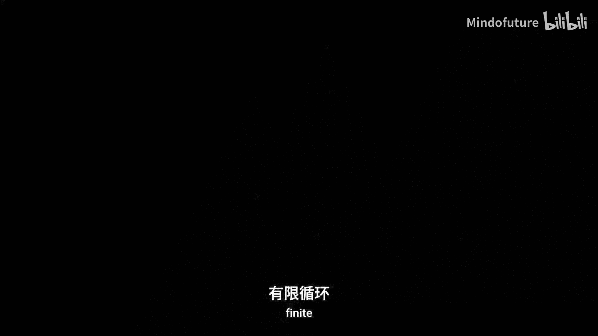

# 【加州大学】C语言编程基础-｜-C-For-Everyone-p29-P29_奇特运算符-条件运算符和逗号运算符_03_03_03--BV1Fqe7zDEVT_p29-

🎼TheYeah。In this segment， we're going to look at two of the more oddball operators we have in the sea language。

The first of them is a conditional operator， it's question mark Co。

 the second one is the comma operator。Again， as with lots of things in C。Things get overused。

 so comma can occur in many places， it's not always a comma operator sometimes。It's a list separator。

And question mark can be something elsewhere， and question mark Co。

 the conditional operator is uniquely the only ternary operator。

So here's an example of use of the question， Col mark。And。syntax in this example is C assigned。A。

 less than B， which is a relational expression。 Remember， it will evaluate to。0 or one。

 true or false。 Well0 is false。 One is true。And depending on which that's the question mark。

If it's true， the value of the expression is a。 and if it's false， the value of the expression is B。

And we can express this as an ordinary if then else， so if we wanted to。

 we could avoid the ternary operator。And it just means if A less than B， then C is replaced by A。

 L C is replaced by B。So notally， we have a ternary operator。Which saves us a lot of writing。

 So that's。What you might say， it's as big value as stirs， iss concise。

The general syntax is there's an expression， typically the expression that's。

Taken to be zero and non zero， then depending on the expression， it evaluates either expression one。

 the true part or expression， two here the false part。

Another characteristic of this is it's very low in precedence。

 so it occurs as one of the last things that would be evaluated。

 it's the third lowest precede among the 16 levels of precedence in the language。

And it's also unique in that it's the only ternary operator in sea。

 so that's an interesting fact to it。On the other hand， the comma operator。Is written as this。

Expression1， comic expression 2。And its semantics are first expression one gets evaluated。

Only after that does expression 2 get evaluated， and the value of the overall expression is expression 2。

And this comma operator is also known as a sequence point， in other words。

 expression one must be operated on first before expression 2 is done。

That's very important because C is a language that allows side effects and the side effects can affect and depending on order of evaluation。

 what the outcome of。As a program is。So where you have an operator like a plus B， a symmetric。

Add operator， binary operator， there may not be a specified order of evaluation。

 and different compilers may for optimization purposes to different orders of evaluation。

 That's very poor practice。 You don't really want a program to be non portable in that way， but。

You have to be aware of that as possibly something that would give rise to。Sperious results。

The other thing about this is that it's the lowest precedes operator。

So it gets done last and it's just below。The assignment operators or the operator assignment operators。

 so any of the assignment operators。Are next to lowest， and as we said， theterernary operator。

 a conditional operator is third lowest。And as I just said， it's a sequence point。

Sequence point is also important for the logical and and logical or。

 and it also comes up when you see a semicolon ending a statement， that's always a sequence point。

 in other words， everything has to be done before you move on to the next statement。Similarly。

 if you have two expressions in a logical end， the first one must be done first。

And then only if the first one is true， does the second one get evaluated。Here's an example。

C is assigned。 A is assigned。0， comma B is assigned 1， the value of this parenthesized expression。

Ends up being1。 So if we use this print F， we would see1 we would have as a side effect a assign0。

Now that seems like sort of a weird thing to want， but it does come in useful。Iiomatically。

 the place you see this most and where it's acceptable。Is in four statements。

 So you might see an expression like for some comma0 equal assign 0。 I assign 1。

 So you might want to assign several things at the beginning of a loop。

And then you test for the terminating condition， in this case。

 I less than equal to 50 and here's your。啊。Final step in each iteration where you're incrementing eye。

And you can see that this force statement is going to be a sum。In which。Ultimately。

 you'll add up well。What does the for loop do， let me give you a few seconds here to think about it yourself。

Okay， time's up。Should have been obvious。Some was initialized to0 i to1。

 and then by the end of the loop， we have summed 1 to 50。

And this is a standard an idiom for initializing for loops。Okay。

ね？🎼The。

