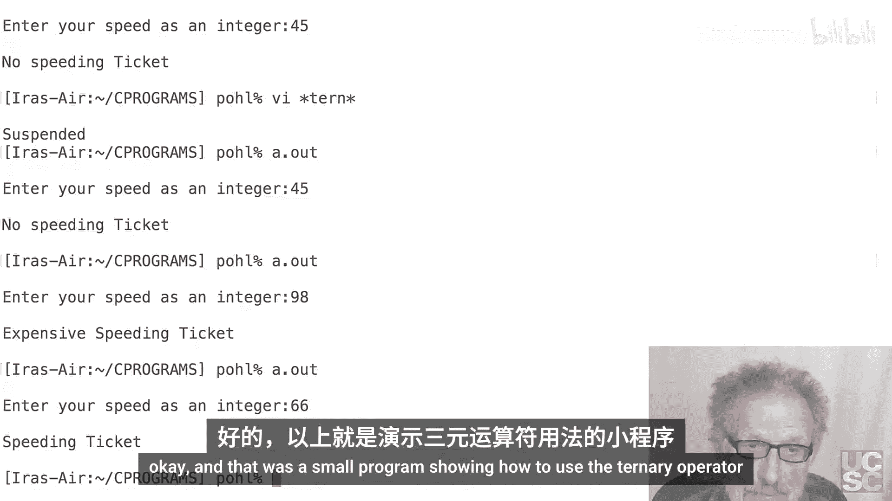

# 【加州大学】C语言编程基础-｜-C-For-Everyone-p30-P30_三元运算符代码示例_03_03_04--BV1Fqe7zDEVT_p30-

🎼2。🎼。

Okay， let's look at some code。Where we used the turnernary operator。

So this code is like a previous program where we。We're checking on a speeding。Car。

 and we wanted to know whether there was a speeding ticket and if it was a speeding ticket。

 was an ordinary one or an expensive one。But in the earlier version。We had three values。

 And if we didn't give those exact values， we we。The case。And the switch would be to default。

 and it would give us an incorrect speed， but we know that normally when we're speeding。

 there are ranges。And there's a range。 if you go less than 65 or 65， you're not speeding。

 If you go over 65， but less than 70， you're speeding， but not excessively。

 And then if you go over 70， you're speeding excessively， regardless of your speed。

that's what we're going to do， we're going to turn the earlier program into one that's a little more flexible using a nested ternary operator just to show you the convenience and how nice and expressive the ternary operator can be。

So just as before， we asked the user to print in a speed。 After we get to speed。

 we check to see if the speed is less than 65。And if it is， if the true part is， then we return 65。

 and that would be a case where we get no speeding ticket。

 So any value under 65 will yield no speeding ticket。If the speed。Isn't less than 65 or equal to it？

Then we will check to see if it's less or equal to 70。 If it is。

 we return 70 that will be used for our case label， and then we'll print a normal speeding ticket。

 otherwise we return 90， and that will be an expensive speeding ticket。

And notice if we've done this all correctly。There would be no need to use the default。

Now you might want to modify this program that would be an interesting exercise。

To show what happens if the speed is less than0。That would be an incorrect speed。

 Maybe you could modify this so that the default would show up if one of these cases wasn't right。

Now。Let's。Let's run the program just to test it out。You can see on the bottom。

 we're going to enter speed。If I had 45， there was no speeding ticket。

I run the program again and I give it。98， there is a speeding ticket and it's an expensive one。

Just to test the last case。我 do。66。And that was a normal speeding ticket。Okay。

 and that was a small program showing how to use。Histerernary operator。

あ。