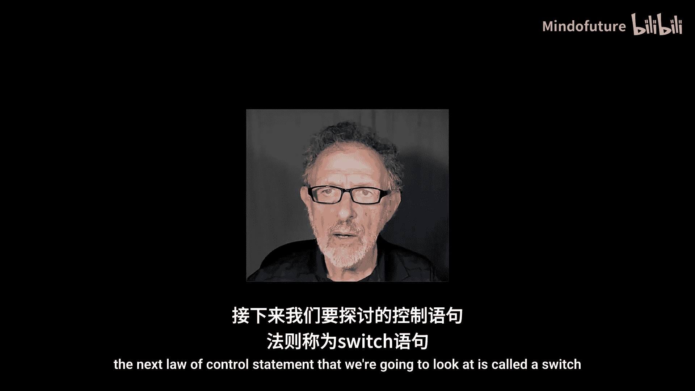
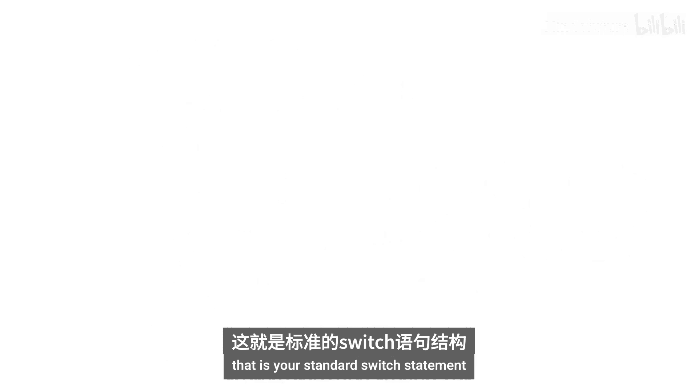

# 【加州大学】C语言编程基础-｜-C-For-Everyone-p31-P31_break和continue以及switch-包含文件_03_04_01--BV1Fqe7zDEVT_p31-

🎼2。🎼。

The next law of control statement that we're going to look at is called a switch statement。

At one level， it's a bit of a generalization of an if then else because you can accomplish pretty much the same thing。

With and if then else， but structurally for certain。Particular。Control flow。

 The switch statement is more elegant。And the code that you obtain is more readable。

So in a switch statement， basically you switch on an integral expression。

So a simple one might be the integer I， and then you have a bunch of cases。And those cases can。啊。

Be critical cases where you want to do different things depending on。Some small value of I。

So let's look at an example。Here's an example。We have the keyword switch。

Then we have an integer expression I， which would have to have a value before we enter here。

And then we have what effectively are three cases， we have case， a key word。With。An integer constant。

 so in this case it's a constant one。A colon。And then we have a series of statements that will get executed。

I was equal to one。In this case， we have a simple。Assignment statement a equals two times I。

 And then we have this special flow of control statement break。

 And what break means is if you get here， jump。2。The next statement that goes after this closing brace。

And this is idiomatic。If you didn't have the break here。

You would have what's called fall through semantics。 So imagine if break was no longer here。

 Then you would execute case 2， and there you would have a equal assign three times I。

 which point you'd have a break。Okay， so here the notion is there are three things we want to do either I is one。

 I is two or I is some other value for another value。

 there's the special key word which constitutes everything else called a default。Colon， and again。

 you have some。Series of statements， in this case， a single statement。

 and then you fall out of the case。So what you're looking at syntactically is switch。

An integral expression can't be floating point， It must be integral。

 but it could be something like a short or a long in or。I ask you value for。Character。

And then you have the series of cases that are going to be enclosed in these braces。

And the braces sort of act like a block。 And the cases act what we call case labels。

 They basically tell you the switch jumps to one of a number。

And if that expression is not seen in this list。呃。Then you go to the default。 If there is no default。

 then you just。Don't do anything。 and you leave。🎼So normally， idiomaticically， again。

 you would typically have cases delineated by brakes。And then finally a default。

That is your standard switch。Statement。

