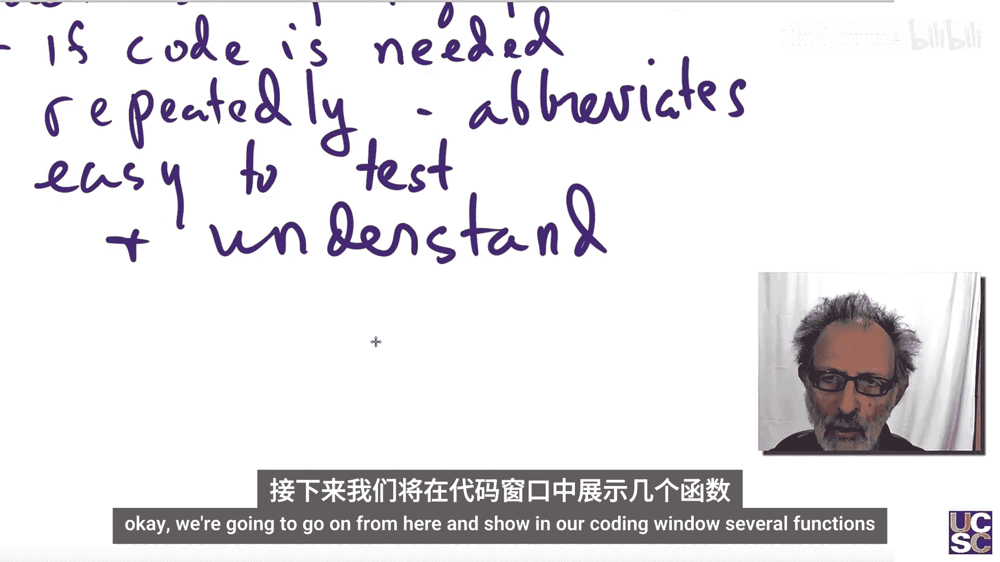
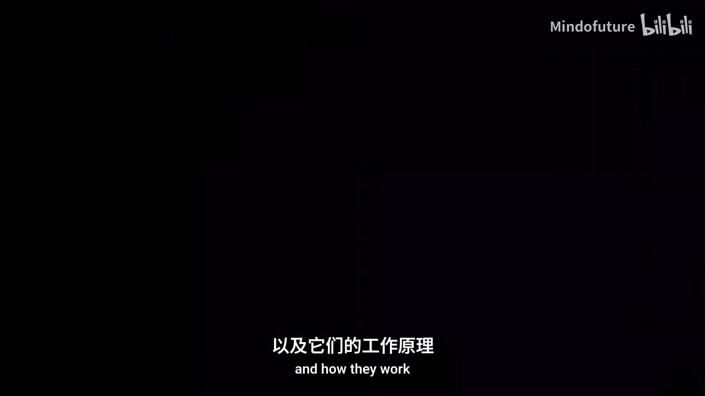

# 【加州大学】C语言编程基础-｜-C-For-Everyone-p32-P32_函数定义_04_01_01--BV1Fqe7zDEVT_p32-

🎼TheYeah。Okay now we're going to start one of the most important topics in this whole course and that's。

Functions。A reference if you're following the textbook is chapter 5， especially 5。1。

So here's a quote， the paragraph of coding is a function， Doctor P。

We already have used functions all along。We started with our basic beginning program with the function int main Paren void Paren。

And inside that function， which was function with an open brace。

Was the start of the executable program。We've also used standard IO which had functions like printntf and scanf。

And it was， again， an in function， print f， and it could have many arguments， actually。

 a variable number of arguments。We've also used a pseudo random number generator function in RAandN。

And others。Why are functions so important？They in effect the paragraph。If you can write a paragraph。

 you can write an essay， if you can write an essay， you can write a book。So structurally。

 the paragraph is a big jump。 It takes you from the。Single correct sentence to a coherent。

Set of thoughts。The same is true for a function， it takes you from a single statement。

Understanding that statement， like an assignment statement。

Or like a call on a function such as print F and putting it together to achieve some purpose。

 some coherent purpose。Functions are important， because。They are crucial to the reuse of code。

 They're especially crucial if they exist in libraries， libraries like Standard I O dot H。

 Standard live dot H。 These are universally useful libraries。 and we don't have to rewrite them。

 So we have to understand how to use them。 And indeed to be good coder。

 We have to know how we should be writing code that's reusable。There。

 a fundamental encapsulation technique。 When you have a big piece of code and nowadays， code can be。

In the tens or even hundreds of millions of lines to produce a big system。

You don't start on that all by itself。 You break it up into smaller and smaller pieces。

as calling a small piece of encapsulation， a function is a form of encapsulation。

It allows you to structure a big piece of code， you structure it into a bunch of functions。

 functions call other functions， and then finally you have the overall function main。

Here are some things you should think about when writing functions。

A function largely should be able to do one thing Well。 Think of ran， Think of print F。

 Think of square root。 These do one thing。 They don't do multiple things。

 You don't have a function that does both square root and cube root。 You keep those things separate。

Functions when written should stay with one page of code。 Why， because that's like a paragraph。

 it's easy to understand， and it's easy to test。 So a function is a unit that you can manage to test effectively。

 and sometimes we want what are called preconditions and post conditionsition。

 If we have the right kind of input， we should get。The expected output。

 and that should be something we can properly test。Here's our syntax for a function。

We have a type such as in or void。We have a function name。

 and the function name is a form of documentation like printf orandand or Maine。

Then we have a parameter list。 This can be an arbitrary comma separated list。

 These are the parameters passed then。You've seen that with， for example， print E。

And then you have the body of the function， which is typically this brace enclos what we call block。

 The block starts with a bunch of declarations， if needed。And then a bunch of executable statements。

So here's an example， simple example。Void， write address， void。 so it returns nothing。

 It needs no arguments。And we're going to say printf clause。New lie， printf North Po。

Santa Claus's address。Close brace， so now we've encapsulated this idea and we can use it wherever we need it。

This is a function definition， it allows us to call the function。

 Howard would we call the function we would just say right under our address。Penparen， semicolon。

And one could imagine that being called inside Maine。

 and then this would execute those two print deaths。As I said， it acts as a paragraph。

The code is needed repeatedly， it abbreviates， makes it easier to test。

 and makes it easier to understand big pieces of code。Okay。

 we're going to go on from here and show in our coding window several functions in how they work。

🎼。