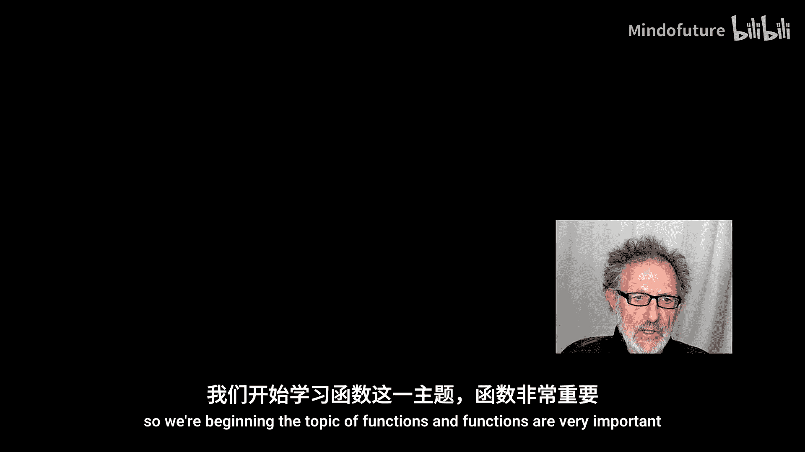
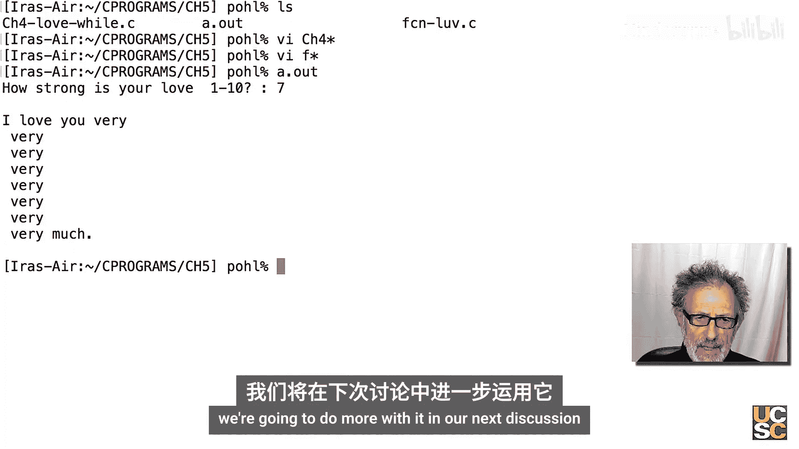
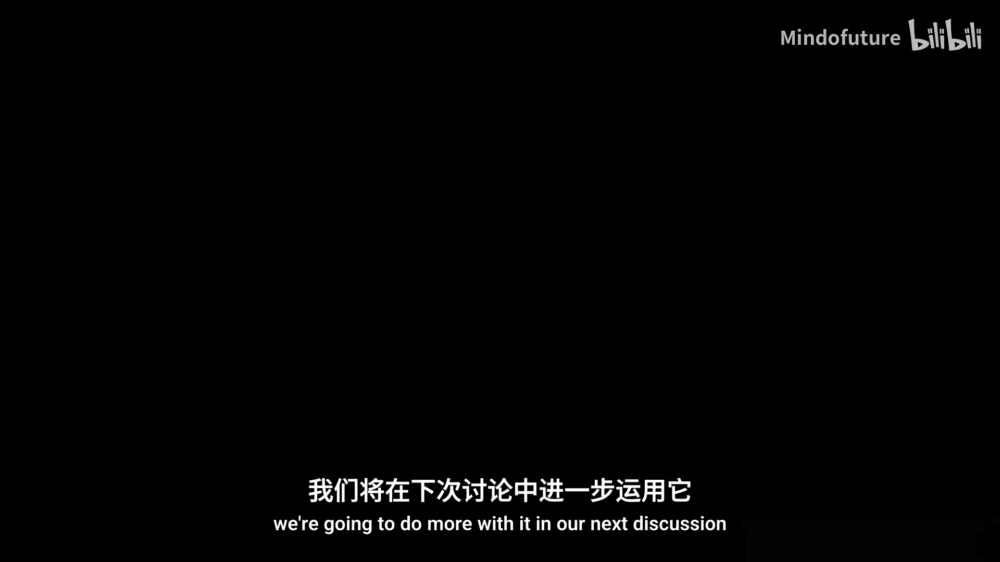

# 【加州大学】C语言编程基础-｜-C-For-Everyone-p33-P33_函数代码示例_04_01_02--BV1Fqe7zDEVT_p33-

🎼TheYeah。So we're beginning the topic of functions and functions are very important。

 I just discussed。

How come？They're possibly the most significant topic in this whole course。

They basically get you from the level of being able to write a sentence to the level of being able to write a paragraph。

 and as a consequence。Once you can write a good function， you can write any kind of code。

So here's a function， of course， it's main。And notice we've done this before it was to exhibit the use of the while loop again once we learn how to。

Right flow of control statements they're very critical。 Iteration is crucial。

 The while loop is the simplest form of iteration。 This was a program I wrote for。

My daughter and wife for Valentine's Day， so you're asked。How much。呃。You're loved。

 and it repeats and says， I love you very。 And then however， many times you've asked it to repeat。呃。

You say very， very， very much。Now。A crucial part of this。

 than if I wanted to reuse it in other code is this little for loop。

So I'm going to encapsulate it as a function。All right， so let's look at。

The function version of the same code。So here we've written our function。

This first part of the function， is a function definition。

 because it includes how the function is declared and。What its meaning is， what its code is。

 if we just had。This first part。With the semicolon， that would be a function declaration。

 That would also be known as。This part is known as a signature。 It signature is。

What are its characteristics， What is its return type， What are thee。

Arguments that are being passed in and its name。So。This open brace， we could have declarations here。

 but we don't need them for the simple function。 And there's our code again while count。

 count being passed in。And we end up executing that。And now， look how much simpler。 and in fact。

 it even aids the documentation it aids in the debugging of the program where inside main。

 which is a second function。 we call this function。Write， very repeat。

 So repeat is the actual variable here。 It's whatever we entered is value as。It gets passed as count。

 and we'll talk a lot more about that later。 These are all passed in by value。

 and they get used locally。So they don't affect the value of repeat whatever repeat was if I'd put8 in。

 even though count goes to zero repeat later would stay at eight。We'll discuss that in more detail。

And you can see right very repeat。 And now we have a much simpler main。

 So if we nest these functions， if we write a function package to do a complicated program。

 and then in Maine， we just call them， we have a structure。To how to write our code。Very important。

Let's just test it out。🎼Okay， I love you very， very， very， very very much， so play with that program。

 make sure you understand function encapsulation and we're going to do more with it。

And our next discussion。

