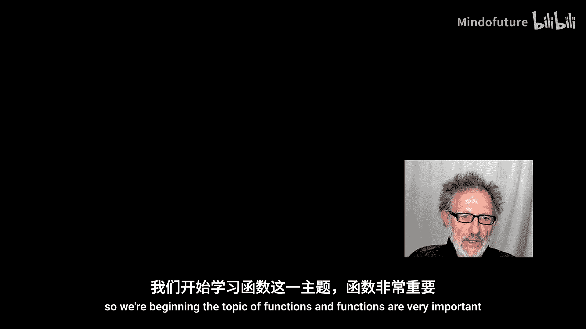
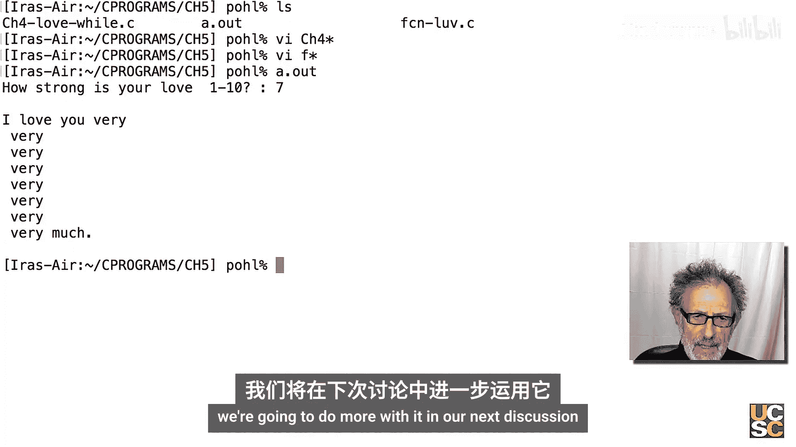
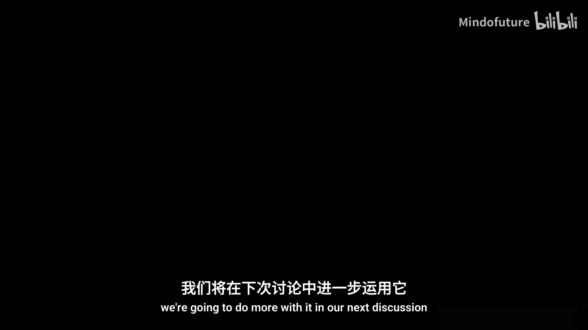

# C语言编程基础：P33：函数代码示例



## 概述
在本节课中，我们将要学习C语言中一个极其重要的概念——函数。我们将通过一个具体的代码示例，了解如何将一段代码封装成函数，以及这样做如何使程序结构更清晰、更易于维护和复用。

---

## 函数的重要性
函数可能是整个课程中最重要的主题。它们将你的编程能力从“书写句子”提升到“书写段落”的层次。一旦你能够编写一个良好的函数，你就有能力编写任何类型的代码。

## 示例程序：爱的表达
为了说明函数的概念，我们首先来看一个未使用函数的简单程序。这个程序使用`while`循环来重复表达“非常”这个词，以传达爱的程度。迭代（循环）是控制程序流程的关键语句，而`while`循环是其最简单的形式。

以下是该程序的代码：
```c
#include <stdio.h>

int main() {
    int repeat;
    printf("How much? ");
    scanf("%d", &repeat);

    int count = repeat;
    while (count > 0) {
        printf("very ");
        count--;
    }
    printf("much.\n");

    return 0;
}
```
这个程序的核心部分是`while`循环。如果我希望在其他代码中重用这段逻辑，就需要将其封装起来。

## 函数的封装
上一节我们看到了一个使用循环的程序，本节中我们来看看如何将这段逻辑封装成一个独立的函数。

函数封装的第一步是创建函数定义。一个完整的函数定义包括声明部分和实现代码。如果只有声明部分并以分号结尾，那只是一个函数声明。函数的“签名”至关重要，它定义了函数的特征：返回类型、参数列表和函数名。

以下是将上述循环逻辑封装成函数后的代码：
```c
#include <stdio.h>

// 函数定义
void write_very(int count) {
    while (count > 0) {
        printf("very ");
        count--;
    }
}

int main() {
    int repeat;
    printf("How much? ");
    scanf("%d", &repeat);

    // 调用函数
    write_very(repeat);
    printf("much.\n");

    return 0;
}
```
在`main`函数中，我们调用了`write_very`函数。这里，变量`repeat`的值作为参数`count`传递给函数。在C语言中，参数是“按值传递”的，这意味着函数内部对`count`的修改（例如递减到0）不会影响外部变量`repeat`的原始值（如果输入是8，`repeat`之后仍然是8）。我们将在后续课程中更详细地讨论这一点。

## 封装带来的好处
通过封装，`main`函数变得非常简洁。我们可以编写多个函数来完成复杂程序的不同部分，然后在`main`函数中调用它们。这为我们的代码提供了一种清晰的结构，极大地帮助了程序的文档编写和调试。

让我们测试一下这个函数版的程序。运行后，输入一个数字，例如5，程序会输出：“I love you very very very very very much.”。

请尝试运行并修改这个程序，确保你理解了函数封装的概念。我们将在接下来的讨论中更多地使用它。

---





## 总结
本节课中我们一起学习了C语言函数的基础知识。我们通过一个具体的例子，了解了如何将一段代码（特别是循环逻辑）封装成一个独立的函数。我们认识了函数定义、函数签名以及参数传递（按值传递）的基本概念。最重要的是，我们看到了使用函数如何让主程序变得更简洁、更具结构性，这是构建复杂、可维护程序的关键一步。