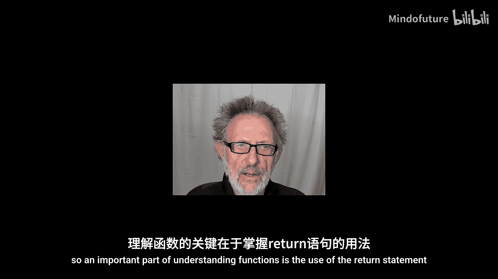
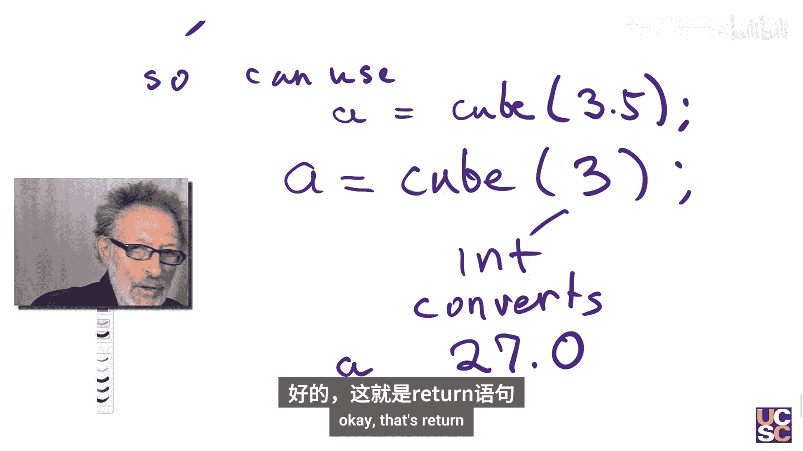

# 【加州大学】C语言编程基础-｜-C-For-Everyone-p34-P34_return语句_04_01_03--BV1Fqe7zDEVT_p34-

🎼TheYeah。It's an important part of understanding functions。

Is the use of the return statement？And the return statement is a flow of control keyword return。

And we've already seen it。 We've seen it right from the begego with our first programs。

 where we always say at the end of main return of 0， thiss a convention。It can be。啊。Not used。But。

It's better style to use it explicitly。So at the end of a function in main。

What its meaning is is that Maine returns a value0， but where does return it to。

 Maine is the program that you're executing， it returns it to the operating system。

And it's used by the operating system sometimes to figure out whether there was an error in the program。

 So return of 0 means the program finished in an expected orderly way， a normal exit。

The syntax of the return statement is either its return semicolon。No expression， return of semicolon。

 or its return of an expression， semicolon。Here are three simple examples， the return of semicolon。

Return of zero。Return of the expression A plus B notice。I did not need to parentsize this。

 but by parenthesizing， I made it clearer。 So I could just as well have。Written。Pure。

It could have parenthesized even a simple integer constant like zero。

So people generally when they're returning expression， even if they don't need to。

 because of clarity stylistically， they do use parentitization。Let's see a simple use in a function。

Here's a function。Self explanatory。 I've called it cube。 It means that I'll take a value。

 which is a double。 I'll multiply it three times。 So I get the cube of the past and parameter X。

So double is what's returned。That's the appropriate value。 If these do not line up。

 If this expression is not double， then there's going to be some kind of conversion。

Conversion rules can be messy and complicated and generally want to avoid conversions。But。呃。

We will expect a conversion。How can it be used？We can call it like a is replaced by the cube of 3。5。

So internally， this gets computed。It it's 3。5 times 3。5 times 3。5， and that is the value return to a。

Notice， by the way， just to make that last point clear。If I had said。A is returned。Q。Of three。

What actually happens is。Three is an end。Converge to double。And A ends up being。The double 27。0。

 not the integer 27。Okay。That's return。 Return is fairly simple。

