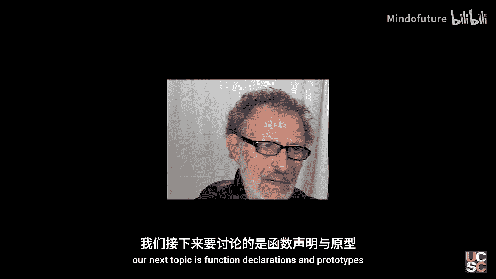
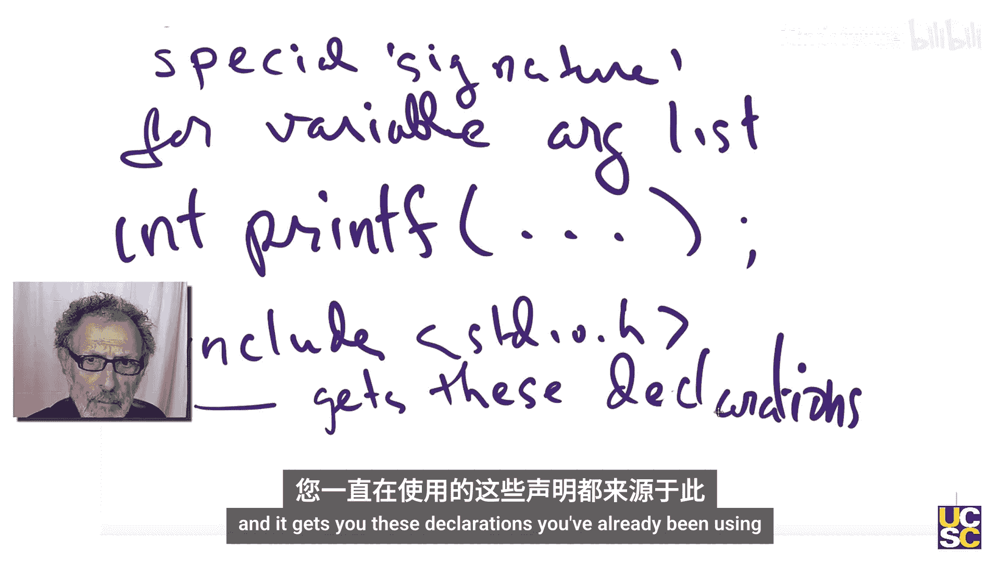
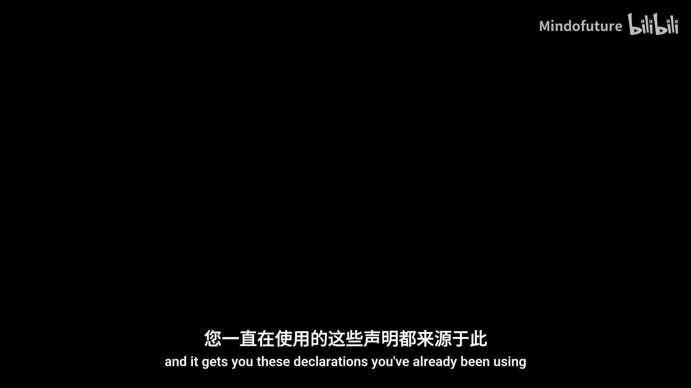

# 【加州大学】C语言编程基础-｜-C-For-Everyone-p35-P35_函数原型_04_01_04--BV1Fqe7zDEVT_p35-

🎼TheYeah。Our next topic。

Is function declarations and prototypes。So far， what we've been using is definitions which are also declarations。

But what if。Maine didn't yet see the definition。Of。A function that it's trying to use。

You would see an error， for example， You could try to use a printf without sharp include of standard lib。

 a not standard Lib of standard I O dot H。 You would get an error that something was undeclared。

So we need to know。A declaration before we get to use something， including a function。

The way to get around that， why you can also declare something first before it。Defined。

Is what's also called a prototype。So we can say double cube， double。Semicolon。

That acts as a declaration。 And then in Maine， we can call cube。

 And there's an expectation that we would have the actual code， the definition。Somewhere else。

 and typically it might be after。Main。And this would work perfectly fine。Or。

When we get to very complex programs， we would have multi file programs。And the definition may also。

Be found。In a further file。This definition or also called a prototype known as prototype。

Can be just with the parameter types or with names for the parameter， so。

You can just say double cube double X， just as well as saying double cube double。

 leaving off its name。It's also sometimes known as a signature。

 this becomes important when you move on to languages like Java and C++， which allow。

What are called overloading of functions， giving functions of the same signature， different meanings。

 Well， of the same name with different signatures， different meanings。

Don't worry about that until get those you get to if you're going to move on to C++ in the sequence。

You'll find out a lot about that。Is also the special signature for a variable argument list。

So as we've already found out， when we call print F， we can give it a format string。

 and then we can give it a whole bunch of variables。And that。Since it's a variable I' argue list。

Can be。Shown as dot dot dot， namely the ellipsis。Oh。Argument twistist。And of course。

 these things are defined in。Includes standardo。h and it gets you to these declarations。

 which you've already been using。

