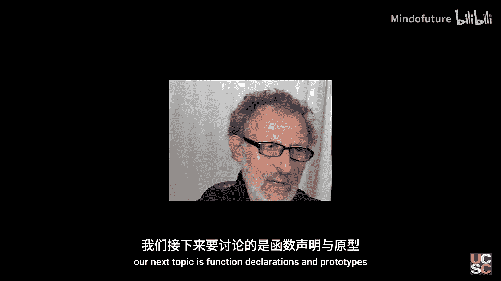
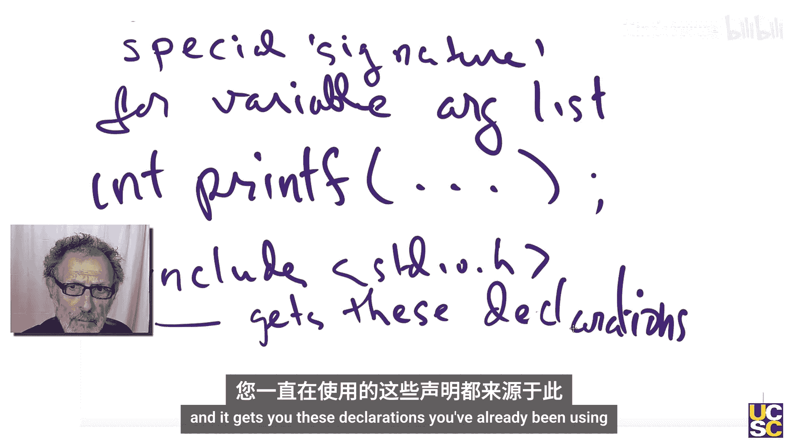
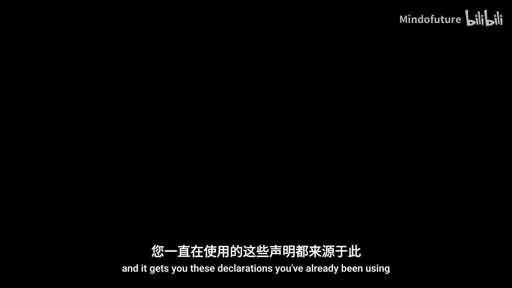

# C语言编程基础：P35：函数原型



## 概述
在本节课中，我们将要学习C语言中的函数声明与原型。理解如何在使用函数之前声明它们，以及原型在程序编译过程中的重要作用。

## 函数声明与原型
上一节我们介绍了函数定义，本节中我们来看看函数声明与原型。

到目前为止，我们使用的函数定义同时也充当了声明。但如果编译器在遇到函数调用时，尚未看到该函数的定义，就会报错。例如，如果没有使用 `#include <stdio.h>` 包含标准输入输出库，直接调用 `printf` 函数，编译器会提示该函数未声明。

因此，在使用任何函数（包括库函数）之前，我们需要先知道它的声明。

解决这个问题的方法是，可以在函数被定义之前先声明它，这被称为函数原型。例如，我们可以这样写：
```c
double cube(double);
```
这行代码就是一个函数声明。之后，在 `main` 函数中，我们就可以调用 `cube` 函数。编译器会期望在程序的其他地方找到该函数的实际代码（即定义）。

通常，函数定义可以放在 `main` 函数之后。这样写程序完全可以正常运行。或者，在更复杂的多文件项目中，函数的定义可能位于另一个单独的文件中。

这种声明，也称为原型，可以只包含参数类型，也可以包含参数名称。以下是两种等价的写法：
```c
double cube(double);
double cube(double x);
```
省略参数名也是允许的。

函数原型有时也被称为函数签名。当你后续学习Java或C++等语言时，这个概念会变得非常重要，因为这些语言支持函数重载，即允许同名函数拥有不同的签名（参数列表）来实现不同的功能。不过，在学习C++之前，你无需担心这一点。

此外，还有一种特殊的签名用于处理可变参数列表。正如我们已经知道的，调用 `printf` 函数时，我们可以提供一个格式字符串，然后提供一系列变量。因为它是一个可变参数列表，所以在声明中可以用省略号 `...` 来表示。当然，`printf` 等函数的这些声明都定义在 `stdio.h` 等头文件中，通过 `#include` 指令引入后，你就可以使用它们了。





## 总结
本节课中我们一起学习了C语言的函数声明与原型。我们了解到，在使用函数前必须先声明，函数原型可以只包含类型或同时包含参数名，并且理解了原型在多文件编程和后续学习其他语言中的重要性。