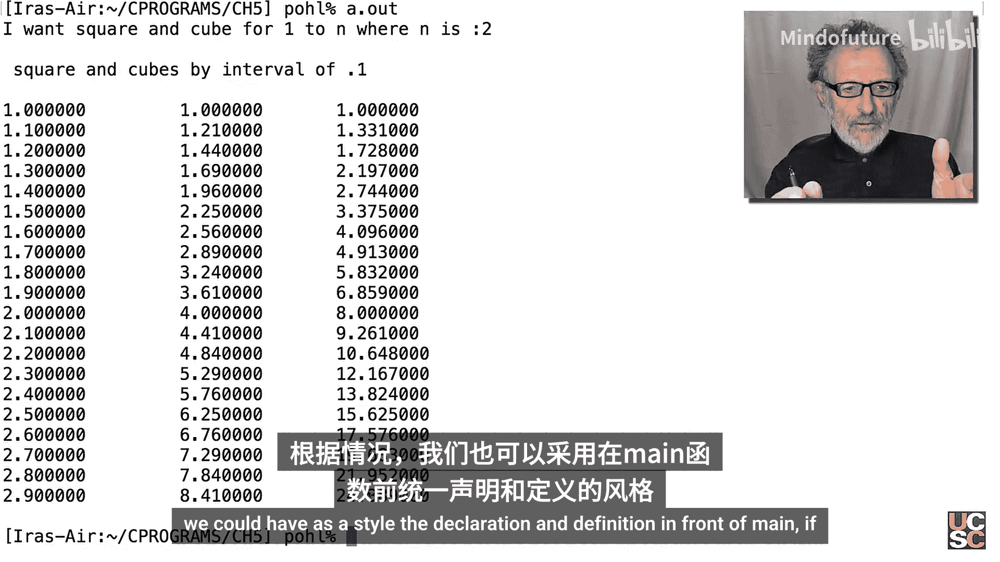
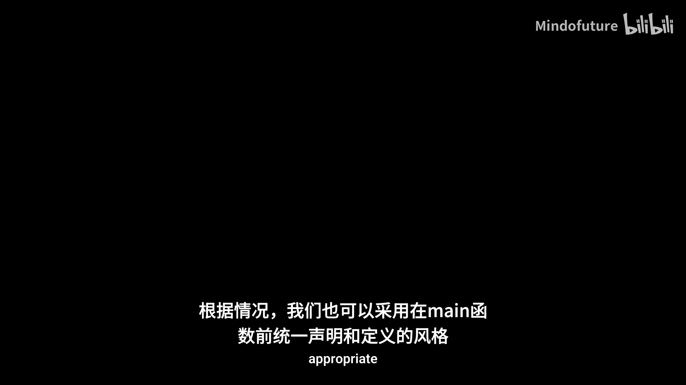

# 【加州大学】C语言编程基础-｜-C-For-Everyone-p36-P36_函数原型代码示例_04_01_05--BV1Fqe7zDEVT_p36-

🎼TheYeah。Okay， let's take some of the ideas we've already been discussing with functions。

And use them again， more practice， you should practice on your own。

In this example， we're going to try to print。啊。A table of squares and cubes。

And we're going to use some simple functions just again to structure the code properly。

And we're also of course， going to use the standard IO functions from standardIo。h。

 where we'll also get prototypes or function declarations。So here。

We have what we just discussed about。A prototype。We didn't need to include the name of the parameter。

 We， we need the type of the parameter。 So we know from the point of view。Of mainine。

 which is going to use this， It understands that it needs to call a function whose name is square。

 which returns a double and which computes a double。

 That's all it needs to understand how to compile that。

As long as it can find the definition of square。At a later point。

 either in the same file or brought in from some outside file。

We'll learn later how to include our own coding files， for example。Here's Maine。

Here is where Maine is going to make use of。Square and cube。And you notice。We have。

A nested forstatement。 Let's look at that briefly。Just to remind you of why。

A computer can be so powerful。 It gets you to do a lot of computation trivially。

Just a little bit of writing。So here we're going to say。From one to how many。

That's how long the table is going to be。And we're going to want to write out cubes and squares at intervals of 0。

1， that we're going to say we're going to ask about square and cubes by interval of 0。1。

We're going to ask for n。So we will have a table from one to。Whatever n is。

09 and print out the squares in the cubes。So this is the outer loop。 This is the inner loop。

 We're doing it intense。 if we want to do it in hundred0th， this would be 100。 So again。

 very simple structure， but very powerful。 We get this double loop。And we're going to print。

Where the evaluation occurs and the square and the cube。 And， of course。

 this could be extended if we had other things we wanted to compute for that number。And then。

Go down to the end of the file。And here's the actual definitions。So at the front， these things were。

Prototypes。Prototype， but no。Definition yet， here's the definition。So now the compiler knows， oh。

 that's how I define this function called square。Let's go and run it。I want it。

Square and cube for one to n。Let's just do。2。You can see I get a nice table， one， one squared is one。

One cubed is one。1。5。On 。5 squared is 2。25。Cube is 3。375。And here's the squarearing cube of two。

So always good for computer scientists to know everything about。Powers of two， so that's2， four，8。

 what would be next if we was。Raace to the fourth power would be 16 so the fifth power would be 32。

And here we're all the way up to 2。9。Okay， so that shows you how in a standard program we would package it。

Divide and conquer， write our individual routines， declare them before you use them and then have their definitions。

Either style， by the way， is okay， we could have as a style。

The declaration and definition in front of Maine if appropriate。

