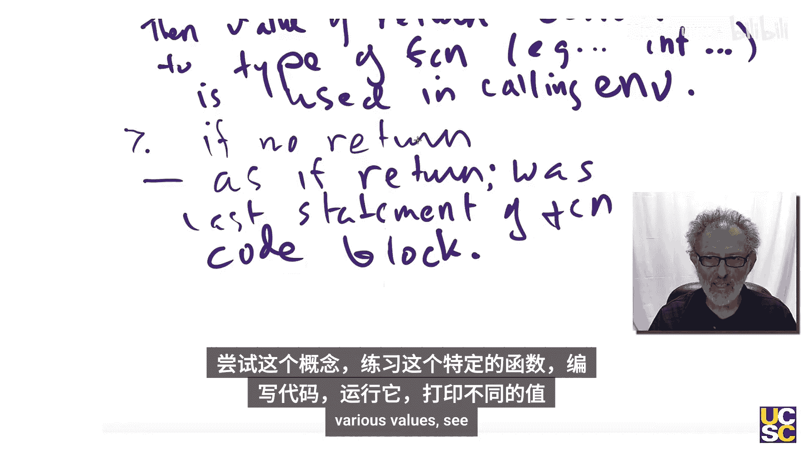
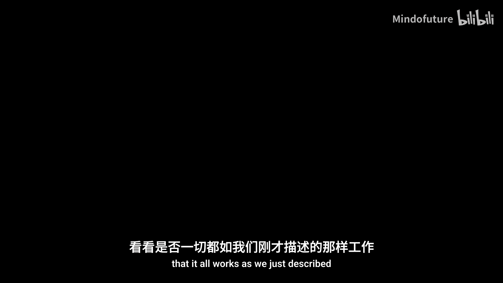

# 【加州大学】C语言编程基础-｜-C-For-Everyone-p37-P37_按值调用解释的函数变量_04_01_06--BV1Fqe7zDEVT_p37-

🎼TheYeah。Our next topic is function andvocation。

And the notion of call by value for the parameters。And this is an extremely important topic。

 so this is central， so you really have to work at understanding this。And as you see。

 there's a reference if you're following in a text 5。7。

So we're going to look at how parameters behave， and they behave。Or arguments behave。

 they behave call by value。Is simple function。And compute sum to n。One argument， one parameter。

 int and semicolon。The body of the function is an internal local variable。Some equals 0。

And then we have this for loop。 notice we don't have a beginning part。

 that means nothing is done at the beginning。Our testing part is when n stays greater than 0 and we decrement n。

 so we're expecting to pass。Positive value， and we're going to sum all of the integers up to end。

And then return that sum。Notice internally， it seems like n is being reduced to  zero right so if n started at 20。

 this is going to count down to0。 what we're going to see is in the external or calling environment。

 the actual parameter， the actual variable passed in here， if it is a variable。Is unchanged。

So imagine。Now we call this function with an integer M equals5。

And we want to compute the sum to end of five。And indeed。

 what should be the answer it should be one plus two plus three plus four plus five。

And you should try this out。When we invoke that function， when that function is called here are。

The semantics here is the meaning of that function， here is how that function is executed。

Each expression。In the argument list。Parameterters is evaluated。 So in this case， it's simple。

 M was 5， but it could have been something else。 It could have been 5 plus M plus 2。5 or。

Three times N， or it could have just been an actual value passed in。

 all of those would be appropriate。What happens is whatever that value is。It has to be converted。

If necessary to the type of the parameter， in that case， the parameter was an integer parameter。

Now for M already 5。In an inch parameter， there would be no conversion。

But it turns out we could have used an expression that would have been double， we could have used 3。

5 times M in which case the answer would have been 17。5。And in that conversion。呃。

It gets locked off to 17。Again， you might want to try this in your own code if you don't believe it。

But you have to understand the whole character of。Both implicit and explicit conversions between types。

This is one place where you're going to get a possibility of conversions。

 very similar to conversions you'd get in an assignment expression。

Where the left side expression is converted to the right side。Type。

this we're saying is a very important step， called by value。It's as if for n。

 remember that parameter， n and we write inside the code action on N， well， if you substitute for n。

 an n local。As if it is what is used inside execution of the function。

With the first step being and local is assigned and notice， whatever。And will be as an expression。

That is going to have a value be and local， so n is going to be integer would get an expression conversion。

 if whatever gets done there and then。And local is what is used and is unaffected。

The end value is never changed， even if， as in our example， it seems to go to zero。

 that's not what's going to zero。A local version of it is what's being changed and that local version has no effect。

On the surrounding environment， on the environment from where。It was called。

The rest remains straightforward， the function body is then executed。

We look for a return statement and if the return statement is encountered。

The function exits to where the function was called。Where it was invo， called invo， same thing。

If there's a return expression， remember， in this case， our example， we have an integer function。

So again， whatever the expression is。It has to be， if necessary converted back to the type of the function in this case。

 integer， and that's what gets used in the calling environment， for example。

We could print the value of that function。Finally， if there is no return。It's as if a return was。

Implicit in the last statement of the function code block， so even if when you don't see a return。

 you can imagine a return when you fall off the end of the code for that function。All right。

 so crucial， very important topic。Play with this idea。Try that particular function， write it up。

 run it。Print various values， see that it all works as we've just described。

🎼The。

🎼。