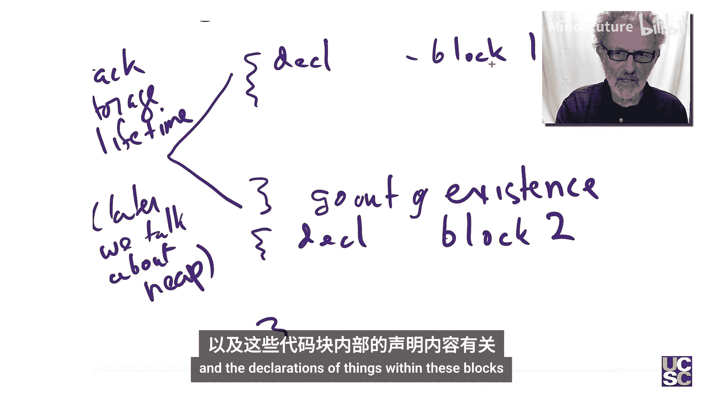

# 【加州大学】C语言编程基础-｜-C-For-Everyone-p38-P38_函数定义和作用域规则_04_01_07--BV1Fqe7zDEVT_p38-

🎼TheYeah。Our next topic is scope rules。

Scope ruless。Involve。Deeclarations。The declarations typically occur at the head of blocks。

And blocks can exist in different architectures， there can be nested blocks and there can be parallel blocks。

呃。We'll see parallel blocks later。Now， inside those blocks， we're going to have nomenclature。

 We're going to have。呃ello。Identifier names and identifier names can be for both functions and for variables。

And what we have to know about them is。When they're available， what their lifetime is。

And the first thing we're going to look at is something we've already used。

 and that's basically a simple。呃。The simple arrangement。So here， for example。

 is something fairly simple。In main void。Block， we declare I， we initialize it to5。

And now its lifetime begins。So it exists。And we can use it throughout this code。

And then we can enter an inner block。And we can declare further variables。 for example。

 you can say int J is assigned I plus 2。 so if I had remained5， now J is 7。

 and at this point we could print both I and J， we would get 5 and 7。Now if we exit this inner block。

Jay lifetime goes away， J disappears。And we see well for simple variables， that isn't critical。

Other variables that involve large amounts of storage， like very big arrays。

This can become critical and it can be a cause of。Efficiency of the use of resources this。

 the memory resources， so it becomes important in large scale programs。And then once again。

 we're outside this inner block and here if we print F of I， we can do it， we can get5 again。

 but what we couldn't do is if we tried to print F of J。

 it no longer exists it would' get a syntaxer。More complex situation， here's an outer block， I5。

We're allowed to declare an inner block variable of the same name。

 but what that's going to do is it's going to hide the outer block variable。

So the innermost block and this could go on， we could have them even further nested。

This is now thought of as I outer。 This is I enter。 Any time there's a reference in here。

 Like if we did a print f here， we would see 7 and 3， not 7， and not 5 and 3。

So there isn't a way to look at the outer block there is， by the way。

Possibilities of doing that in C++， but not in C。So once you reuse a name。That name。

 the preference for name is in whatever is most local， whatever block is most local。

Once you get out of here， the outer eye is no longer hidden， it can be used。J disappears。

 the inner eye disappears， your lifetime goes away。We have structures。That are nested outer。

 then we have inner。Inside here we have lifetimes， they go away， inside here， we have lifetimes。

 and then it goes away。We also have an architecture that's parallel。

So if we call that block one in parallel with block two。

We have a lifetime for these variables that goes from here to here。

 and then we have a new set of variables that goes from here to here。Different lifetimes。

 and of course， there are different lifetimes where we're declaring functions as well when we invoke a function。

We have a lifetime。And it only exists as long as the functions being executed。

And keep this in mind when this set of variables is declared。It's put on something called stack。

It's that internal way that the compiler manages storage for these variables。Later。

 we'll see a different way to manage storage， which will be heat based。But for the moment。

 the way we will always manage storage is all related to these blocks and the declarations of things within these blocks。

🎼The。

