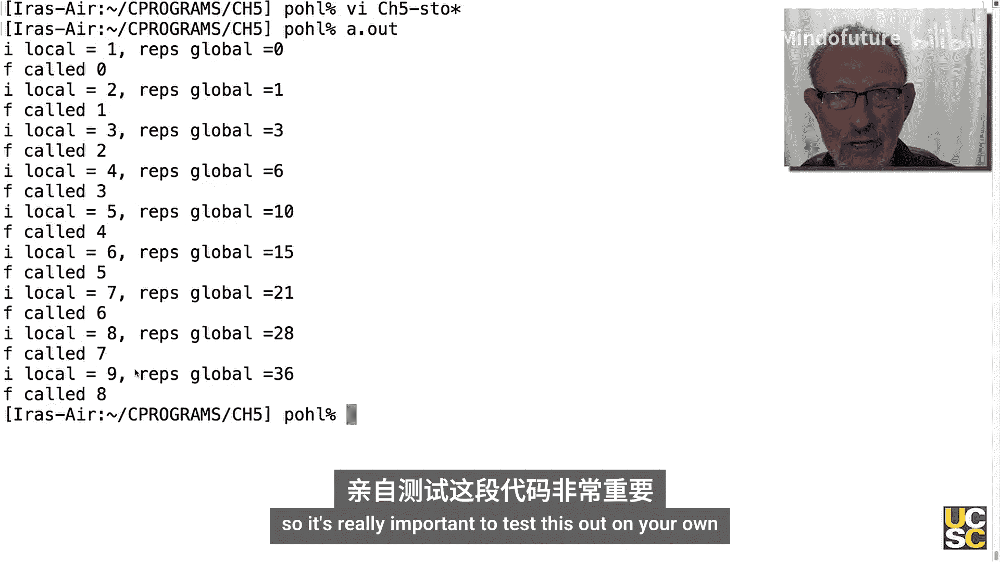
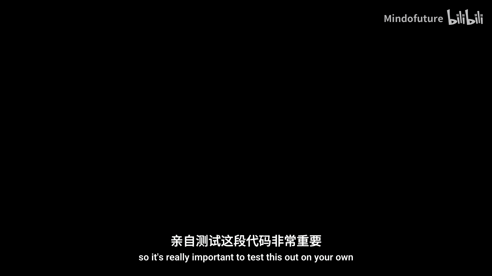

# 【加州大学】C语言编程基础-｜-C-For-Everyone-p39-P39_存储类代码示例_04_02_01--BV1Fqe7zDEVT_p39-

🎼TheYeah。Okay， let's look at some code that shows some of the ideas that we just talked about。

In storage class now， this particular code is not going to be terribly useful。嗯。

So it's only meant to explore our understanding。Of the different storage classes。

So here's our use of externaltern。Now we could have just gotten away with saying int rips。

Iitialized to zero but external。Is the same thing。 in effect， its saying。This item。Should exist。

Throughout。This item should exist throughout the execution of the code and is available in any of the functions。

So。It's global。That means F can use it， in fact， we're going to use it right here。

We're going to do an assignment。Now here's that use of static。Again。

 that means this local variable call called initialize initial to 0。

 But every time it's called after that， that value is going to be whatever its last exited value is。

 And notice we've added one。 So the first time called is going to be 0。

 But the second time it's going to be one and the third time it's going to be 2 and so on。

And we are going to use it in this expression。And we're going to use this global variable as well。

So it's sort of an unusual combination of。Use of the storage classes， but again。

 it's just really to show you if you understand what the lifetime is and the semantics of the storage classes are。

Now let's look at main， mainine。Is using this Pose keyword auto， we don't need it。

But it can be used and indeed it just means that I is automatic automatic means on entry to main。

 it gets put on the block and gets used。Here， by the way， con is not a storage class。

 Cons means that the initial value is to remain that value throughout so that this value in here cannot be changed Cons is。

feature of modern sea。And C+ plus， which。Adds to the nature of the typing。

 so not only do you know that there's an integer， but you know its value shouldn't be changed。

Let's go further down and look at the main program。

So I was initialized to one con says go up to I less than 10 in effect because that's going to be 10。

 So this is going to count from one up to 9。 Autoincrement I。 I is in effect a local variable。

 Res is a global variable。 It's going to print out I in reps。

And each time it's also going to call this function。

What's the idea you want to see inside that function that call keeps getting changed。

 so that function is going to tell you that called is updated。

And then you're also going to see that effect when you print up this。

continually added to rep's value of cold。So it's confusing if it's confusing to you。

 what you should do is take this piece of code。And rework it and try to use the ideas。

 even increase it， or add some more functions to make sure you understand the semantics。

 that's just going to help you。 You're not going to write anything like this。

 This is merely to explore。The meaning and make sure you understand that meaning。

So I'm going to execute this。And we're seeing that the first time in。Reps had value zero as expected。

F is called with that value。 that's its yourest time to be called。 I was locally one。

I get changed to two reps。Is now one。I is called the first time， so。We get。呃。I and Res。Right。

I and reps are going to diverge because reps is going to become reps plus I。 So first off。

 you get I equals 2。Reps is one， then you're going to add two and you're going to get。I is。

I is inemented。 that's just an accident that's the same so you get one plus2。3，3 plus 3 is 6。

6 plus 4 is 10，10 plus 5 is 15。That's the value of age age time。I is now 6， so 15 plus 6 is 21。

 I become 7， you get 21 plus 7 is 28。 I becomes 8， and you get 28。呃。It makes it 36。

 and then you get exiting from the loop when I is finally 9。

 Everything is called F has been called actually nine times。

 It starts when it's called with with the called value being 0， and then F gets called。

The indexing goes from zero to8， so F is actually called nine times。Okay。

 so hopefully I didn't confuse you too badly， I probably did so。It's really important。

test this out on your own。

