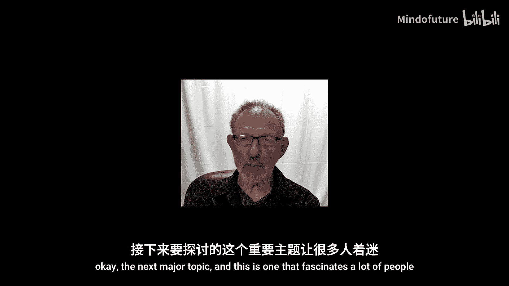
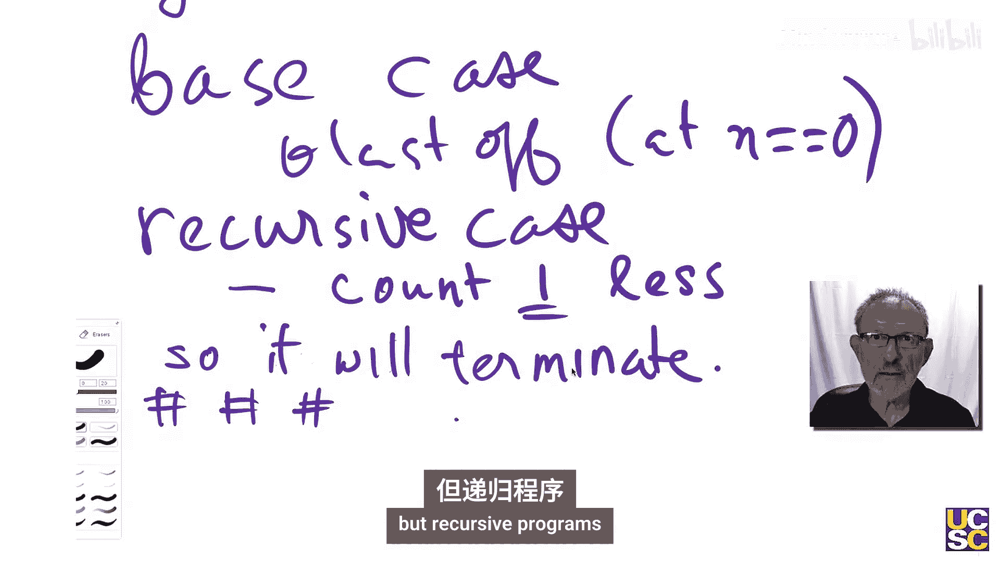

# 【加州大学】C语言编程基础-｜-C-For-Everyone-p40-P40_简单递归_04_02_02--BV1Fqe7zDEVT_p40-

🎼TheYeah。Okay， the next major topic and this is one that fascinates a lot of people is to write programs that are recursive so we'll look at。

Very elementary program that does it this way。And then later in some further segments。

 we will very much make use of the technique and show you actual code。

And why you want to write code frequently recursively。So the big thing about computation。

 what we know is， well， it's really useful。And it's really useful when you do lots of things over and over again。

Big things。And that's why iteration is so powerful。

And that's why we've paid a lot of attention to statements like the for statement and the W statement。

 they're very useful。And they're going to be even more useful when we come to our next big topic。

 which is going to be using them in relation to arrays and very large amounts of data。Okay。

So we've seen how to do things repeatedly with iteration。

 I'm going to show you a simple example of doing that。

 and then I'm going to show you how the exact same thing can be done recursively。First off。

 in the iteration， we're going to write this little NASA program。

 little Cape Kennedy thing where we have a countdown。

We're going to decide that we need to countdown from whatever some integer， for example， could be 10。

And here's how we might do it iteratively， so you might say while n greater than0 print F time is。

We'd print， for example， if it starts at 10 as 10， then we'd auto decrement。

And then we keep printing that， so we do 10，9， eight，7，6。

The last value wed print is one because after one， it goes to zero。

And then before we exit to routine， we print blast off。That's our iration。

We should be comfortable with doing that， we've already done a number of iterations。

AhNow let's do this recursively about the simplest recursion I can think of。

We're going to call this routine F recursive countdown again。

 it's going to have the inteature N and may again start at then0。In the recursive case。

We have a test to see if what we're going to call the base case。So if we're at the base case。

 n equals zero。And we're going to print blast off。If we're not at the base case。

 then we have to do the recursion。We do an else。Print F time is， whatever n was， for example。

 starting at 10。And then we call the function again the same name function。

 but now we call it at one less。And we're going to keep on doing that。

 the recursion is going to keep printing this， it's going to do the else part until it reaches a value of zero called with the value of zero。

So it happens repeatedly you have。As a key idea。A base case in this case blasts off at an equals zero。

 and then you have a general case or the recursive case。And in the recursive case。

 you're doing a print of the time， you're counting one less， that's ensuring that it'll terminate。

And。You're done with。Understanding the most elementary。Of recursions。

 And if you've had some mathematics， if you're on the mathematical side of things。

 you'll recognize that recursion is very similar to mathematical。Induction。

And one of the nice things about doing things recursively is they may be easier to debug or in effect。

 prove correct， they may be more obviously correct。And as I say in the next video。

 we're going to show some interesting。Recurt again， simple but recursal programs。

