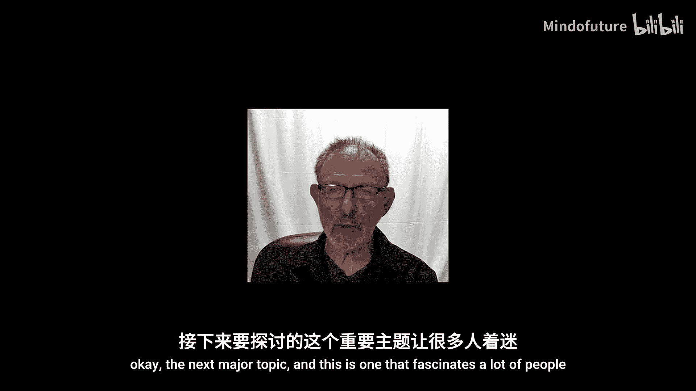
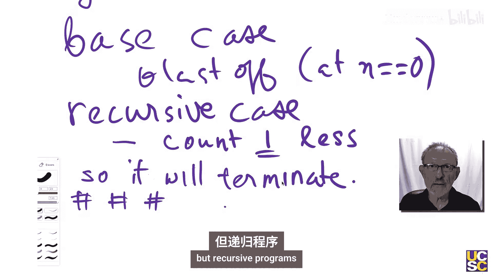

# C语言编程基础：P40：简单递归



## 概述
在本节课中，我们将要学习递归这一核心编程概念。我们将通过一个简单的倒计时程序，对比迭代和递归两种实现方式，来理解递归的基本结构和原理。


## 从迭代到递归
上一节我们介绍了使用循环进行迭代的方法。本节中我们来看看如何用递归实现相同的功能。

迭代的核心是使用循环语句重复执行一段代码。例如，我们可以使用 `while` 循环实现一个倒计时程序。

以下是迭代版本的倒计时代码示例：
```c
while (n > 0) {
    printf("T minus %d\n", n);
    n--;
}
printf("Blast off!\n");
```
这段代码从初始值 `n` 开始，每次循环打印当前值并将其减1，直到 `n` 不大于0时，打印“发射！”。


## 递归的基本思想
理解了迭代后，我们现在来探讨递归。递归是一种函数调用自身的技术。

递归程序通常包含两个关键部分：**基准情形**和**递归情形**。基准情形是递归终止的条件，而递归情形则包含函数对自身的调用。


## 递归倒计时程序
以下是使用递归实现相同倒计时功能的代码：
```c
void recursive_countdown(int n) {
    if (n == 0) { // 基准情形
        printf("Blast off!\n");
    } else { // 递归情形
        printf("T minus %d\n", n);
        recursive_countdown(n - 1); // 递归调用
    }
}
```
在这个函数中：
1.  如果 `n` 等于0，我们到达基准情形，打印“发射！”。
2.  否则，我们处于递归情形，打印当前倒计时数字，然后以 `n-1` 为参数再次调用 `recursive_countdown` 函数。


## 递归与数学归纳法
如果你有数学背景，可能会发现递归与**数学归纳法**非常相似。两者都基于一个基准情形和一个能够推导出下一个情形的步骤。

使用递归编写程序有时能使逻辑更清晰，更容易调试或证明其正确性，因为其结构直接反映了问题的定义。




## 总结
本节课中我们一起学习了递归的基本概念。我们通过对比迭代和递归版本的倒计时程序，理解了递归的两个核心组成部分：基准情形和递归情形。我们还了解到递归与数学归纳法的联系，以及它在某些情况下能使代码更清晰易懂的优点。在接下来的课程中，我们将看到更多有趣且实用的递归程序示例。