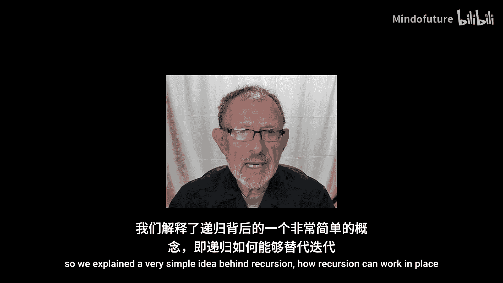
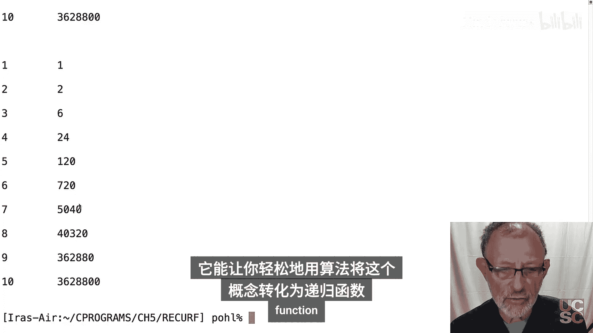

# 【加州大学】C语言编程基础-｜-C-For-Everyone-p41-P41_递归-阶乘代码_04_02_03--BV1Fqe7zDEVT_p41-

🎼2。🎼，So we explained very。Simple idea behind recursion。 How recursion。Can work in place of iteration。

Sometimes。You should prefer one to the other， but you should know how to work with either scheme。

And we're going to show both schemes now。In computing。N factorial， so n factorial is。

A mathematical quantity。あ。How to build especially large numbers。

And it's defined as one times two times3 times4， et cetera， up to n。It then gets large。

 just gets extremely large。So for that reason， we're going to use the long int because if we use a shorter。

And we can't actually compute it for too long， actually long only allows it to work for up to 20。

What happens past 20， you get what's called integer overflow， you get results that are。Incorrect。

 because the number of bits available and along on most machines is。Eight bytes， 64 bits。

 and so for an integer type。Only able to represent factorial up to 20。

So let's look first at something we should be comfortable in。We're going to do factorial iteratively。

And we're going to accumulate the answer。In。The variable sitting there， long F。Equals one。

And then you're going to see。In the iteration。So your standard iteration。

 the beginning is that F of I equal1， I goes up to and equal to n or increment I and accumulate F。

And by multiplying F by I， so you see after you finish the iteration， you will have。

Multiplied1 times 2 times 3， et cetera。 by end， the definition of factorial， and then you return F。

Ask the iteration， that should be straightforward， it should be no problem for you。Now。

Let's look at the iterative version。This is what's a bit novel。And calling it recursive factorial。

Again， it's long。AndN doesn't need to be long because we can't， in fact。

 compute on very large numbers。And we check to see the base case， so here's our base case。

N is equal to one。What we know about when n is equal to1， the definition of factorial is just one。

So'll we return one。But if we don't have the base case。We can count backwards。

And it just was in our countdown program。Except here we take recursive factorial of a smaller value times n。

So this is the generalized case， this is generally what happens in the inductive case。

N times the smaller value of vector。You need to convince yourself that this give exactly the same result。

And that's what I've done here。And comparing both， I've just asked the user to say how many？

And then I first do it。Edititiveively， and then I second do it recursively， just to show。That。

We're going to get the same result， so let' I've already compiled this， let's run it。

Why don't we do it for？Small number。So here's your inner thing， factorial of 1 is1。

 factorial of2 is2，1 times2 is 2， factorial of  three。6。And again。

 you get the same results recursively。I do a slightly larger version。Let's stew up to 10。

And here the numbers start getting big。And you only see because I didn't have enough screen width。

This is a recursive version， you can see the final 10 is the same as this 10。

And you can see how they go up， and you can see that since you multiply by 10。

 that's 10 times larger than that。Just like three to four is four times6 is 24。

 five times 24 is 12620 is 7，27 times。720 is 5，040， et ceter。Okay。

 so that's a very standard example taken for mathematics， you get it straight out of a definition。

 if you saw a mathematical expression， you frequently see functions of this kind defined inductively or recursively。

 so there's a natural mapping， it lets you easily and algorithmically transcribe that idea into a recursive。

🎼Thanks。

🎼。