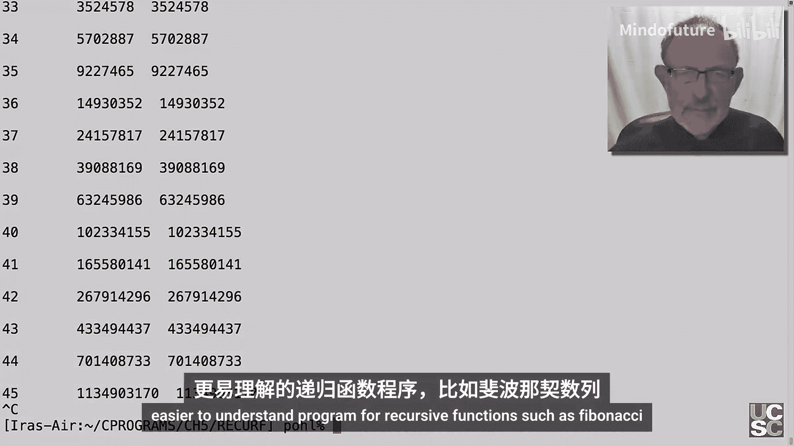

# 【加州大学】C语言编程基础-｜-C-For-Everyone-p42-P42_递归-斐波那契数列代码-包含文件_04_02_04--BV1Fqe7zDEVT_p42-

🎼TheYeah。Okay， we want to examine yet another recursive function。

And again， we're going to show how that recursive function can be written iteratively。

 and we're going to show in this particular example。Which is the Fibonacci sequence is very famous。呃。

That sequence。Its defined as the n element of the sequence is equal to the n minus one element of the sequence plus。

The-2 element of the sequence， where the sequence initially starts with the zeroth element being 0 and the first element being one。

 So if you follow this formula， F of 2 would be 0 plus 1， namely  one and F of。3 would be。1 plus one。

 which would be 2， and F of4 would be1 plus2， which would be3 and so on。

And what's interesting is even though the numbers at the beginning look very small。

 the sequence grows exponentially。So here's a definition doing it iteratively。

 I'm going to use longs because if I want I can。Easily write something that exceeds a single precision integer。

So I'll start off with。F2 equals0 and F1 equals1， and here's where I add them together。

 F2 plus F1 becomes a new F2， and we retain the older value。Of the sequence in this step。

And then after we make the summation， F1 becomes CFf older value。

 and you can go to see and check that that will indeed compute this sequence。And we turn for n。

 we have to compute it up until the n element of the sequence。And then we return F2。So。

That's an iteration。If you think about it， the sequence is more naturally defined with a recursion。

And here's the recursion。If n is less than or equal to 1 then return n， that means if n is 1。

Then f of1， the febonacci sequence of1 is 1， or if it was0， the feacci sequence of0 is 0。

And for purposes， the Fibonacci sequence is only defined on the non negative integers。Else return。

The recursive call of Fibonacci n minus1 plus recursive call of Fibonacci and minus2。So that's where。

We have a recursion。And indeed， both recursions count down。So in each call。

To this recursive function。We get two calls。And so on。So notice。

If you have to go very deep in computing femenacri of n。

 you're going to get something like to the end calls of this sequence in order to do the number of summations that you'll need when you get to a large value。

Of Fibonacci using the recursive。A formulaula。And here I'm just going to ask you to print a table and I'm going to print a table with ordinary Fibonacci and recursive Fibonacci。

Okay。I'm going to exit that routine and now I'm going to execute it。

I'm going to do a small value event just to show us what it is， so iterative Fibonacci。

Recursive Fi beacci answer 0，0，1，1，211， the third member of the sequence is2。

 fourth member2 plus1 is3。3 plus two is five，5 plus three is eight， and so on。And works very。

Very quickly， let's do it again， though。Let's do it for up to 25。

And we've zip by on our screen a whole bunch of values， and then we can see that 15 is 6。

 10 plus 987， so we get 1597 indeed。Both the iterative and recursive。

Give us the same answers as expected。But now let's look at。A much larger number， let's look at。45。

Now look what happens。We've hit 40， the screen is slowing down。

I'm working on a fairly modern Macintosh。All the answers are drivingibing。

You can add the irrespective previous two to get this。哦。Okay。It wasn't large enough。

 I'm going to do it once again because。It started to slow down， but what if I do 50？

Now you see at 43， all of a sudden the screen is frozen。

We saw that it did 44 and that took a significant number of seconds and now look at 45。

 it's still crunchy。Crunch， crunch， crunch。Nope， finished。

But you can see a noticeable lengthening of time， and I'm not going to let this run any further。

I just want you to think about that I'm going to abort this。

So what is going on is on the recursive side and if I is separated， you can do this yourself at home。

You could separate writing it iteratively from writing it recursively。

 and you could see you would readily get 45， 46， 50。Until you got a number too big。

For the accuracy of long integer。But it would run very quickly because it's a simple iteration。

And it's just a linear time set of additions。In that sequence， on the other hand。

 calling it recursively means that。We're going to ultimately end up with a bunch of ones being added。

Maybe a bunch of zeros。And those。For example， here， we're going to have something like。4 million。

 so this is。This is formula million。So this is over a billion。

And when you have over a billion function calls， you have a whole bunch of operations going on。

this what on the stack。And on calling a function， which is one of the more complex functions at the machine level that can actually take。

三。呃。Q。Maybe tenths of a millisecond， but still some significant time in relation to the simple calculation you're doing So that's a pitfall。

 if you use recursion， it could lead to。A significant slow up。Even though on the surface。

It gives you a more logical， easier to understand program for recursive functions such as Fibonacgi。

🎼The。

