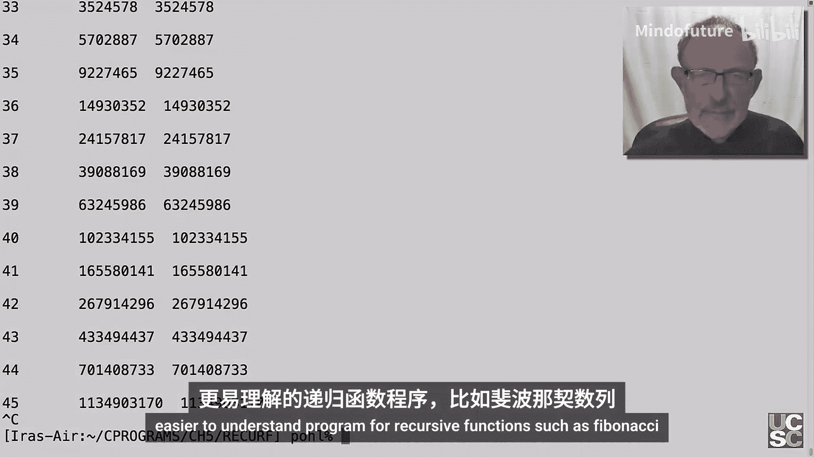

# C语言编程基础：P42：递归与斐波那契数列


## 概述
在本节课中，我们将学习递归函数的另一个经典示例：斐波那契数列。我们将探讨其递归定义，并展示如何用迭代方式实现相同的功能。通过对比两种实现方式，我们将理解递归在某些情况下可能带来的性能问题。

---

## 斐波那契数列的定义

斐波那契数列是一个著名的整数序列。其定义如下：序列的第 `n` 个元素等于第 `n-1` 个元素与第 `n-2` 个元素之和。序列的初始值为：第 0 个元素是 0，第 1 个元素是 1。

用公式可以表示为：
**F(n) = F(n-1) + F(n-2)**
其中 **F(0) = 0**，**F(1) = 1**。

根据这个公式，我们可以推导出后续的值：
*   F(2) = 0 + 1 = 1
*   F(3) = 1 + 1 = 2
*   F(4) = 1 + 2 = 3
*   以此类推。

这个序列的特点是，尽管起始数字很小，但后续数值会呈指数级增长。

---

## 迭代实现方法

上一节我们介绍了斐波那契数列的数学定义。本节中我们来看看如何用循环（迭代）的方式计算它。

以下是用 C 语言实现的迭代版本。我们使用 `long` 类型来存储结果，因为数列的值很容易超过普通整型的范围。

```c
long fib(long n) {
    long i, f2 = 0, f1 = 1;
    if (n == 0) return 0;
    for (i = 2; i <= n; i++) {
        long temp = f2 + f1; // 计算新的F(n)
        f2 = f1;             // 更新F(n-2)为旧的F(n-1)
        f1 = temp;           // 更新F(n-1)为新的F(n)
    }
    return f1;
}
```

代码逻辑如下：
1.  初始化 `f2` 为 F(0) = 0，`f1` 为 F(1) = 1。
2.  从 i=2 开始循环，直到 i 等于 n。
3.  在每次循环中，将 `f2` 和 `f1` 相加得到新的斐波那契数。
4.  更新 `f2` 和 `f1` 的值，为下一次计算做准备。
5.  循环结束后，`f1` 中存储的就是 F(n) 的值。

这是一种高效的线性时间计算方法。

---

## 递归实现方法

斐波那契数列的数学定义本身就是递归形式的，因此用代码实现递归版本非常直观。

以下是递归实现的代码：

```c
long fib_recursive(long n) {
    if (n <= 1) {
        return n; // F(0)=0, F(1)=1
    }
    return fib_recursive(n - 1) + fib_recursive(n - 2);
}
```

代码逻辑遵循定义：
*   **基线条件**：如果 `n` 小于或等于 1，直接返回 `n`。这对应着 F(0)=0 和 F(1)=1。
*   **递归步骤**：否则，返回 `F(n-1)` 与 `F(n-2)` 之和。这通过递归调用自身来实现。

需要注意的是，每次递归调用会产生两个新的递归调用，导致调用次数呈指数级增长。

---

## 性能对比与分析

我们编写一个程序来对比两种方法的计算结果和运行效率。

以下是测试代码的核心部分：

```c
#include <stdio.h>
int main() {
    long i;
    for (i = 0; i <= 15; i++) {
        printf("F(%ld) - 迭代: %ld, 递归: %ld\n", i, fib(i), fib_recursive(i));
    }
    return 0;
}
```

对于较小的 n 值（例如 15），两种方法都能瞬间给出正确且一致的结果。

然而，当 n 值变大时，差异开始显现。尝试计算 `F(45)`：
*   **迭代方法**依然非常快速，因为它只进行了大约 45 次加法运算。
*   **递归方法**则变得极其缓慢。屏幕输出会出现明显的卡顿，计算 `F(45)` 可能需要数秒甚至更长时间。

如果尝试计算 `F(50)`，递归版本可能会因为耗时过长而变得不切实际。

---

### 递归性能问题的根源

为什么递归实现会这么慢？原因在于其巨大的计算冗余。

为了计算 `F(n)`，递归函数需要计算 `F(n-1)` 和 `F(n-2)`。而计算 `F(n-1)` 又需要计算 `F(n-2)` 和 `F(n-3)`。注意，`F(n-2)` 被计算了两次。这种重复计算随着递归深度增加而爆炸性增长。

计算 `F(n)` 所需的递归调用次数大致是 **2^n** 量级。对于 `n=45`，这意味著可能超过 **10亿** 次函数调用。每次函数调用都需要在栈上分配内存、传递参数、跳转指令，这些开销虽然单次很小，但累积起来就造成了巨大的性能瓶颈。

---

## 总结

本节课中我们一起学习了斐波那契数列的两种实现方式：
1.  **迭代法**：使用循环，效率高，时间复杂度为 O(n)，是计算斐波那契数的推荐方法。
2.  **递归法**：代码简洁，直接反映数学定义，易于理解。但对于斐波那契数列这类问题，会产生指数级的时间复杂度 O(2^n)，导致在 n 较大时性能急剧下降。




这个例子揭示了一个重要的编程启示：**递归虽然是一种强大而优雅的工具，但在使用时必须仔细分析其时间复杂度和可能产生的重复计算问题。** 对于存在重叠子问题的情况（如斐波那契数列），通常迭代法或结合记忆化（缓存已计算结果）的递归法是更优的选择。