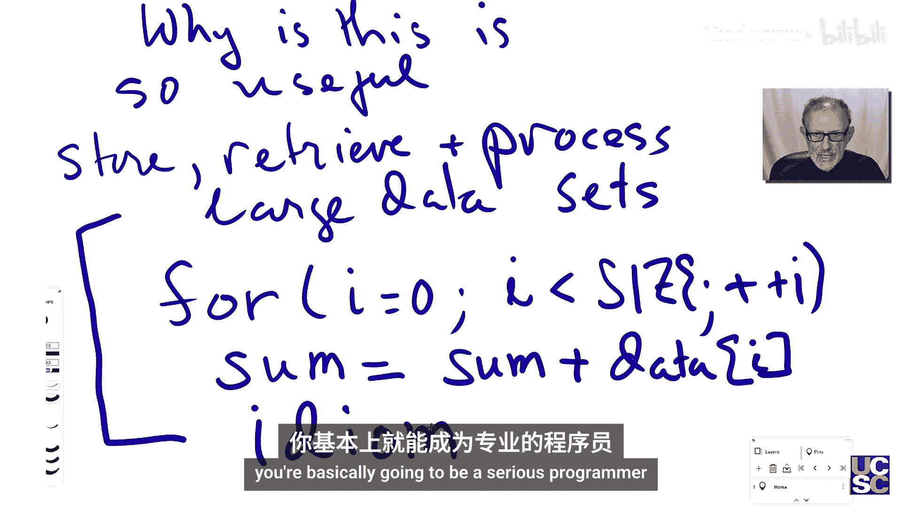
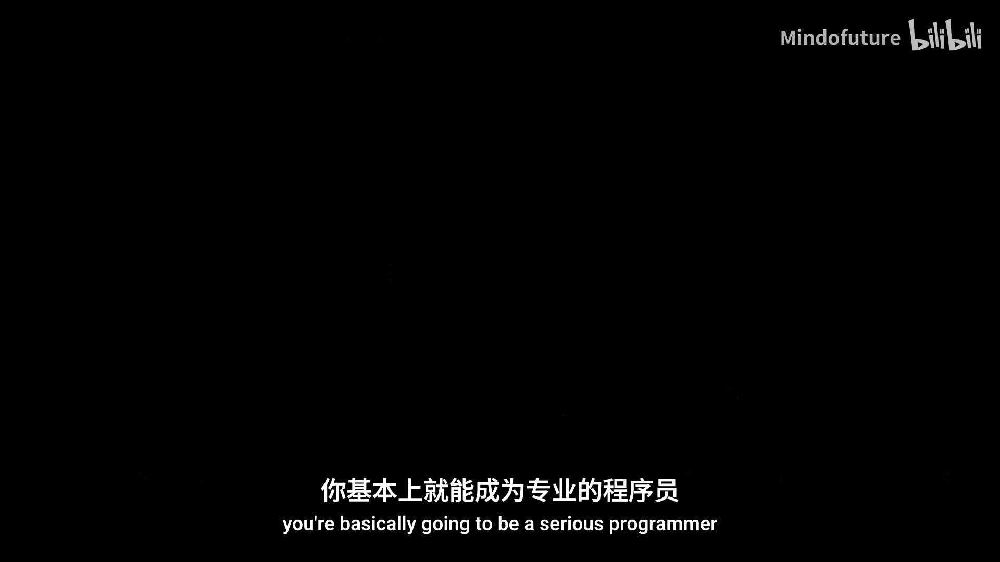

# 【加州大学】C语言编程基础-｜-C-For-Everyone-p43-P43_指针和简单数组_05_01_01--BV1Fqe7zDEVT_p43-

🎼TheYeah。Heate， this is going to be the last major topic。Of。See for everyone part A。

And it's going to be the topic of how to deal with aggregate data。

 and after we're done with this topic， you can consider yourself a serious programmer in some sense。

 the major programming languages of。

啊。The first。Two decades of。The real use of computers， namely the late 40s through。The early 60s。

I had languages like Fort Tran。And alcohol in these languages basically had aggregate data。

The array type。So we are going to。あ。Show。How to deal with the simple one dimensional array type in the C language。

Now， so far we had multiple amounts of data， we would have to write out individual declarations。

 so we'd say something like int， AB，C， and so on for as many variables as we need。

Or we could say if they were somehow related in A1A2A3， etc。But this is too limiting first off。

 if we really need to do things for very large data sets。Like we have to examine。

A colony of several thousand elephant seals is one of our homeworks suggests to find out your average weight。

We don't want to have to write out thousands of individually named。啊。

Variable are going to be too hard to process， too limiting。

Our way around this is to have the following kind of declaration。And。Data。Square bracket。

 100 square bracket semico。So as with the normal declaration is a type。

 this can be any of the standard types like double long。Surehar。

An identifier that should indicate what we're processing。

I'm going to use the generic term in a lot of my examples。Data。And then a size。

 which is an integer content， it's got to be known at this point。

 partly because the allocation at this point would frequently be off the stack。

When we perform that declaration， this is what the compiler produces for us。

We get a one dimensional array structure。Whose elements are data of zero， data of 1， datata of2？

Date of 99。A raise and C start at zero。Some programming languages started to raise at one。

 but zero is。The base address。Of this array。In some sense。Data itself is an address in memory。

Zero means the。Sureth element。So I see index really at the quote， first element。

That you're going to use in processing， whereas the last element is going to be whatever that size was。

 in this case， it had been 100 minus1。So in effect， these brackets with an index。

Perform an address computation。That starts or wherever in memory we have data。

 normal cell like int A， it might be stuck in memory cell 2004。And that's what it refers to。

 but here we have two parts in the memory calculation。

 and it's important to understand that this is a way to get what we call an address because later we're going to talk about the relationship between array and pointer and for more sophisticated work in the C programming language。

 you're going to have to understand addressing and pointer。But for very simple things。

 indexes and arrays。Our straightforward abstraction。

So each of these items can store an int and most machines that will be four bytes。

Why is this so useful？Well。Most processing is not about processing a few things。

 It's mostly about storing， retrieving and processing very large data sets。

 data sets that frequently。In the millions。Well。Look at this little four statement for I。

Initialized to zero or s zero is not initialized to sine zero。I， less than some size。

Ao increment eye。Turns out we're doing a calculation here， we're summing。

 we're going to take the sun， iss the old sum plus whatever is in data。

So by the time we get through that， we have added up all the data in that collection。

 maybe we want to use it for an average， maybe we have other reasons to want to use it。

But this doesn't matter this one statement handles as much data as we have available to us。

That's what's so powerful。Consider it as the canonical idiom。

Canonical idiom for treating data when stored in a。

 and as long as you understand this and can make use of this，You're basically going to be。

A serious programmer。

