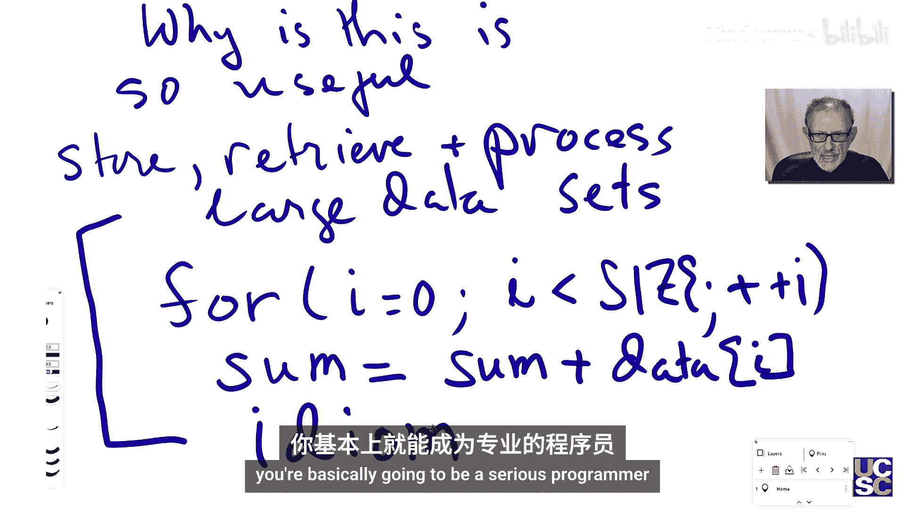
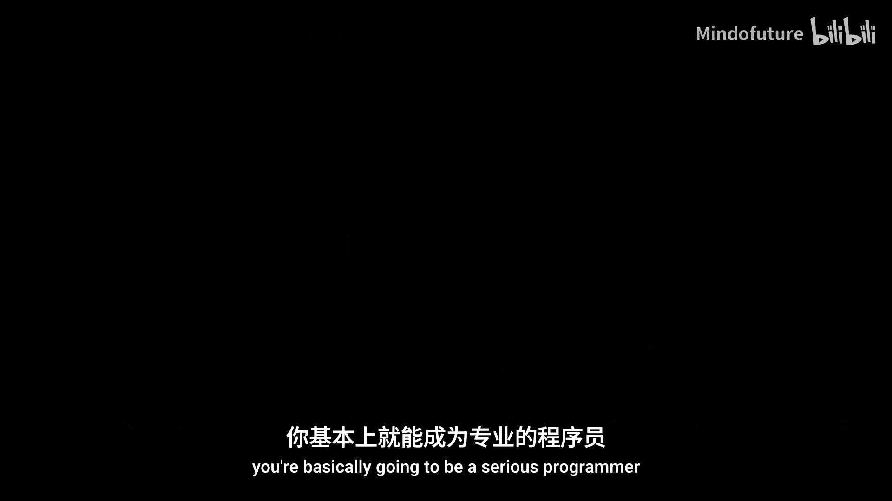

# C语言编程基础：P43：指针和简单数组 05_01_01


## 概述
在本节课中，我们将学习C语言中处理聚合数据的关键概念——数组。这是C语言编程基础课程A部分的最后一个主要主题。掌握数组后，你将在某种意义上成为一名严肃的程序员。我们将从数组的基本声明和内存结构开始，理解其索引机制，并学习处理数组数据的标准方法。

## 数组的基本概念与声明

在计算机真正开始使用的头二十年（即20世纪40年代末到60年代初），像Fortran和Algol这样的语言就已经有了聚合数据类型——数组。本节中，我们来看看如何在C语言中处理简单的一维数组。

到目前为止，当我们需要处理多个数据时，必须写出单独的声明，例如 `int a, b, c;`，或者使用类似 `int a1, a2, a3;` 的命名方式。但这种方式限制很大。例如，如果我们需要处理非常大的数据集，就像我们作业中提到的，要检查数千头象海豹的平均体重，我们不可能写出数千个单独命名的变量，这既难以处理，也过于局限。

我们的解决方案是使用以下形式的声明：
```c
int data[100];
```
与普通声明一样，它包含一个类型（可以是 `double`、`long`、`char` 等标准类型）、一个标识符（用于指示我们正在处理什么数据，这里使用通用术语 `data`）和一个大小（必须是一个已知的整型常量）。之所以需要常量大小，部分原因在于此时的内存分配通常发生在栈上。

## 数组的内存结构与索引

当编译器处理这个声明时，它会为我们生成一个一维数组结构。其元素是 `data[0]`, `data[1]`, `data[2]`, ..., `data[99]`。

C语言中的数组从0开始索引。有些编程语言的数组从1开始，但在C语言中，0是数组的基地址。在某种意义上，`data` 本身就是一个内存地址。索引0指的是第一个元素，而最后一个元素的索引是数组大小减1（本例中为99）。

实际上，带索引的方括号 `[]` 执行了一个地址计算。这个计算从 `data` 在内存中的位置开始。例如，一个普通的 `int a` 变量可能存储在内存地址2004。但对于数组，内存计算包含两个部分。理解这是一种获取地址的方式非常重要，因为后续我们将讨论数组和指针的关系。在C语言中进行更复杂的工作时，你必须理解寻址和指针。但对于简单的操作，数组索引是一个直观的抽象。

数组中的每个元素都可以存储一个 `int` 值，在大多数机器上，这需要4个字节。

## 数组处理的强大之处与标准范式

数组之所以如此有用，是因为大多数处理任务并非针对少量数据，而是涉及存储、检索和处理非常庞大的数据集，这些数据集通常达到百万级别。

请看下面这个简单的四语句循环：
```c
for (i = 0, sum = 0; i < size; ++i) {
    sum = sum + data[i];
}
```
我们在这里进行计算，对数组中的所有元素求和。循环结束时，我们就累加了这个集合中的所有数据。这个结果可能用于计算平均值，也可能有其他用途。

关键在于，这一个循环结构可以处理我们拥有的任意数量的数据。这就是它强大的地方。我们可以将其视为处理存储在数组中的数据时的标准范式。

只要你理解并能运用这个范式，你基本上就具备了成为一名严肃程序员的基础。





## 总结
本节课中，我们一起学习了C语言中数组的基础知识。我们了解了如何声明一个数组（例如 `int data[100];`），理解了数组在内存中的结构是从0开始索引的连续空间，并且掌握了使用 `for` 循环处理数组数据的标准方法。数组是处理聚合数据、应对大规模数据集的核心工具，掌握它是迈向更高级C语言编程的重要一步。