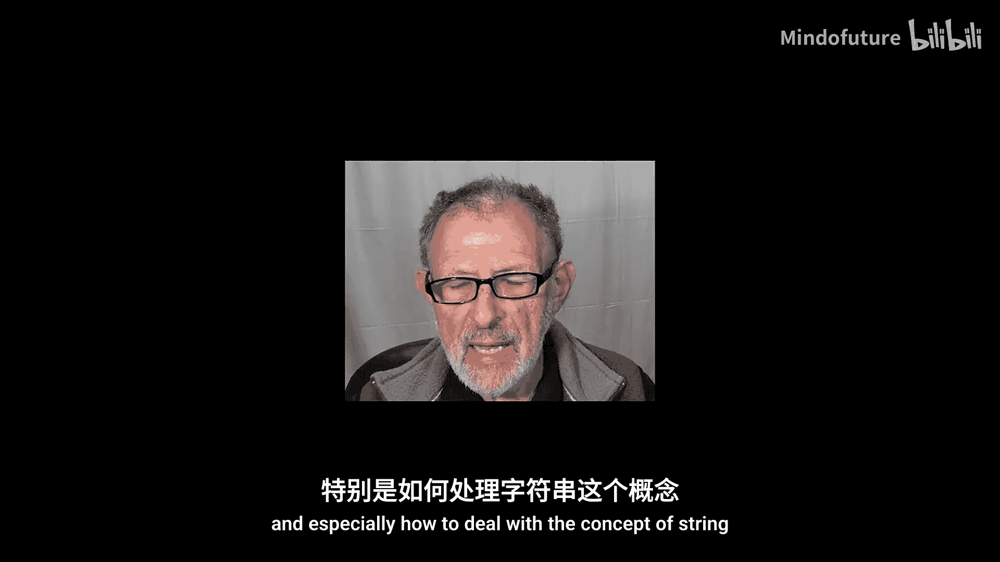
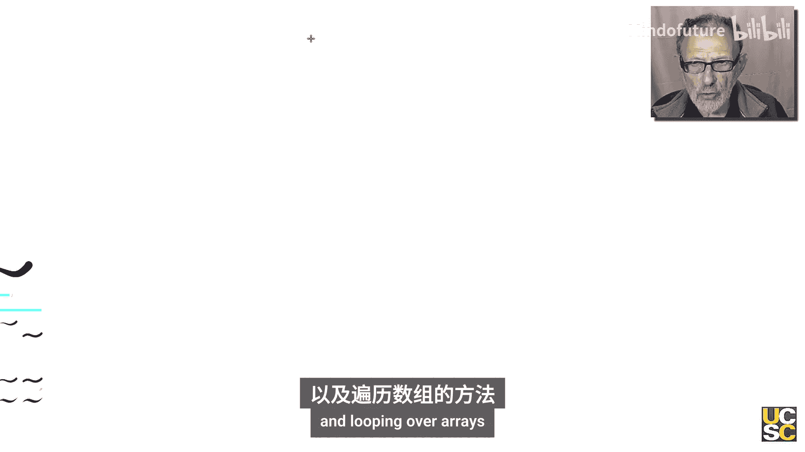
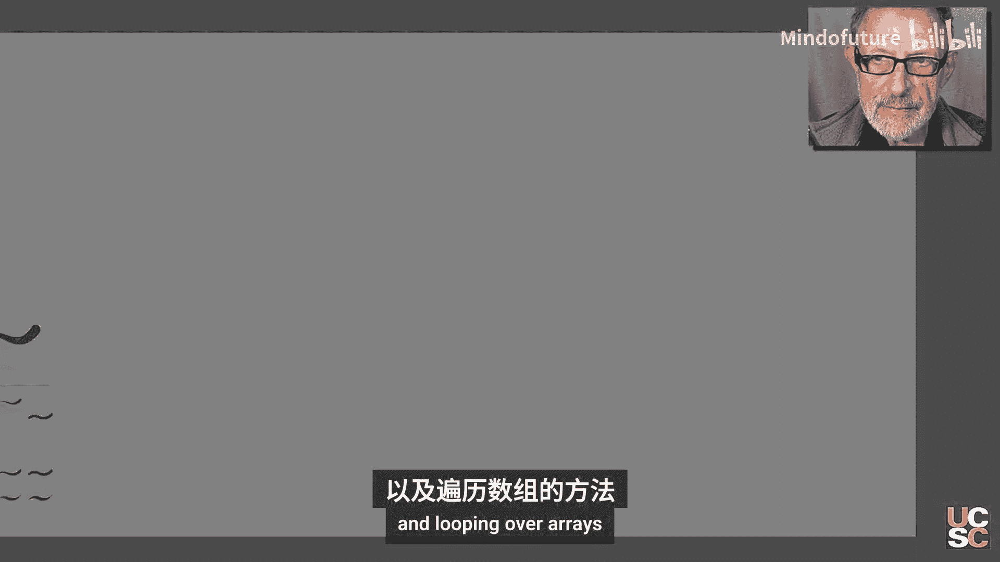

# 【加州大学】C语言编程基础-｜-C-For-Everyone-p44-P44_初始化数组_05_01_02--BV1Fqe7zDEVT_p44-

🎼TheYeah。Now we're going to focus on the topic of arrays and how to initialize them。

And especially how to deal with the concept of string。String is not a data type。In。The sea language。

It's really a series of characters。So the they。A string is really an array of char。

And we want to see how to initialize it， course a lot of our interesting。Examples。

 including some in the homework， is to make use of working with strings。First。

 let's deal with the whole concept of array initialization。So we know that when we declare。

ASple variable like here in SSN。We can after and。The equal sign。

 which in this case is initialization， give it some appropriate constant value。

AhBut what happens when we declare an array， when we declare an array。

 we're actually declaring a bunch of variables。Which your indexed。

And if we don't have an initializer again， it becomes uninitialized。In some cases。

 the system will decide to automatically give you a zero。But you can't necessarily rely on that。

But now if you want to give your array specific values。

 and here you'd have an inter array which has five elements。Don't forget， this means data of zero。

 datata1， data of 2， data of 3 and data of four。Then we can give an appropriate number of comma separated values。

This kind of list。The curly brackets。So in this case， data of zero would be1。

 data of one would be two， data of four would be5。But also， we can abbreviate the list。

If we wanted all the elements to be zero， we could just list a single zero。

 We wouldn't have to list comma separated list of zero。 it turns out that。

All of the elements will be initialized to this value。And also， we can have。An array。Where。

We don't specify the size of the array， so we just say int data， unspecified size initialized by 1，2。

3， and now the compiler says ah。There are three values， so that means they wanted data。

And this would have been equivalent to int data。2。And now data of zero is one， datata of1 is two。

 datata of two is three。Okay， so and depending on type， we would have such lists。

 so in doubles we would have doubles。Oh。Now what about the concept of string？Very， very useful。

So we've already had strings， we've used them in things like print F and Scanf。

But strings are really。What you might call concatenated together。Sequentialally next to each other。

 characters， chas。So this string， A B denoted by。The string constant with the double quotes is really in internal representation。

 the character A a char， typically placed in one bite。The character B a char again in one bite。

And what we're going to call the Sentinel character， we're going to indicate that it's a zero。

And it can be also written as。Single quote。Backslash hero， single quote。

And the reason for that is if we have single quote， zero， single quote。We would not have a true zero。

 we'd instead have the ASI value of the character zero。And that isn't a zero。

So in order to have a true zero， we have to escape。The zero。With this escape character。

And then we get a true zero。So anytime you see a series of characters and the last by being zero。

 that。Is an internal representation of an array？Let's look at something。Remember。

 we can also have an array。STR， not give it a length equal， and we can do this quoted string。

 and this is equivalent to having a series of inside curly braces， a series of characters。 But look。

 there's a space there I've drawn it and a space there。So really。

 this is a character string that has， this is his first element。 The letter A。

 A space is a second element。 The letter B， a space is its fourth element， the letter C。

 and then implicitly the sententinel character。 So what's that going to mean。

That's going to mean as an internal representation， A， space， B， space， C。Zero。

 Sentinel character zero， so that's really a six element。Charra Ray。

 that would really have been chara STR 6。Keep in mind that the space。Single quoted space。

Has in the ASCI table， if you look up the ASCI table value。32。

So that's what would actually be stored in here。ABinary representation of 32。

So SDR of0 would have the a character， SDR of4 would have。The C character。

 and then the final element of the string array， S R 5 would have the Sentinel character 0。

 I call it a sententinel because when we do a lot of spring， string processing。

 we generally put in a loop。And it searches for the end of string。

So that's why we call it a sentinel or sometimes a guard， it's a way to find the end of a string。

So this has six elements。Okay， now。We're going to go on。Undering more sophisticated ways。

Of indexing and looping over a race。

