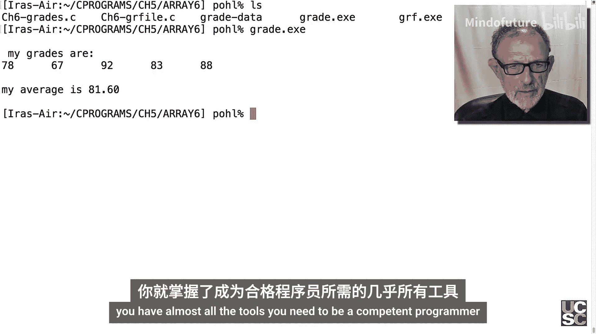

# 【加州大学】C语言编程基础-｜-C-For-Everyone-p45-P45_数组-成绩代码示例_05_01_03--BV1Fqe7zDEVT_p45-

🎼TheYeah。Okay， so now we're going to look at some code that reflects our basic understanding of the single dimensional array。

And this piece of code is to take a bunch of data， in this case。

 a series of grades be five grades for a student。And then see what the student's average is。

 and you can see that this could apply to as large a size an array as you want。So。First off。

We establish the size of the array， and it must be a constant because when we declare an array this way。

It's going to come off the stack and the array must be a constant。So here's grades。

 there are going to be five of them。And recall that grades of zero is going to be the first element and then grades of size minus1 is going to be the last element。

And in this syntax with the curly braces is a way to initialize。

This kind of aggregate data structure so just like you can initialize a single variable。

 you can initialize。An array of。Whatever size by。Keeping a comma separated list of。

Appropriate constant values for that array。And if you don't list。Five of them。

 let's say only listed three than the last two would have been assumed to be zero。

Then this is going to be our summing variable and the reason that it's going to be a double is we want the average to be a floating point number。

We don't want a truncation error。I commonly is used as a summation variable。

 so we don't have to say it if we could say int index and maybe that would be。More clear。

 but generally speaking， IJK are used as summation variables。How here is our chief iterative。Im。

For I replaced by zero， start with the lowest element of the array。Go up to size。

 auto incrementing and do something。 This is the step， the internal step。Of that。Iteration。

 in this case we're going to print the individual grades。

 we're going to print them separated by tab values。Then we will jump at two lines。

 then we will do this further work of doing a summation of all the grades， again。

 size could have been arbitrarily large as long as we had enough data， so this program。

 the simple program could work for a uongous size of aggregate data。And then after we're done。

Here's our average， some oversize。So， let's。She。That that can be made to work。嗯。

I already compiled the program。It's going to be in this grade。ex code。And sure enough。

 my grades are 78， 67， 92 83， 88， my average is。81。6。Okay。

 so once you have that understanding and you can modify this program。

You're nearly a professional coder， I mean once you can manage aggregate data of any size。

 especially using the array。You have almost all the tools you need to be a competent。

