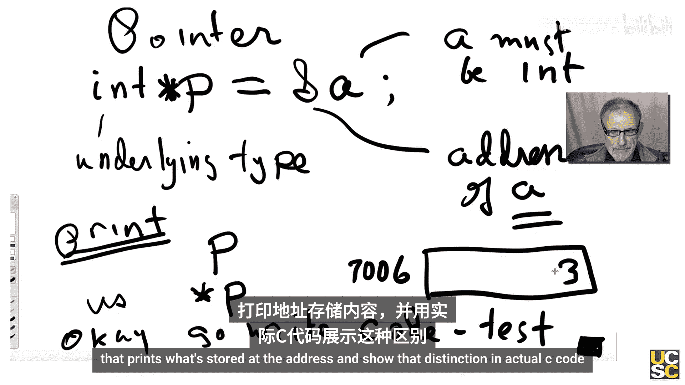
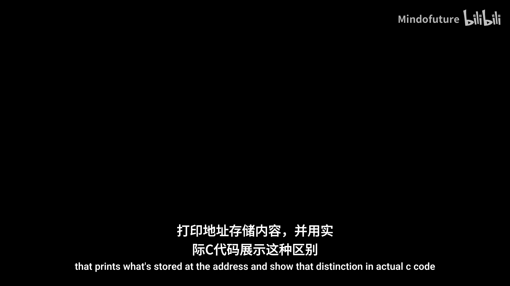

# 【加州大学】C语言编程基础-｜-C-For-Everyone-p46-P46_什么是指针_05_01_04--BV1Fqe7zDEVT_p46-

🎼2。🎼，Okay， now we want to get into the weeds。 This is a difficult to picture。Set of ideas。

 exactly how is an array stored in memory？And what we have to understand is an array has。

place where it's stored。And。It starts at what's called its base address。

 and that's because we want a bunch of elements， so we have to have a place to start。

 and then it runs contiguously through as much memory as is needed。

And that gets allocated automatically in this case by the compiler。

So there's some things we don't know explicitly because the compiler is doing it for us。

And the array has a very strong relationship with another data type called a pointer。

So we're going to start to explore。AConnection between array， address and pointer。Now。

A simple data type like an insure。When we say integer A inside a block。

 it means create a variable in memory。And the memory needs to be as many bytes as to store appropriately the values that are allowed for an integer。

So an integer on most computers now is stored in four bytes。Four bytes are 32 bits。

And if we say something like a is a 3。Then what that means is in these four bytes。

 we put an appropriate representation， binary three。

And it's going to be in some location and memory and remember， nowadays computer memory involves。

Gigabytes that's billions of individually addressable cells。

 so each of the cells in your computer memory has a location which basically in number。So for just。

sake of having some concrete thing to think about， let's say。This is location 7006。

And we stored three there in this four byte set of memory cells。So when we think of a variable。

We think of its name。That's how we use it in the code。

 but we think it has a location and memory and inside that location is some stored value interpreted as an integer。

Way to think about this is think of these things as imagine a whole bunch of billion。

In big computers， it could be hundreds of billions of mailboxes， and in the mailboxes。

 there are specific kinds of values。Integers， long integers， doubles， chars， okay。

 so that's what we're going to store we have a mailbox it has an address。

 that's a number and then inside there's something which is represented as a binary set of digits and interpreted as a particular data type。

Now when we go over to an array as opposed to a simple variable。

So let's say we have the array data for its integer again and we're going to store。

 remember we just talked about how we can initialize it。This represents instead of a single variable。

F integer variables。And they start。Again， if we view the compiler as having assigned them to the mailbox 7006。

Well， two is put in mailbox 7006， four bytes later， at 7010， we put it in four。

Four bytes later in 7014， we put six， four bytes later in 7018。We put in eight。

So we think of this array as having four individual。啊。Cells。

Mailbox appropriate to that integer data type， meaning we need4 bytes。And。

We can think of this as data of zero， data of1， datata of2。 there specifically is data data of。3e。

And if you want to know how the address calculation happened。

The address is equal to the base address plus two times the length of the4 byte integers。

 so if the base address was 7006 and we need to be over here， well， that's 2 times 4， which is 8。

 so it's going to be 2014。That's an address calculation。

 so an address calculation for an array and C base address plus。The offset。

 the index times the size required， the size and bytes required to store that individual data type。

And that's what we mean by address arithmetic as I say。If these are unfamiliar notions。

 they do take getting used， so it's something that don't worry about if you didn't get it。

And some of you may not even need it， youll certainly need it if you want to go on and do more computer scienceency work。

But if you just want to be a simple programmer。It may be enough to just understand that indexing works for you。

 but really to get to the next level， you want to really understand the notion of address now。

There are special variables called pointer variables， they're a derived type。

And the type is expressed and follows， you say what the basic type is in this case it's an integer。

Then you use the special star character， the asterisk。And then the variable name。

Frequently we'll use P for pointer or PTR。And here we're declaring a variable。

That can point at something that can store integers， but is in fact。An address。

So let's say a was an integer variable， a pure integer variable。This is。Initialization。

 and we're saying here， initialize。This pointer。To where a is stored。

 the address and memory where A is stored， again， if you think back to my previous example。

 that would end up being 7006 it's something we don't have to know。

 the compiler is going to decide on it， compiler could decide differently。

At different times in the compilation。So it's not something we worry about。

But we have to understand that this is getting the address of this variable。

And that address is being stored in P。So we can now think of P。It's this value 7006。

 what's stored in that。Area memory。Is an integer variable whose value is3。

 namely that was what we were thinking of as a。And now。

We can have as an expression P or star P and those are two different variables if we tried to print the value of P。

 we would get some。Address。If we were to dereence it， star is a dereencing， if we were dereence B。

 the value there would be the integer value 3。All right， all of that is。Fairly。Theoretical。

A little hard to get your handle on if you haven't seen these ideas before because you're really thinking at a machine level。

 you're thinking what the compiler does for you。But we're going to go ahead and in the next segment。

 we're going to write some code that will actually show what these values are。 We're going to try to。

啊。Understand it by testing our concept by actually writing code that prints an address。

 that prints what's stored at the address and show that distinction， and actual C code。

