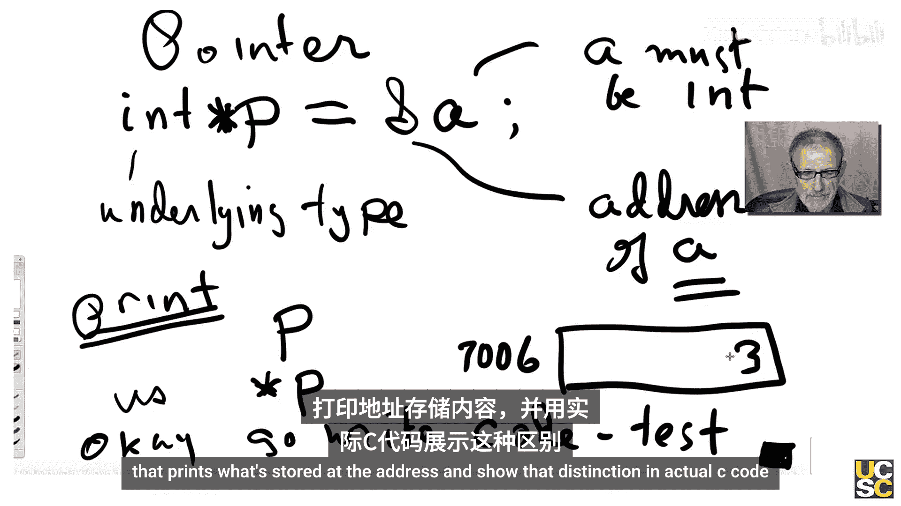

# C语言编程基础：P46：什么是指针

## 概述
在本节课中，我们将要学习C语言中一个核心且重要的概念：指针。我们将探讨数组在内存中是如何存储的，以及数组与指针之间的紧密联系。理解这些概念对于深入掌握C语言至关重要。

## 数组在内存中的存储方式

上一节我们介绍了数组的基本概念，本节中我们来看看数组在计算机内存中是如何具体存储的。

数组在内存中占据一块连续的存储空间。它从一个被称为**基地址**的位置开始，然后根据所需元素的数量，连续地占用后续的内存空间。编译器会自动为我们分配这些内存。

一个简单的数据类型，比如整型 `int`。当我们声明 `int a;` 时，意味着在内存中创建一个变量。这个变量需要占用足够存储一个整数值的字节数。在现代计算机上，一个 `int` 通常占用4个字节（32位）。

当我们执行 `a = 3;` 时，意味着在这4个字节的内存单元中，存放了二进制表示的数值3。这块内存有一个具体的地址，我们可以将其想象为一个编号，例如地址 `7006`。

我们可以将计算机内存想象成数十亿个并排的“邮箱”，每个邮箱都有一个唯一的地址编号，里面可以存放特定类型的数据（如整数、字符等）。

## 数组与地址计算

现在，让我们转向数组。假设我们有一个整型数组 `int data[4] = {2, 4, 6, 8};`。

这代表了四个连续的整型变量。如果编译器将数组的基地址同样分配在 `7006`，那么存储情况如下：
*   `data[0]`（值为2）存储在地址 `7006` 开始的4个字节中。
*   `data[1]`（值为4）存储在地址 `7010` 开始的4个字节中（`7006 + 4`）。
*   `data[2]`（值为6）存储在地址 `7014` 开始的4个字节中（`7006 + 2*4`）。
*   `data[3]`（值为8）存储在地址 `7018` 开始的4个字节中（`7006 + 3*4`）。

以下是计算数组中某个元素地址的公式：
**地址 = 基地址 + 索引 * 数据类型大小（字节）**

这种计算就是**地址运算**。理解这个概念可能需要一些时间，对于只想进行基础编程的学习者，知道索引能正常工作可能就足够了。但若想深入计算机科学，理解地址的概念是必不可少的。

## 指针变量

存在一种特殊的变量类型，称为**指针变量**。它是一种派生类型。

指针的声明方式如下：首先指明它指向的基本数据类型（例如 `int`），然后使用星号 `*`，最后是指针变量的名称（常用 `p` 或 `ptr`）。

例如：`int *p;` 声明了一个可以指向整型数据的指针变量，但它本身存储的是一个内存地址。

假设 `a` 是一个普通的整型变量：`int a = 3;`。
我们可以进行指针初始化：`int *p = &a;`。

这里的 `&` 是“取地址”运算符。这行代码的意思是：初始化指针 `p`，让它存储变量 `a` 在内存中的地址。沿用之前的例子，`p` 中存储的值就是 `7006`（具体值由编译器决定）。

现在，我们可以区分两个概念：
*   `p` 本身：它的值是内存地址（例如 `7006`）。
*   `*p`（解引用 `p`）：`*` 是“解引用”运算符。它表示“获取指针 `p` 所指向地址中存储的值”。因此，`*p` 的值就是整数 `3`。

## 总结
本节课中我们一起学习了指针的基础知识。我们了解了数组在内存中的连续存储方式及其地址计算方法。更重要的是，我们引入了指针的概念，明白了指针是一种存储内存地址的变量，通过 `&` 运算符可以获取变量的地址，通过 `*` 运算符可以访问指针所指向地址的值。这些概念初学可能有些抽象，但在接下来的课程中，我们将通过实际编写代码来观察地址和指针的值，从而巩固对这些核心思想的理解。