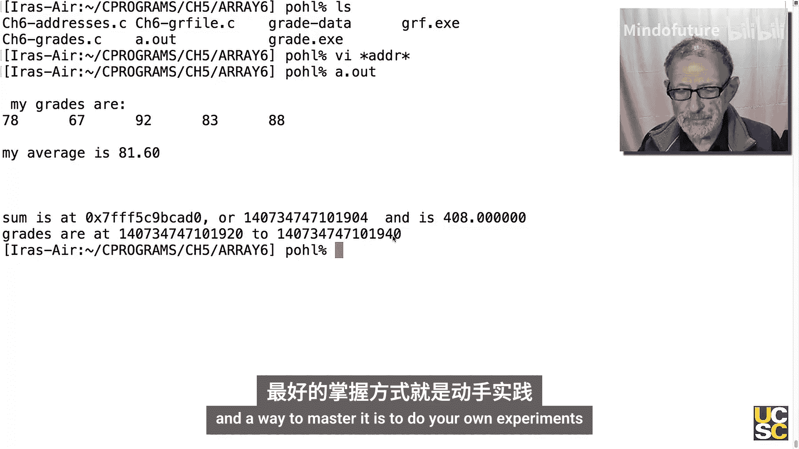
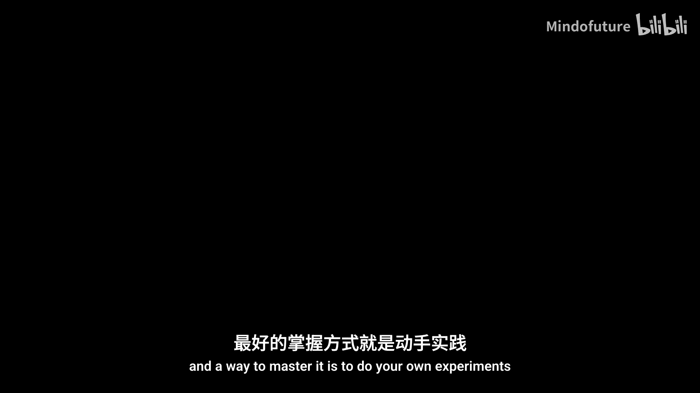

# 【加州大学】C语言编程基础-｜-C-For-Everyone-p47-P47_指针代码示例_05_01_05--BV1Fqe7zDEVT_p47-

🎼TheYeah。So we're continuing with our understanding of pointers， arrays， and addresses。

And what we're trying to show here is that while。This topic。Is truly wonish， in other words。

 it gets really into the weed very detailed and understanding。How。

Code functions at the machine level， namely， you have to have a really good appreciation of。

Memory as a resource and allocated in how it's addressed。

And one way to at least get some exposure to it is play around with code。

So I just urge you to write your own variations of what I'm doing just to make sure you get a real sense of what's going on。

And here's a piece of code and it's largely to。Understand some of the elements of how an array is laid out and how。

The machine。Acces is a memory cell and use a memory cell in place of a name。

And also the contents of the memory cell is yet something else。So in this program。

 it's a modification of one we earlier used， which was。To allocate some grades into an array。

And then we're going to sum up and average the grades。The sum variable is going to be a double。

And here's where we get into this whole notion of pointer so here is。The Pointer declaration。Double。

Atk。So that's essentially saying double。Point or 2。Some。And that's initialized。To Ampersand。

 which is address of。Some。So some has zero stored at it。

 this is some address that at the moment we don't know， but whatever the address is in memory。

And I'm going to print that out for you， so you're going to get a sense of this magic number because it's the compiler that gets to decide where to put things and that's going to be different from compiler to compiler machine to machine。

And conceivably even from run to run。Because on a big machine。

 many programs may be running and there may be different parts of memory that get allocated to a particular program。

So again。Get used to， again， contextually。Star here is not times， it's part of the declaration logic。

 it means pointer to double。Double star is pointed to double。 N star is pointeder to n。

 Char star is pointed to character， which frequently gives rise to the notion of a string。

Here's an ordinary variable in I， and then we do the same thing we did before， which is。Calculate。

The grades。Printing them out first， and then summing them and then printing the average。

 And after that， we're going to look at。Where all of these variables are located。

So I'm going to print out some is at percent P。Is。Format for a pointer address and a pointer address on a motor machine is displayed in hexedademal。

So that's not something you're used to， Exodadecimal is a base like base 10 except that base is 16。

 and because we run out of digits， we only have the normal 10 digits， we use the letters A， B， C， D。

 E and F。F， in effect， is 15。呃。But we're also going to print it as long unsigned。

 so you'll see it more as an ordinary decimal number。And then we're going to print out the value。

That's found there， so look at what we're printing pointer to sum。So that's。

The value of pointer to sum is the address where some。Itself is placed in memory。

And this is the two versions of it。 We get both the。Exxiadecimal and the long on side。

 And then we do a de referencing star， in this case means de referenceence。This。Pointer to double。

 which means look inside it and return a double。So Ampersand as an operator。Back up here。

It meansans address。Star。Down here means dereence and your dereference。

APoer variable and then you get effectively as contents and what that is going to be is whatever the sum of the grades are。

And then we're going to print that stuff out。And then we're going to further print。

Where that array starts， so it says grades are at。And now we're going to also use instead of hexodademal。

 maybe you're not used to it yet。We're going to use long on side and it says grades go from long on sign to this long on sign。

And this is the base address of grades where it was stored。

 and this is the address of the fifth element。And we'll find that it's offset by 20 because each element in grades is an integer which is stored in four contiguous bytes。

Okay。So。Let's run that program and see that this all works。And again。

 I just want you to do your own experimentation。Here were my grades。

 here was what the program ordinarily was going to do， this is the average。Some is at。

This0 x is the format for a hexadeadeciimmal number。And then we see a7， an F。

 which remember is the digit 15 F FF5 c， which is the digit。I believe 12。Uh， maybe it's C D， Yeah。

 I think it's 12。And then。B is 11， 12，10。D is 13。At zero。

And this translates into a long unsigned as this very big number。So that's like the mailbox。

 that's the address and stored there is the value 408。Notice 408 is the sum of 78，67。

 928388 so indeed。That dereferencing of that pointer actually got us the same thing we would print if we had just printed some at that point。

And now look at how grades are laid out， notice， let's forget all this beginning stuff because that's too big a number。

It's located between 1920 and 1940。Where some was at 1904 and there was a variable like I so if you think about。

What was being laid out in memory， there were all these individual variables。One was。啊。

The variable sum， another was the pointer to sum variable。Another was I。

 and those were all four bytes。And then you come on where the beginning of graze is。

 so it all makes sense if you think about where things are laid out。In that program。

 and then it goes up to 1940 because each individual element is four bytes long。

 and there are five elements so you're adding 20 and you get to the last element。Okay。

 hopefully that makes sense， that's too wonish for you。

 you can probably skip this idea and still manage most of the work in the class。

But if you're going to try to go on。嗯。And you're going to make a heavy use of C and then finally C++。

 then this is a subject you want to try to master and a way to master it is to do your own piece。🎼们是。

🎼The。

