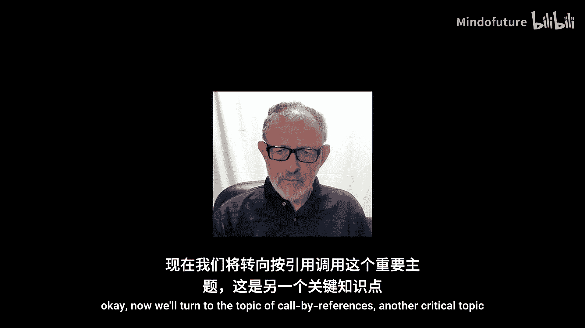
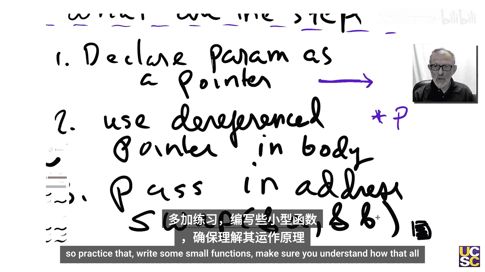
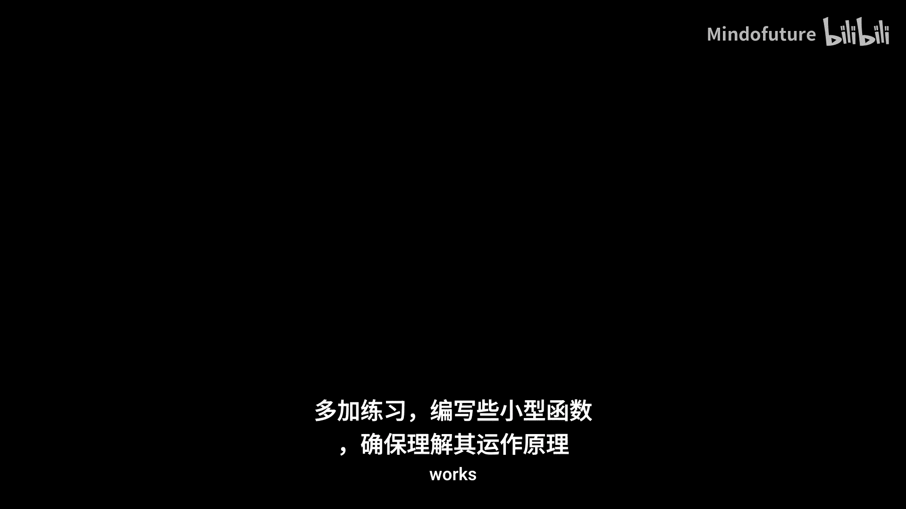

# 【加州大学】C语言编程基础-｜-C-For-Everyone-p48-P48_模拟按引用调用_05_01_06--BV1Fqe7zDEVT_p48-

🎼TheYeah。Okay， now we'll turn to the topic of call by reference， another critical topic。

 very important that you get to understand this。

And again， it gets to this level of abstraction about。Pointer。Variable memory address。あ。

So you have to have a。Model of the physical memory of the computer。

And understand what is going on there， where things are stored， what is an address。

 what's a value in that address。Now， see。As a language supports call by value。And if you recall。

 call by value is where arguments are passed in。Possibly variables from the calling environment inside the routine。

 they're manipulated， inside the function， they're manipulated。But when that function exits。Those。

Variables are unchanged， so basically what's being manipulated in call by value is some local。

A local instance of where the。Value argument。Is initialized。Now。

Many languages also allow call by reference， but C allows you to， what you might say， simulate it。

The way we're going to simulate it is we're going to have to be able to dereference addresses that means。

An address variable。When prefaced by a star。Accessses the contents at that address。

And to get at a variable， to know its address， we use the Ampersand operator。

These are both very high precedence operators and the way we've seen that already is in our use of scanf。

So recall， when we say something like scanf， we have a format， for example。

 getting at an endier percent D and we use。Am percent of size， not size。

 so we go and take the address of size。And inside there， the manipulation occurs where。

Scan F is and for input， so whatever sizes value on entry was， it can be changed by。

Not manipulating the address size， that's being called by value。

 but byipulating the contents at that address。Okay， so as we to restate。Normally。

 parameters are called by value， but we can pass in an address。An address。

Not necessarily to a pointer， but an address。And。This should really be or a pointer， may just say。

Then。We use this mechanism to achieve call by reference。

We use call by reference to change values much as we did with Scanf。In the calling environment。

So let's look at something that would be a function we try to create。

 we're going to call it a swap function。It has a very simple job。

Sp A of B is supposed to exchange values， what A's value was becomes B's value becomes A's value。

 A's value becomes B's value。So if A started at2， B started at5， we want to reverse that。

 we want B to now B2 and A to be5。If we try to write this code as swap into I and J。

In temp equals I I is replaced by J J is replaced by temp。 So internally here the logic is right。

The values that come in as I and J internally will be swapped as Z and J。

But if instead we called these with A and B， we would notice that nothing happened to A and B。

 so it won work， won't work。Hence we need call by reference。AndCall by reference。

 rewrite the swap function as two pointers。Temp is still an int。

 Temp gets the D reference value of I。 The D reference value of I is assigned the Dvalue reference of J。

 The de reference value of J is assigned s temp。This will work。 That's what we want to do。 by。

 this is the canonical call by reference function。If you understand this。

 you'll understand how to write call by reference in the sea world。

What are the steps let's summarize？We declare parameters as a pointer。

We use de referenceence pointers star P within the body of the function。

 notice how we dereference I and J there， and then we pass in the address。Of the variables。

 we want the value swap， just like what Sc up we'll say a percent of A and a percent of B and then。

It all works。So practice S， write some small functions， make sure you understand how that will。

