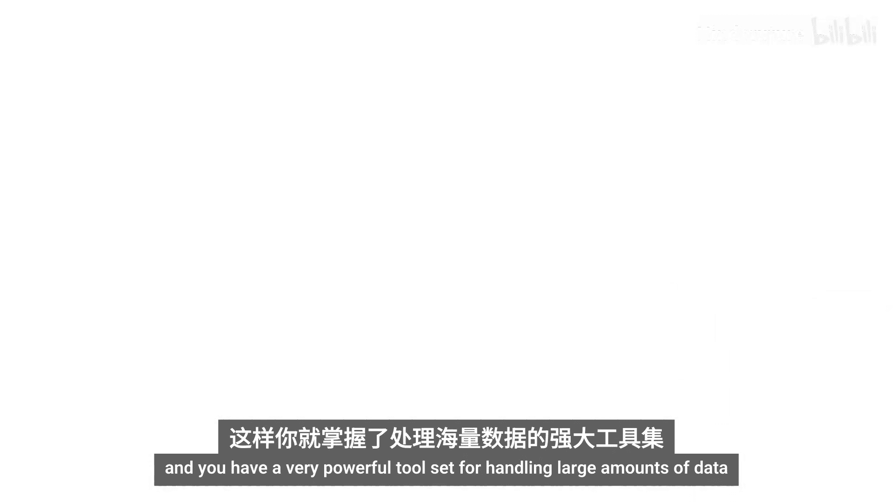

# 【加州大学】C语言编程基础-｜-C-For-Everyone-p49-P49_数组作为参数_05_01_07--BV1Fqe7zDEVT_p49-

🎼2。🎼，Now let's turn to some actual code。

Where our parameter will be one dimensional array。And this will look familiar because we had one dimensional array already。

In Maine， and we were doing the same thing we were。Printing some grades。

And then computing an average。 So we'll show how to do both things。

 but now we'll encapsulate as parameter。The grades and will' show why this is so effective。So。

Both routines， one will be forgetting the average of the grades， the other will be four。

Brinting the grades。And get any average of the grades， we need to know how many grades。

And then we're going to pass in the base address of grades。

So we're going to assume that if there are 10 grades。

 then therere going to be 10 entries in the grades array that everything will be。

Of the appropriate length。That's one place where you can make an error。You can have too many。

For the array that you're passing in， for example。Lally， we need a count parameter， int I。

 and we also need a parameter for adding up the sum of the grades as before。

 and here again we see this very natural idiom for I equals zero。

 I less than how many because the array starts from zero。Auto incrment the index， and then create。

The repeated sun， so you're adding in each element。And it doesn't matter how many elements。

 so that's why again， so powerful。To use a programming language。

 it lets you work with as much data as you want。With relatively small code， if you use。

These forms these idiomatic forms of iteration。And then at the end。

 because you have a sum over a integer and we have a double divided by an integer。

 we do return a double。Our second routine。The Prince gray's routine is even simpler。Yen， same setup。

We have how many that we want to process。We pass in the grades。

We have our counting variable internally to the procedure that I'm going to print。

 I have this many grays and that I'm going to， with a tab separated format string。

 print out those grays。 and again， as many as we want can be printed out。

And now the logic becomes very simple in Maine， rather than having embedded everything there。

 this can be reused time and again with different routines。 In fact， they can get us。An average。

 as you'll see， one of the。Problems， homework problems is to do an average for the weight of elephant seals。

And here。We've created the array。We called it grays， we could have called it data。

 we could have called it my grades。あ。We pass it in with its how many parameter size。

And then internally。We print the grades out。And in the second line。We figure out the average。

 the average grades， all very clear。So just get used to writing simple functions in which a parameter is array and you have a very powerful tool set for handing。

 handling large amounts of data。

あ。