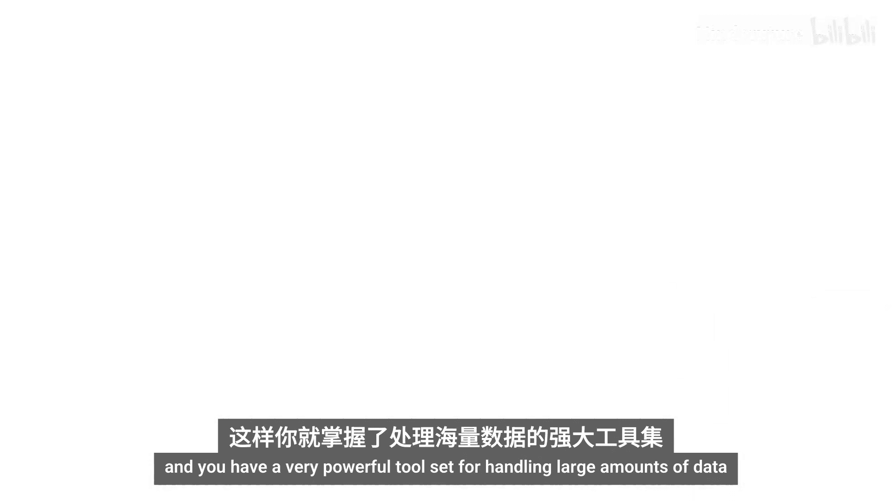

# C语言编程基础：P49：数组作为参数


## 概述
在本节课中，我们将学习如何将数组作为参数传递给函数。这是处理大量数据时一个非常强大且高效的工具。我们将通过两个具体的例子来展示其用法：一个用于计算数组元素的平均值，另一个用于打印数组的所有元素。

## 将一维数组作为参数

上一节我们介绍了数组的基本概念，本节中我们来看看如何将数组传递给函数。这看起来很熟悉，因为我们在主函数中已经使用过一维数组，并执行了打印成绩和计算平均值的操作。现在，我们将把这些操作封装成函数，并展示为什么这样做非常有效。

我们将创建两个函数：一个用于计算成绩的平均值，另一个用于打印所有成绩。为了计算平均值，我们需要知道成绩的数量，并传入成绩数组的基地址。

我们假设如果存在10个成绩，那么成绩数组中就会有10个条目，并且所有内容长度都合适。这里有一个可能出错的地方：例如，你传入的数组可能包含过多的元素。

## 计算平均值的函数

以下是计算平均值函数的逻辑。我们需要一个计数参数 `int howMany`，还需要一个参数来累加成绩的总和，就像之前一样。

这里我们再次看到了一个非常自然的惯用写法：`for (i = 0; i < howMany; i++)`。因为数组从零开始，所以循环条件是 `i < howMany`。然后我们递增索引，并累加总和，将每个元素都加进去。

无论有多少个元素，这种方法都适用，这再次体现了使用编程语言的强大之处：它允许你用相对较少的代码处理任意数量的数据，只要你使用了这些迭代的惯用形式。

最后，因为总和是整数，而我们需要返回一个双精度浮点数，所以我们执行 `return (double) sum / howMany;`。

**代码示例：计算平均值**
```c
double computeAverage(int grades[], int howMany) {
    int i;
    int sum = 0;
    for (i = 0; i < howMany; i++) {
        sum += grades[i];
    }
    return (double) sum / howMany;
}
```

## 打印数组的函数

我们的第二个函数，打印成绩的函数，甚至更简单。同样是相同的设置：我们传入需要处理的成绩数量 `howMany` 和成绩数组 `grades[]`。

在函数内部，我们使用一个计数变量 `i` 来遍历数组。使用一个制表符分隔的格式字符串，打印出这些成绩。同样，我们可以打印出任意数量的成绩。

**代码示例：打印数组**
```c
void printGrades(int grades[], int howMany) {
    int i;
    printf("There are %d grades:\n", howMany);
    for (i = 0; i < howMany; i++) {
        printf("%d\t", grades[i]);
    }
    printf("\n");
}
```

## 在主函数中使用

现在，主函数中的逻辑变得非常简单。我们不再需要把所有代码都嵌入在主函数里。我们可以创建数组（可以称之为 `grades`、`data` 或 `myGrades`），然后将其连同表示大小的参数 `size` 一起传入函数。

首先，我们调用函数打印出所有成绩。接着，在第二行，我们计算并输出平均成绩。整个过程非常清晰。

**代码示例：主函数调用**
```c
int main() {
    int myGrades[] = {98, 85, 92, 88, 91};
    int size = 5;

    printGrades(myGrades, size);
    double avg = computeAverage(myGrades, size);
    printf("The average grade is: %.2f\n", avg);

    return 0;
}
```



## 总结
本节课中，我们一起学习了如何将一维数组作为参数传递给C语言函数。我们创建了两个函数：`computeAverage` 用于计算数组元素的平均值，`printGrades` 用于打印数组的所有元素。通过这种方式，我们可以将处理数据的逻辑封装起来，使代码更清晰、更易于复用，从而高效地处理大量数据。请习惯编写这种以数组为参数的简单函数，它是处理数据集的强大工具集。