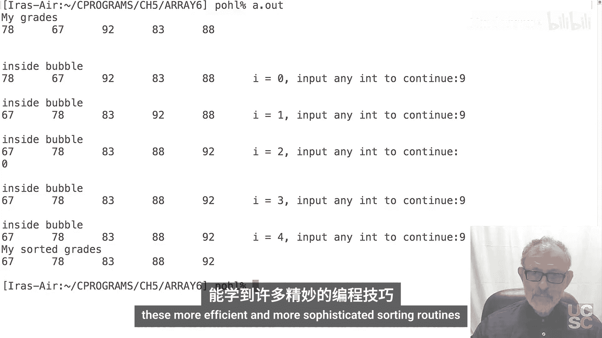

# 【加州大学】C语言编程基础-｜-C-For-Everyone-p50-P50_数组-冒泡排序代码_05_01_08--BV1Fqe7zDEVT_p50-

🎼2。🎼，Okay， now we come to one of our most important topics。

And this starts getting you way more sophisticated in your use of the programming language C。

And what we're going to show is a sorting algorithm， a very simple sorting algorithm。

 it's called bubble sort。And。While it's perfectly fine for small arrays。

 it's considered quite inefficient if you're going to use it on very large arrays。Now。

 sorting is one of the most important。Functions one does on a computer why？

Peters are used for a lot of data。So let's take data in。

Phone book for a big city like New York or London or Moscow。

 where there might be many million of people。If those phone numbers and the people。We an unsorted。

Then it would be。Excessively difficult to go through and try and find somebody's phone number。

Think about it。If you had。Several million。啊。Phone numbers unordered。

 it would take you something like several million looks at that pile of information to come up with the right phone number。

Or hadn't thebi if the person wasn't in that city， you would be hopelessly searching through every piece of information only to find that the person wasn't there。

 On the other hand， if you have the information sorted。

Then you can find that information in what we call log in time， namely if there's several million。

 then it might take you only 10 or 15 looks in that big phone book and that big thick phone book to actually look somebody up because you're going look towards the middle of the phone book and see whether you're past where the person's name might be or you haven't come on it yet。

 and then you'd look in the next quarter of the phone book and then you would get down to the right page and on the right page。

 you'd be able to also。Do an efficient search of finding that phone number So by having。

Information sorted， you have it also readily available for searching and looking up and sorting and searching are so important that most important computer scientists of our era。

Wrote a book， Don Canoeth。This book is called Soing and Searching。So it's a volume。

Just devoted to these techniques with very detailed analysis of them。And indeed。

 even talks a fair amount about the bubble sort let me just read you。

 he says perhaps the most obvious way to sort by exchanges is to compare。Two keys， interchanging。

R1 and R2， if the keys are out of order and then keep doing this。Repeating it until。In effect。

 you have a。Information sorted。So。These methods have been。Exhaustively。

Analyze because it's so important。And let's see how to do that now that we know how to have parameters passed。

So a critical thing we're going to look at is swap where the swap occurs between， in effect。

 what will be two out of order keys， A and B。And notice again that we're using our pointer parameters to simulate call by reference so that the two actual values can be interchanged。

And we're going to end this program。Have reason to print out the array because we want to see that it's been properly sorted。

And we see how we have a parameter for how many elements the data that we're sorting。

 and then in this case， when we're printing the array， we're going to print it with a title。

 namely that。characterracter。The pointer to character， which we're going to call STR for strength。

Looking at the routine。We first print using a format percent S for string， the string， the title。

And then we go in。Again， idiomaticically， that's what you've got to learn these idioms once you master them。

 you can do most of your coding， you can do it very very correctly and quickly so for I。

In not initialized by I assign assigned to zero。I， if it's less than how many elements。

 what to increment I and then print each element tab。With a tab in between it。

Now let's go to the actual bubble sort。We have the unsorted data， at first。

Potentially unsorted data by accident， it could be sorted。We want again to sort。

ACertain number of elements。And we're going to need a double loop。

 so in the double loop we're going to。Have two indexes， I and J。

And I'm going to use a little trick because I want to show you how this works。

So I'm going to use an integer， which is going to be a way to have the program stop at the critical point in the loop。

And only go on if we enter this particular integer。

So look at this double loop for the outer loop is for I equal how many auto increment I。

 then we're going to print how the array looks each time through。

 so for each eye we're going to print array。And notice our title， it's inside the Bu sort。

And then I'm going to ask you to continue after we've printed the array in order to continue。

 you're going to have to enter something of value for Go。

 you don't really care what that iss this is just a standard technique to halt the program Now you could halt the program other ways frequently the system you have might have a very good bugger and you can set break points in which the bugger will automatically look at the program at particular times。

 but this gives us control and we can see exactly what we need to see we want to see for each。

Step through the array。How does the sorting work？And then this is what's called the inner loop for j equals how many minus one we don't have to。

Go the whole way。We advanced J。But we subtract J， J starts at five and then what this bubble sort is going to do is it's going to place。

The largest element。In the array off to。What might be called the extreme right。

So each time each time through the outer loop， we get one more element。Properly sorted。

 and here's the sort。We see if two elements are out of order， if they are， we swap them。Okay。

Let's look at how main works， we're going to do it with a simple case， do it with something larger。

 one thing I'd recommend is take this， generate a bunch of data with a very large for a very larger array using random numbers to have appropriate data and then see how this might work for a much larger data set。

We're going to first print the array of grades， and we've done that before。

 and then we're going to bubble it and don't forget internally to bubble。

 we've put that in effect a bugging statement showing how the bubble sort works and then when we're finally done。

 we're also going to print out the fully sorted list。Okay， so that's what we're doing。

And let's see it work。Execute。So。Just as in that program。

 the data started with it being out of order， 78 too large。呃。

Is me a message showed up that I'm not interested in。Oh。Okay。So I've started the program。

My grades are 78，67，92，83，88。 Some of those are out of order。 And we've entered bubble sort。

 And then inside bubble。 Don't forget。 that was printing a title。

 We're using print array in each case。And now we stop and it's saying， okay。

 this is what we see before we do any swamping。And now I'm going to input an integer to continue。

And then the first time through， the swapping has。Swpped。呃。67 and 78。And then。83 and 92。Well， oh。

 we went backwards， excuse me， let's start that over。So 88 got compared to 83。They got swapped。

88 compared pair to 92， they got swapped。83。Got compared to 67， it wasn't s。

 67 got compared to 78 and they were swap。Let's do it again。92 got compared to 88 they were swapped。

88 is compared to 83， no swapping， 83 is compared to 78， no swapping， etc ce。

And one of the inefficiencies of bubble sort is that。Even though we're ready in order。

 it doesn't know we're in order， it has to complete the n minus one inner loops to make sure that things were out of order because。

If the smallest element， the 67 had been over there， it would have bubbled down to the first element。

 you would have seen it occur。啊。是呃。Throughout。So。One of its inefficiencies is。

 and you could try to improve on this by seeing if you could check whether it's already sorted。

 you could have a flag and it could test whether any swapping occurred and if no swapping occurred during a particular routine。

 you could stop。Right after that， that would indicate that everything was in order and then my sored grades are indeed 67。

 78， 83， 88， and 92。Okay， why don't you play around with that program and we're going to also show you some more advanced sorting techniques that are efficient A because this is such an important topic that you really need to understand it and B if you want to go on in computer science or even if you just want to be informed。

 there's lots of fancy things and fancy programming that you learned by doing these more efficient and more sophisticated sorting routines。

🎼。