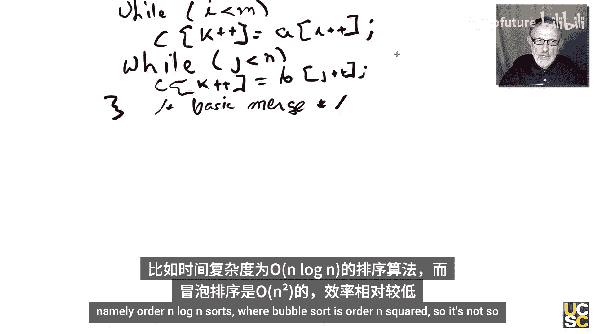
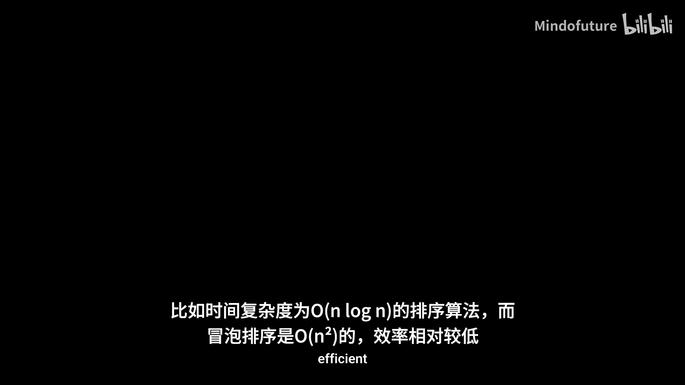

# 【加州大学】C语言编程基础-｜-C-For-Everyone-p51-P51_归并排序概述_05_01_09--BV1Fqe7zDEVT_p51-

🎼TheYeah。So sorting is a very important topic and as I promise， we're going to do more with it。

So in our first case， we saw a very simple sort， bubble sort。It's not very efficient。Works fine。

For small cases， computers are very fast。But now let's look at something that's。Quite efficient。

 and it's going to be called merged sort。And the idea behind it is a very important idea for all of computer science and algorithms and programming。

 it's a divide and conquer strategy。In merge's sort， the principal idea。

Is that you have two existing。Sored piles。And you want to turn them into。A combined sort of pile。So。

Pile A and pile B will be merged into pile C。And let's look at the specific case。

 and it'll show in a way。The algorithm for the very general case。So if pile A had 3，5。

 and7 and pile B at one，2， and4 in it， don't forget。

The piles are already going to be merged and then they're going to be merged into bigger piles that are already sorted。

So you look at the two smallest elements。 You know that the smallest element in the resulting pile speed has to be chosen between one of those two。

 So at one at any time for the next smallest candidate。You have。Only two choices。

 the bottom of the pile， so look at the bottom one and three。

 well one's your choice so we move one in now your choice is two and three。She moved to in。

Now your choice is three and four。So you move three in now your choice is four and five。

 so you move four in。And now you're not let you don't have anything in this pile。

So you have a cleanup phase， the rest of this pile is already in order， so you just move it directly。

 five and7。And that's the general idea。So the heart of merge sort is take small piles， merge them。

Take bigger piles， merge them， keep going until everything is merged into one sorted order。Turns out。

And I won't do that rigorously again， I told you about canoeuth volume。3， sorting and searching。

 and you can look at it in other books or。As well and something like a Wikipedia page。

You can show that such a procedure is going to be order and log N。

Where N is the number of elements to be。Sored。Now let's look at the heart of the algorithm。

Here we are。In this algorithm。We have as our merge， pile A， pile B， and the result pile C。

Pile A has size N， and pile B has size n。So we can generalize it， though it turns out。

For our purposes。The ideal is to have the piles be equal or indeed。Be roughly a power of two。

 That would be your most efficient。But。We have three indexes and these keep track of where we are in the three piles。

K will be the result pile。I will be the pile A， J will be the index of the pile B。

And we can do this all with a while loop， while I less than M。

 the size of file A and J is less than n the size of file B。This is the logical operator and。

We have a simple if。A less than B。And Che A into C。Or to increment both of these indexes。

 which means move to the next element in each of those piles。Else place into the C pile。

 the B element， you either place an A element or a B element， if it's an A element。

 you advance the A index， the B element， you advance the B index。

 and in either case you're going to advance the C index 1。Ultimately， you're going to finish。

And there's going to be some cleanup。You might not have gotten to the end of both simultaneously。

 So you look to see if you're at the end of pile。A， if you're not the end of Pi。

 it means it has some elements remaining and you just can shove them in turn。

That's your wild statement into your merge pile C。Similarly， if J is less than n。

 then you can merge the rest of the B pile into C， just as we did in our simple example。

So that's your basic merge algorithm。 And now will be at the heart of。

A merge sort that will continually call。Starting with piles of two。Appropriate sizes。Merge them。

And you'll finish with having the whole list sorted。Okay。

What we're going to do next is actually show the whole routine。Encode。So， we'll just。Do that in code。

 But this is the heart of the thing to remember。 And if you're not trying to get to a sophisticated computer science understanding。

Just go with bubble sort。And just know that there are other sorts available to you that are more efficient。

 namely， order n log n sorts where bubble sort is an order n squares， so it's not so efficient。

