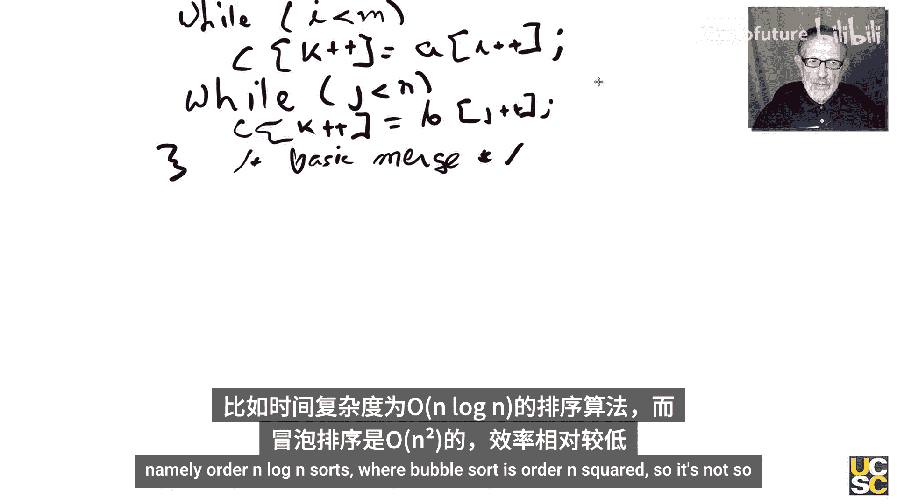
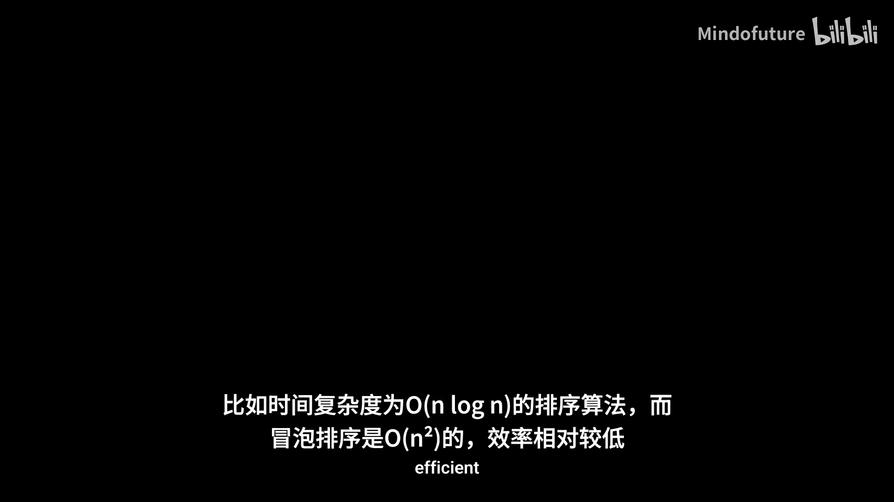

# C语言编程基础：P51：归并排序概述


## 概述

在本节课中，我们将要学习一种名为“归并排序”的高效排序算法。我们将了解其背后的核心思想——分治策略，并详细解析其合并两个已排序序列的基本操作。

## 排序的重要性

排序是计算机科学中一个非常重要的主题。在之前的课程中，我们学习了一种非常简单的排序算法——冒泡排序。冒泡排序虽然易于理解，但效率不高，其时间复杂度为 **O(n²)**。对于小规模数据，计算机速度很快，冒泡排序可以胜任。但对于大规模数据，我们需要更高效的算法。

## 归并排序的核心思想

上一节我们介绍了冒泡排序的局限性，本节中我们来看看一种高效的排序算法：归并排序。归并排序背后的思想是计算机科学、算法和编程中一个非常重要的概念：**分治策略**。

归并排序的基本原理是：假设我们有两个已经排好序的序列（或“堆”），我们希望将它们合并成一个更大的、仍然有序的序列。

让我们通过一个具体例子来理解这个过程，这个例子也展示了通用算法的思路。

假设有序序列A包含元素 `[3, 5, 7]`，有序序列B包含元素 `[1, 2, 4]`。请记住，这些序列在合并前已经是排好序的，合并后我们将得到一个更大的有序序列。

合并过程如下：
1.  我们总是比较两个序列中当前最小的元素（即各自序列的首元素）。
2.  结果序列中的下一个最小元素必然来自这两个候选元素之一。
3.  选择较小的那个元素放入结果序列，并从其原序列中移除（即移动索引）。

以下是合并步骤的详细过程：
*   初始状态：候选元素是 `1` (来自B) 和 `3` (来自A)。`1` 更小，将其放入结果序列C。C = `[1]`。
*   下一步：候选元素是 `2` (来自B) 和 `3` (来自A)。`2` 更小，将其放入C。C = `[1, 2]`。
*   下一步：候选元素是 `4` (来自B) 和 `3` (来自A)。`3` 更小，将其放入C。C = `[1, 2, 3]`。
*   下一步：候选元素是 `4` (来自B) 和 `5` (来自A)。`4` 更小，将其放入C。C = `[1, 2, 3, 4]`。
*   此时，序列B已空。进入“清理”阶段：将序列A剩余的所有元素（`[5, 7]`）按顺序直接放入结果序列C。最终 C = `[1, 2, 3, 4, 5, 7]`。

这就是归并排序的核心思想：取小的有序序列，合并它们；取更大的有序序列，继续合并；不断重复，直到所有元素合并成一个完整的有序序列。

## 算法效率分析

可以证明（例如在《计算机程序设计艺术》第三卷“排序与查找”或其他算法书籍、维基百科页面中），归并排序的时间复杂度是 **O(n log n)**，其中 **n** 是要排序的元素数量。这比冒泡排序的 **O(n²)** 要高效得多。

## 合并算法的核心实现

理解了基本思想后，我们来看看合并两个有序序列的核心算法实现。

在这个算法中，我们有：
*   有序序列A，大小为 `m`
*   有序序列B，大小为 `n`
*   结果序列C，用于存放合并后的结果

为了高效合并，我们使用三个索引来跟踪在各个序列中的当前位置：
*   `i`：序列A的当前索引
*   `j`：序列B的当前索引
*   `k`：结果序列C的当前索引

以下是合并过程的伪代码描述：

```c
while (i < m && j < n) {
    if (a[i] <= b[j]) {
        c[k] = a[i];
        i++;
    } else {
        c[k] = b[j];
        j++;
    }
    k++;
}
```

这个 `while` 循环会持续比较 `a[i]` 和 `b[j]`，将较小的元素放入 `c[k]`，并相应地移动索引。循环条件是 `i` 和 `j` 都未到达各自序列的末尾（`i < m && j < n`）。

循环结束后，可能有一个序列还有剩余元素（因为两个序列长度可能不同）。这些剩余元素本身已经有序，只需将它们按顺序复制到结果序列C中即可。

以下是处理剩余元素的代码：

```c
// 如果序列A还有剩余元素
while (i < m) {
    c[k] = a[i];
    i++;
    k++;
}

// 如果序列B还有剩余元素
while (j < n) {
    c[k] = b[j];
    j++;
    k++;
}
```

## 从合并到完整排序

上面介绍的是归并排序的“合并”核心。完整的归并排序算法会递归或迭代地运用这个合并操作：
1.  将待排序的整个序列视为许多长度为1的微型有序序列（单个元素自然有序）。
2.  将这些微型序列两两合并，形成长度为2的有序序列。
3.  再将长度为2的有序序列两两合并，形成长度为4的有序序列。
4.  重复此过程，直到最终合并成一个包含所有元素的有序序列。

## 总结





本节课中我们一起学习了归并排序算法。我们首先了解了其基于**分治策略**的核心思想：通过反复合并小的有序序列来构建大的有序序列。我们详细剖析了合并两个有序序列的**核心算法**，并使用索引和循环实现了它。最后，我们了解到归并排序具有 **O(n log n)** 的高效时间复杂度，远优于冒泡排序的 **O(n²)**。如果你不需要深入理解复杂的计算机科学原理，使用冒泡排序处理小数据是可行的，但请记住，归并排序等更高效的算法适用于处理更大规模的数据。在接下来的课程中，我们将实际编写完整的归并排序代码。