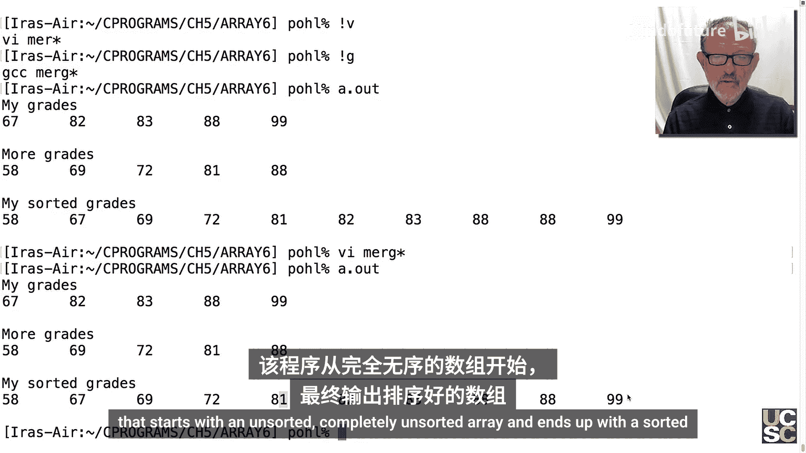
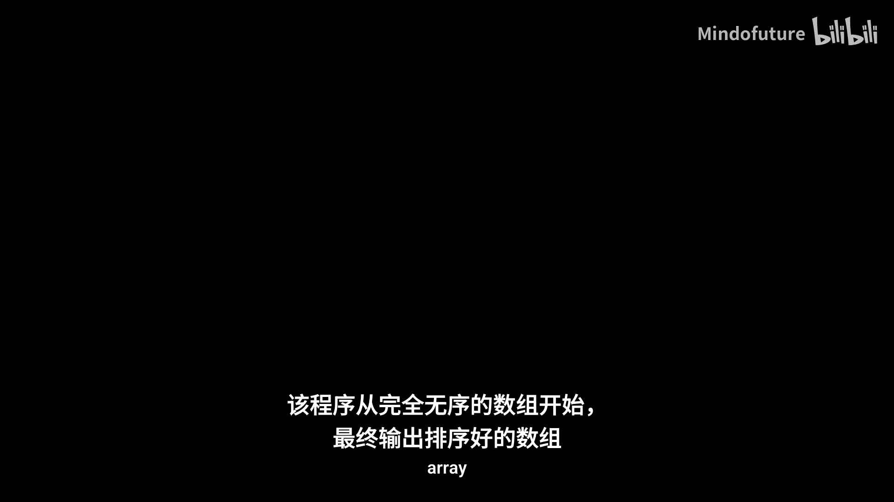

# 【加州大学】C语言编程基础-｜-C-For-Everyone-p52-P52_合并代码示例-1_05_01_10--BV1Fqe7zDEVT_p52-

🎼TheYeah。Okay。Well， we saw how merge sort is supposed to work。

 or at least the heart of a merge sort is supposed to work。

 and I want to show you the actual code for that routine working。

And then we'll go on to show how it gets embedded in。

A bigger routine that can be called on originally a totally unordered array and produce a sorted array。

So first off， let's go and look at。Our code。I't forget one of the reasons we're doing this and that we're not satisfied with bubble sort it is bubble sort is n squared。

 and this is order n log n。Again， we have our print array routine just to see how things work。

And here's that merge。Let's look at it individually。Now in this version。

 I'm just going to assume that both A and B are the same size。

And that C is twice the size of A and B。That'll simplify it a little bit。

The one I showed you on the whiteboard。Allowed for two different sizes。Now。

 when we embed this in a bigger program， we're going to make a further simplifying assumption and we're going to assume。

That the array to be sorted is a power of two， and that's reasonable， and if it's not a power of two。

 we can just have a bunch of empty cells。But a power of two makes it a little easier to both。

Understand and implement。So here are indexes for the three piles。I will be pile A。

 J will be for pile B。And K will be the index for the merged。Aray C。

And here's exactly what we had before， don't forget the logical and operator。Is a。

St circuit evaluation operator， in other words， if the first thing is false， the while loop stops。

 it doesn't have to check that J is less than how many。So we test which is larger in the two piles。

And then we increment a merge pile by the element， which is smaller。In this case。

 it was found to be a， so the A index goes up and of course， the element in the merge pile goes up。

And otherwise， the B pile had the smaller element and that gets indexed。And again， the merge pile。

Is incremented by one。And then we do the cleanup means we've gotten through one or the other of the piles and the remaining elements have to be sorted。

 so we just decide which of the piles we are finished with。And then。Put them in thesorted。Pile。

And we'll go back to something we used in merge sort as well。

We're going to use a hardwired size of five， we're going to have two grading scores。

 and here we see the A and B。Or。Already sorted。And C is going to be the merged array。

And then we're going to print out the grades and A and the grades and B and then show that the merge indeed D produces sorted grades。

So let's go ahead， I've already compiled this。And let me run it。嗯。And sure enough。

You can see in the bottom part of the window。That my grades are I ran it earlier as well。

 my grades are 67， 82。83 8889 and the A's and the B's is 58， 69，7281，88。

 so 58 would be compared to 67， 58 would be placed here， 67 would be compared to 69。

 67 would be placed here。69 would be compared to 82， 69 would be placed here。そ。

72 would be compared to 82， 72 would be placed there， 81 would be compared to 82。

 then 81 would be placed there。And then 88 would be compared to 83 and then 88 with 88 doesn't matter and we get 288s and then we do the cleanup 88 and 80。

And it works。Okay。And now we're going to go ahead in the next segment and show how to embed this into a program that starts with an un。

 completely unsorted array and so。

🎼是。🎼The。

