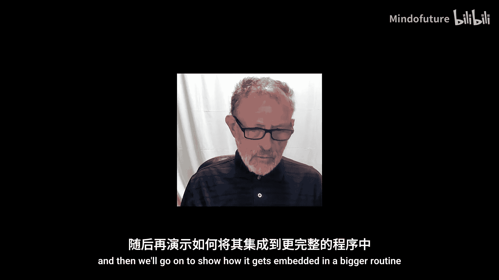
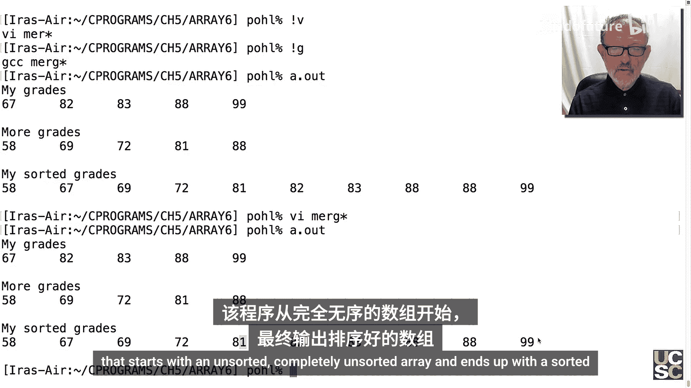
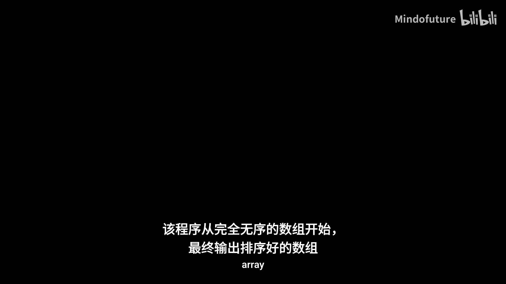

# C语言编程基础：P52：合并代码示例

在本节课中，我们将学习归并排序的核心算法——合并（Merge）操作的具体代码实现。我们将分析一个简化版本的合并函数，并通过一个示例程序来验证其功能。理解这个基础操作是掌握完整归并排序算法的关键。



上一节我们介绍了归并排序的基本思想，本节中我们来看看其核心合并操作的具体代码实现。

## 合并函数代码分析

首先，让我们单独查看合并函数的代码。在这个简化版本中，我们假设两个待合并的数组 `A` 和 `B` 大小相同，而合并后的数组 `C` 的大小是它们的两倍。这比在白板上演示的允许不同大小的版本更简单一些。后续在将其嵌入完整程序时，我们还会进一步假设待排序数组的长度是2的幂次方，这便于理解和实现。

以下是合并函数的核心逻辑：

```c
void merge(int A[], int B[], int C[], int size) {
    int i = 0; // 数组A的索引
    int j = 0; // 数组B的索引
    int k = 0; // 合并数组C的索引

    while (i < size && j < size) {
        if (A[i] < B[j]) {
            C[k] = A[i];
            i++;
        } else {
            C[k] = B[j];
            j++;
        }
        k++;
    }

    // 清理剩余元素
    while (i < size) {
        C[k] = A[i];
        i++;
        k++;
    }
    while (j < size) {
        C[k] = B[j];
        j++;
        k++;
    }
}
```

代码解析如下：

*   **索引初始化**：`i`、`j`、`k` 分别用于追踪数组 `A`、`B` 和 `C` 的当前位置。
*   **主合并循环**：`while (i < size && j < size)` 循环持续比较 `A[i]` 和 `B[j]`。这里使用了逻辑与运算符 `&&` 的短路求值特性：如果第一个条件（如 `i < size`）为假，循环会立即停止，无需检查第二个条件。
*   **元素比较与放置**：在循环内部，比较 `A[i]` 和 `B[j]`，将较小的元素放入 `C[k]`，然后递增对应数组和合并数组的索引。
*   **清理阶段**：当其中一个数组的所有元素都合并完毕后，循环结束。剩下的 `while` 循环负责将另一个数组中剩余的所有元素按顺序复制到数组 `C` 的末尾。

## 示例程序与运行结果

为了验证合并函数，我们使用一个简单的测试程序。程序中定义了两个已排序的小数组，然后调用 `merge` 函数将它们合并。

以下是测试程序的关键部分：

```c
#define SIZE 5

int main() {
    int gradesA[SIZE] = {58, 69, 72, 81, 88}; // 已排序数组A
    int gradesB[SIZE] = {67, 82, 83, 88, 89}; // 已排序数组B
    int mergedGrades[2 * SIZE]; // 合并后的数组C

    merge(gradesA, gradesB, mergedGrades, SIZE);

    // ... 打印数组A、B和合并后的数组C ...
    return 0;
}
```

程序运行后，输出结果如下：

```
数组A: 58 69 72 81 88
数组B: 67 82 83 88 89
合并后数组: 58 67 69 72 81 82 83 88 88 89
```

运行过程符合归并逻辑：首先比较58和67，58更小，被放入结果数组；接着比较67和69，67被放入；依此类推，直到所有元素合并完毕，最终得到一个完全有序的数组。

本节课中我们一起学习了归并排序中合并操作的具体代码实现。我们分析了一个简化版本的 `merge` 函数，它通过比较两个已排序数组的元素，将它们合并成一个新的有序数组。我们还通过一个示例程序验证了该函数的正确性。理解这个基础步骤对于接下来学习完整的、能够处理无序数组的归并排序算法至关重要。





在下一节中，我们将探讨如何将这个合并函数嵌入到一个更大的程序框架中，使其能够从一个完全无序的数组开始，递归地进行分割与合并，最终输出一个完全排序的数组。