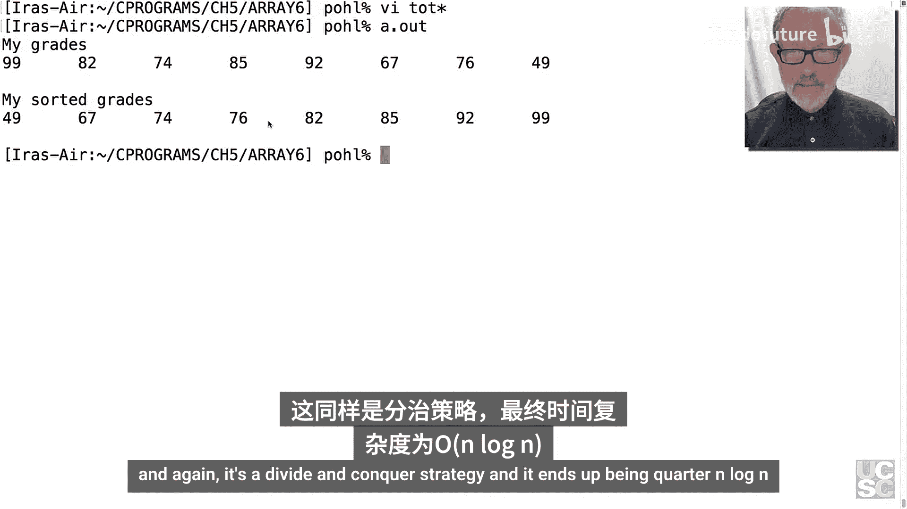
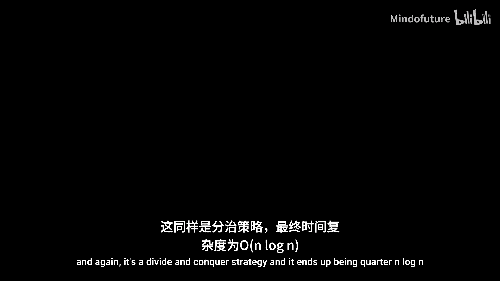

# 【加州大学】C语言编程基础-｜-C-For-Everyone-p53-P53_合并代码示例-2-包含文件_05_01_11--BV1Fqe7zDEVT_p53-

🎼TheYeah。So now we're going to show you the whole bottle of wax for merged sort。

And thiss going to be somewhat specialized because I'm only going to allow it on powers of two because that simplifies the coding sum。

You might like to look into how to modify this so that it could。Work on an arbitrary sized data set。

So some of it's going to be familiar。呃。Here's。Ill print array as before。

 and here's that internal sort routine。Now I won't go back over that now here's where it gets used。

 so let's look at this。We have a set of keys。Sometimes we call that data。

The reason we're calling that a key is that's technical。

 the key means the item that's being sorted on。Later。In our next course。

 when we talk about things like Strs where multiple pieces of information are put together so you can imagine that you're in a。

A payyroll database for your company。And you might be sorted according to an employee number。

 which might indeed be your social security number within。That company and that database。

If they had sorted data， it would be based on some key and that would make it efficient to go look up all sorts of information about you。

So again， this is going to be a power of two， how many？How many will be power of two。

 so that's going to be two， four， eight。1632， et cetera。

So inside the routine there's going to be two indexes and the indexes are going to keep track of the powers of two。

And is generally going to sort。あ。At first， two elements and then four elements and then eight elements until it's all done。

So the index k is being ramped up by powers of2。 K equals 1 until K is less than how many。

 And we multiply k by a power of 2。 So it'll start at one。 that means。

Two elements will be compared and only two elements， and then it will be those will be then in order。

 and then we can go to four elements。And then eight elements until we finish the whole。UAray of keys。

And then internally。We do the comparison， so here's where the actual merge is occurring of the small sets。

And。I'm using address arithmetic， so this， for example， is saying。4。The key offset by the index J。

 which initially is 0。Look at the key offset by the index0 plus  one。

 So it's really comparing those two elements。And is saying。Place them in an array。

Where they're being merged， and that's st you。So it'll be placed in W， starting at W of zero。

And how many keys will be looked at in this case。Is going to be。啊。One in each element。

So what you're going to find is one element is compared to one element then placed into W。

And then that gets repeated over and over again。And then the keys are updated。

So everything is being sorted。In powers of two。Until we're all done。And here， let's go and look at。

are。K array， which will be a。 And again， it looks like our old grades array。

 some more unsorted elements。 There are 8 of them。 So it is a power of two。

 We're going to print my grades， and then we're going to do the full merge sort。

 and we're going to show that in。A， at the end of this will be the sortded grades。I'm there we are。

So what was happening internally is we started with this an order array。

And then we passed it into merge sort， which had it。The central routine， the merge routine。

And what was really happening was 99 82 were being compared， and they were putting in order。

 And then we would jump the index to 74 and 85， and they were being put in order。

 Then 92 and 67 were being put in order。 and then 76 and 49 were being put in order。

 So after an effect， the first pass through the outer loop。All of these payers were in order。

And you can imagine after they were in order， then I'll let you work this out on your own。

 or you can try that trick I showed earlier of putting in a print array showing how each iteration works。

And that indeed is what we did in a book on C if you look in section 6。9 where。

This algorithm is described in more detail。We then have pairs that are in order。

 and we next through the loop， We're taking the 82，99，74。

85 and merging them and similarly merging the 67，92 with the 49，76。

 And then all four of these elements would be done。

 Then we'd up the amount of the of what we're looking at by a factor of two。

 So we'd first look at one element and two elements and four elements。

And four elements would be done because we only have eight elements。

 but we'd keep going even if we had a million elements by doubling the size until we reach that number of elements that would be fully sorted。

And again， it's a divide and conquer strategy。And it ends up being quarter N log N。

