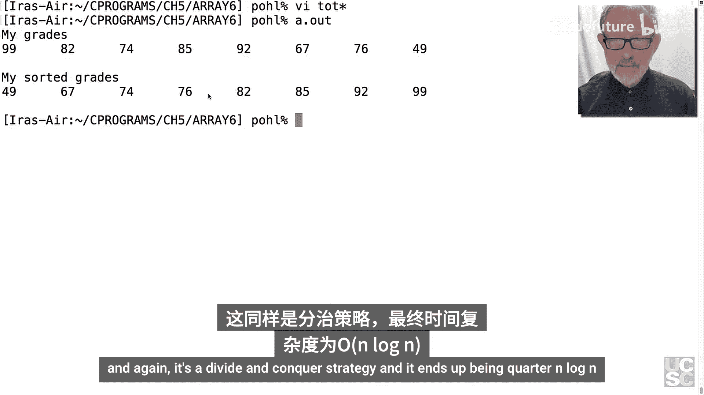
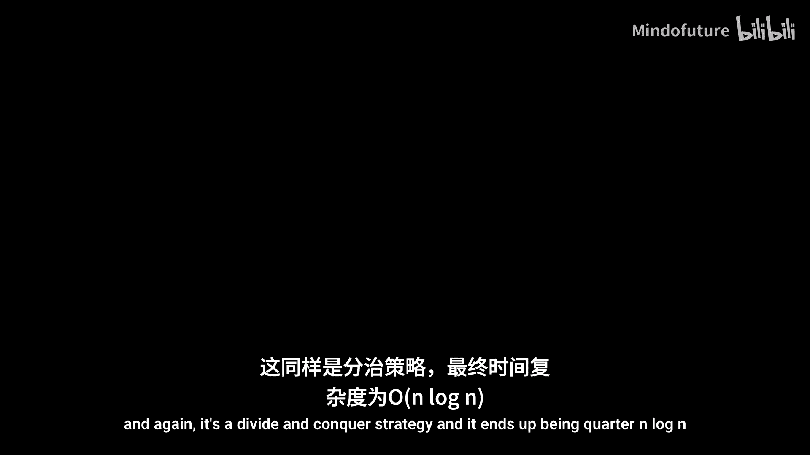

# C语言编程基础：P53：合并排序代码示例-2


## 概述
在本节课中，我们将学习合并排序算法的完整实现。我们将分析一个专门为处理元素数量为2的幂次方的数组而设计的代码示例，并理解其内部工作原理。

---

## 代码结构与全局函数

首先，我们来看一下程序的基本结构。这里有两个熟悉的函数：`print_array` 用于打印数组，以及 `merge` 函数，它是执行排序的核心内部例程。

```c
void print_array(int length, int arr[]) {
    for (int i = 0; i < length; i++) {
        printf("%d\t", arr[i]);
    }
    printf("\n");
}

void merge(int a[], int b[], int c[], int m, int n) {
    int i = 0, j = 0, k = 0;
    while (i < m && j < n) {
        if (a[i] < b[j]) {
            c[k++] = a[i++];
        } else {
            c[k++] = b[j++];
        }
    }
    while (i < m) {
        c[k++] = a[i++];
    }
    while (j < n) {
        c[k++] = b[j++];
    }
}
```

上一节我们介绍了合并两个已排序数组的基本操作，本节中我们来看看如何利用这个操作对整个数组进行排序。

---

## 主排序函数：merge_sort

`merge_sort` 函数是整个算法的驱动部分。它被设计为只处理元素数量是2的幂次方的数组，这简化了代码逻辑。你可以思考如何修改它以处理任意大小的数据集。

以下是该函数的关键部分解析：

```c
void merge_sort(int how_many, int key[], int temp[]) {
    int i, j, k, mid;
    int from, to, N;
    for (k = 1; k < how_many; k *= 2) {
        for (from = 0; from < how_many; from = to) {
            mid = from + k;
            to = mid + k;
            N = to - from;
            for (i = from, j = mid; i < mid && j < to; ) {
                if (key[i] < key[j]) {
                    temp[from++] = key[i++];
                } else {
                    temp[from++] = key[j++];
                }
            }
            while (i < mid) {
                temp[from++] = key[i++];
            }
            while (j < to) {
                temp[from++] = key[j++];
            }
        }
        // 将临时数组temp中的结果复制回原数组key
        for (i = 0; i < how_many; i++) {
            key[i] = temp[i];
        }
    }
}
```

### 外层循环：按2的幂次方增长
变量 `k` 控制着当前正在合并的子数组大小。它从1开始，每次迭代乘以2（`k *= 2`），代表先合并长度为1的数组（即单个元素），然后是长度为2、4、8的数组，直到覆盖整个数组。

**公式表示**：`k = 1, 2, 4, 8, ... , while k < how_many`

### 内层循环：遍历并合并子数组
对于每个 `k`，内层循环遍历整个数组，每次处理两个相邻的、长度为 `k` 的子数组进行合并。
*   `from`：当前处理的起始索引。
*   `mid`：第一个子数组的结束索引，也是第二个子数组的起始索引 (`mid = from + k`)。
*   `to`：第二个子数组的结束索引 (`to = from + 2*k`)。
*   合并过程与基础的 `merge` 函数逻辑一致，但这里直接操作原数组 `key` 和临时数组 `temp`。

### 关于“键(Key)”的概念
在排序上下文中，我们常将数组元素称为“键”。这是因为在实际应用中（如数据库），我们通常根据某个特定字段（如员工号、学号）进行排序，这个字段就是“键”。排序后，可以高效地根据键值查找其他关联信息。

---

## 算法执行过程演示

现在，让我们通过一个具体例子来观察算法的执行步骤。我们定义一个包含8个（2的幂次方）无序成绩的数组。

```c
int main() {
    const int SIZE = 8;
    int grades[SIZE] = {99, 82, 74, 85, 92, 67, 76, 49};
    int temp[SIZE];

    printf("原始数组:\n");
    print_array(SIZE, grades);

    merge_sort(SIZE, grades, temp);

    printf("排序后数组:\n");
    print_array(SIZE, grades);

    return 0;
}
```

### 排序步骤分解
以下是算法运行的逻辑过程：

1.  **第一轮 (k=1)**：合并相邻的单元素对。
    *   比较并排序 (99, 82) -> (82, 99)
    *   比较并排序 (74, 85) -> (74, 85)
    *   比较并排序 (92, 67) -> (67, 92)
    *   比较并排序 (76, 49) -> (49, 76)
    *   **结果**：数组变为多个有序的长度为2的子数组：`[82, 99, 74, 85, 67, 92, 49, 76]`

2.  **第二轮 (k=2)**：合并相邻的长度为2的子数组。
    *   合并 `[82, 99]` 和 `[74, 85]` -> `[74, 82, 85, 99]`
    *   合并 `[67, 92]` 和 `[49, 76]` -> `[49, 67, 76, 92]`
    *   **结果**：数组变为两个有序的长度为4的子数组：`[74, 82, 85, 99, 49, 67, 76, 92]`

3.  **第三轮 (k=4)**：合并最后两个长度为4的子数组。
    *   合并 `[74, 82, 85, 99]` 和 `[49, 67, 76, 92]` -> `[49, 67, 74, 76, 82, 85, 92, 99]`
    *   **结果**：整个数组完全有序。

> **提示**：为了更直观地理解每一轮排序后数组的变化，你可以在 `merge_sort` 函数的内层循环结束后（即更新 `key` 数组后）插入 `print_array` 语句来打印中间状态。

---

## 算法特性与总结

本节课中我们一起学习了合并排序的一个具体实现。

*   **策略**：这是一种“分治”策略。它将大问题（排序整个数组）递归地分解为小问题（排序子数组），解决小问题后再将结果合并。
*   **时间复杂度**：合并排序的时间复杂度非常高效，为 **O(N log N)**。这意味着即使数据量很大，其性能表现也优于像冒泡排序这样的 O(N²) 算法。
*   **本实现的限制**：当前代码要求数组长度必须是2的幂次方。作为一个扩展练习，你可以尝试修改代码，使其能够处理任意长度的数组，这通常涉及在合并时处理剩余的不完整子数组。





通过将数组不断对半分割直至最小单元，再有序合并，合并排序提供了一种稳定且高效的排序方案。理解其合并过程是掌握该算法的关键。