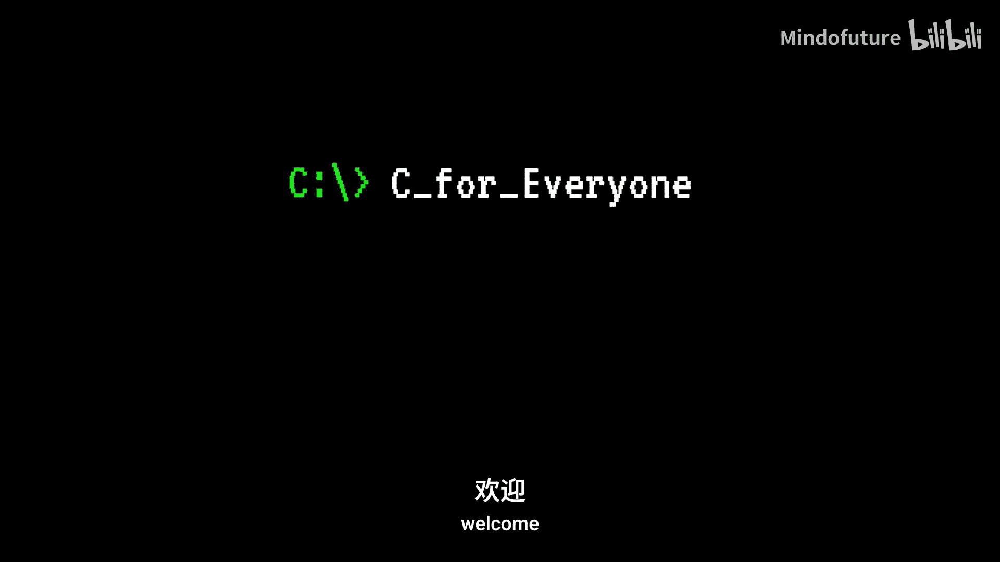
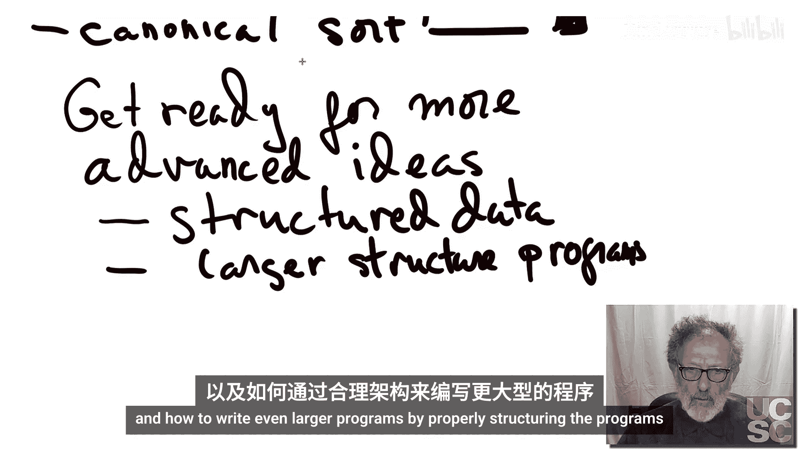

# 001：本课程的先决条件

在本节课中，我们将了解学习本课程所需具备的基础知识。这些知识是理解后续更高级概念，如数据结构与程序结构化的基石。

上一节我们介绍了课程概况，本节中我们来看看学习本课程前你需要掌握哪些核心技能。

## 背景知识要求

你可以通过多种途径达到本课程的起点水平。

*   你可能学习过C语言基础，例如本系列的前置课程《C语言程序设计基础》。
*   你也可能具备其他编程语言（如Java或Python）的基础，这同样可以为你学习C语言提供帮助。

如果你对C语言不熟悉，但已有其他语言的编程经验，可以通过快速复习C语言基础来跟上进度。

## 必备核心概念

以下是进入本课程前必须掌握的几个核心编程概念。

### 开发环境

你需要知道如何使用编译器和编辑器。本系列课程中使用的例子是GNU C编译器和VI/VIM编辑器，但你也可以选择其他工具。

### 语言基本元素

你需要了解构成C程序的基本组件，它们被称为词法元素。

*   **标识符**：用于命名变量、函数等。
*   **常量**：固定的值，如数字或字符。
*   **运算符**：用于执行运算的符号，如 `+`、`-`、`*`、`/`。
*   **标点符号**：如分号 `;`、花括号 `{}`。
*   **关键字**：语言保留的具有特殊含义的单词，如 `int`、`if`、`return`。
*   **注释**：用于解释代码，不会被编译执行。

### 数据类型

程序需要处理数据，因此你需要了解基本的数据类型。C语言内置了多种原生类型。

*   **整型**：用于表示整数，如 `int`。
*   **浮点型**：用于表示实数，如 `float` 和 `double`。
*   **字符型**：用于表示单个字符，即 `char`。

### 流程控制

为了让程序执行有趣的任务，你需要控制代码的执行顺序。

*   **复合语句**：将多条语句组合成一个逻辑块，用花括号 `{}` 包裹。
*   **循环**：重复执行代码块，包括 `while` 循环和 `for` 循环。
*   **条件语句**：根据条件决定执行路径，主要是 `if` 语句和 `switch` 语句。

### 函数

函数是C语言中组织代码的核心概念。

*   每个C程序都从 `main` 函数开始执行。
*   我们可以编写子函数（或称为子例程）来分解复杂任务，这有助于代码的组织和调试。
*   函数通过**传值调用**的方式接收参数，理解这一点至关重要。
*   函数需要先声明（或称为原型声明）后定义。
*   理解存储类别（如 `static`）对函数内变量的影响。

### 数组、指针与字符串

这是基础课程中涵盖的最后一部分重要内容。

*   **数组**：用于处理大量同类数据。数组通过索引访问元素，索引与指针类型有重要关联。
*   **指针**：存储内存地址的变量。指针允许我们模拟**传引用调用**，这对于 `scanf` 等输入输出函数非常重要。
*   **字符串**：C语言中没有原生的字符串类型。字符串被当作字符数组来处理，并有一系列库函数支持其操作。

## 应具备的能力

在掌握了上述概念后，你应该能够运用数组和循环迭代，实现一些经典的排序算法，例如**归并排序**、**冒泡排序**或**快速排序**。这证明了你对核心概念的掌握程度。

## 课程展望

现在，我们已经回顾了学习本课程所需的基础知识。准备好后，我们将进入更高级的主题。

在接下来的课程中，我们将重点学习如何更精巧地**组织数据**——事实上，我们将能够创建自己的新数据类型，以及如何通过**结构化程序设计**的方法来编写更大型、更复杂的程序。

本节课中，我们一起学习了开始《C语言结构化程序设计》课程前需要掌握的先决条件，包括开发环境、语言基础、数据类型、流程控制、函数以及数组、指针和字符串。这些是构建后续高级知识的坚实基础。