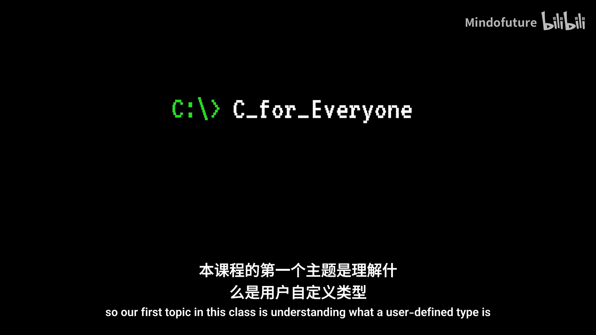

# 002：枚举作为抽象数据类型



## 概述
在本节课中，我们将要学习C语言中的用户自定义类型，特别是最简单的形式——枚举类型。我们将了解枚举类型的定义、用途以及它如何通过类型检查来增强程序的健壮性和可读性。

---

## 理解用户自定义类型
我们的第一个主题是理解什么是用户自定义类型。用户自定义类型最简单的形式就是枚举类型。

如果你正在阅读C语言的相关书籍，这部分内容通常位于第7.5节。

对于一个编程语言及其能轻松解决的问题而言，其原生类型至关重要。C语言的原生类型包括 `int`、`float`、`double`、`char`、`short`、`long` 和 `指针`。这些类型在不同类型的问题中各有其用：数学问题会用到整数和双精度类型；数据处理和字符串处理问题则会大量使用字符和字符指针类型。

然而，一门语言不可能为每个特定问题领域都内置所有需要的类型。化学家、物理学家、生物学家都有他们各自描述问题的方式和类型。因此，大多数现代语言，如Java和C++，都拥有非常强大的类型扩展能力。

C语言是一门更原始的语言，它最初被设计为系统实现语言，其内置类型足以完成那些任务。但随着它演变为一门通用语言，人们发现它非常高效和便捷。因此，即使在C语言中，也有进行类型扩展的方法。本视频将要讨论的方法就是**枚举**。

---

## 枚举类型的用途与优势
设想一个场景，你需要对日历进行计算，并讨论星期几。拥有一个专门的类型，可以让编译器进行**类型检查**，从而让调试变得更加容易。

即使在像C这样的**弱类型语言**中（与Java这样的**强类型语言**相对），类型安全仍然极其有用。C语言之所以被认为是弱类型，是因为它允许很多“有趣”的操作。例如，在C语言中，`if (a = b)` 这样的语句是合法的，因为C语言没有真正的布尔类型，它会将赋值表达式的结果（即赋值给`a`的值）解释为0或非0来判断真假。虽然大多数编译器会对这种常见错误发出警告，但类型安全能帮助我们避免更多其他难以被编译器自动发现的错误。

例如，你可能写出 `a / b` 这样的表达式，如果`a`和`b`是整数，`1 / 2`的结果会是`0`，而不是你期望的`0.5`。虽然你可以通过强制类型转换来得到正确结果，但在匆忙编写代码时很容易忘记。这说明了自动类型转换虽然方便，但也可能影响程序的正确性。

因此，让我们转向如何创建用户自定义类型，特别是枚举类型。

---

## 如何定义枚举类型
以下是如何定义一个名为 `day` 的枚举类型：

```c
enum day {sun, mon, tue, wed, thu, fri, sat};
```

`enum day` 向编译器声明这是一个枚举类型，其**标签名**是 `day`。现在，`enum day` 就成为一个新的类型。

它的值域是什么？它的值就是这些**枚举常量**：`sun`, `mon`, `tue`, `wed`, `thu`, `fri`, `sat`。我们也可以将它们全部写出来。有些人习惯将枚举常量大写。

为什么建议大写？因为从本质上讲，这些枚举常量被赋予了整数值。第一个常量（`sun`）被隐式赋值为`0`，后续的依次为`1`, `2`, `3`, `4`, `5`, `6`。所以，它们实际上是**小整数常量**。

现在，我们可以声明一个该类型的变量：

```c
enum day today = fri;
```

当然，在底层，`fri` 对应的值是`5`。现在我们有了一个这种类型的变量，编译器可以判断你是否在正确地操作类型和表达式。同时，这也增加了程序的清晰度。

是的，你完全可以使用普通整数来完成所有这些操作，但枚举类型是一个非常优雅的扩展，它使你的程序更具可读性，也提供了更清晰的表达方式。

---

## 枚举值的自定义
默认的赋值顺序是可以改变的。在枚举列表中，你可以显式地为某个常量赋值，这会打断隐式的递增序列，后续的常量会从你显式赋值的下一个整数开始继续递增。

例如：
```c
enum day {sun = 1, mon, tue, wed, thu, fri, sat};
```
这里，`sun` 被赋值为`1`，`mon` 会自动变成`2`，依此类推。

实际上，C语言中的枚举类型是整数类型的一种受限形式。我们将在下一个视频中编写一些代码来验证这个概念。

---


## 总结
本节课我们一起学习了C语言中的枚举类型。我们了解到枚举是一种用户自定义类型，它通过为一系列相关的命名常量赋予类型，提高了代码的可读性和类型安全性。虽然枚举在底层是整数，但它为程序员提供了一种更清晰、更不易出错的方式来处理一组固定的选项。在下一节中，我们将通过实际代码来探索枚举的更多细节。