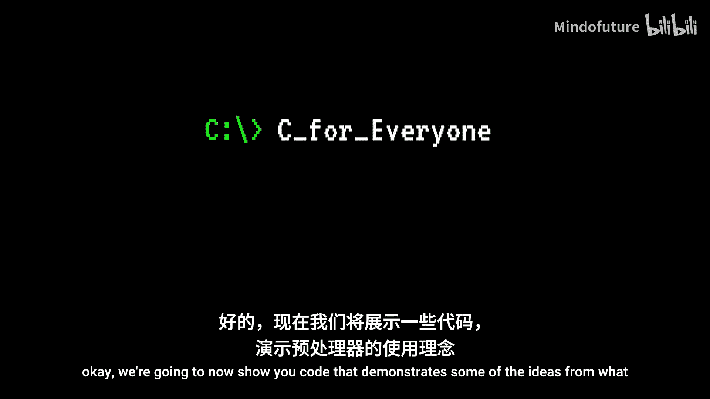
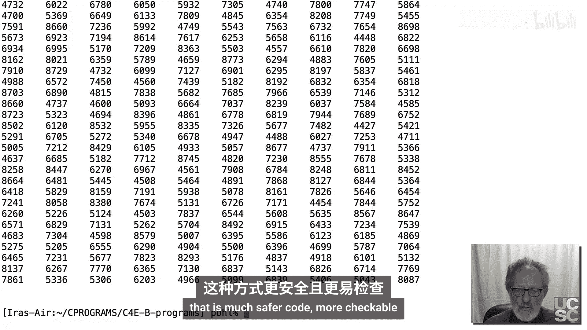

# 005：预处理器代码示例



在本节课中，我们将通过一个具体的代码示例，来演示C语言预处理器的实际应用。我们将学习如何使用宏定义常量、生成随机数，并理解宏在代码生成和简化中的作用。

## 概述

上一节我们介绍了预处理器的基本概念。本节中，我们来看看一个使用预处理器宏来生成随机数据的完整程序。该程序将模拟生成1000只雄性南象海豹的随机体重数据。

## 代码解析

以下是演示预处理器用法的核心代码。我们将逐步分析其组成部分。

### 1. 包含头文件与常量定义

程序首先包含了必要的标准库头文件，并定义了两个常量，分别表示雄性南象海豹体重的最大值和最小值。

```c
#include <stdio.h>
#include <stdlib.h>
#include <time.h>

#define MAX_ELEPHANT_SEAL_WEIGHT_MALE 8800
#define MIN_ELEPHANT_SEAL_WEIGHT_MALE 4400
```

### 2. 定义计算宏

接下来，我们定义了一些更复杂的宏。`RANGE` 宏计算了体重的可变范围。`WEIGHT_OVER` 宏用于生成一个0到该范围内的随机数。`WEIGHT` 宏则利用前一个宏的结果，加上最小体重，以生成符合实际范围的体重值。

```c
#define RANGE 4400
#define POPULATION 1000
#define WEIGHT_OVER (rand() % RANGE)
#define WEIGHT WEIGHT_OVER + MIN_ELEPHANT_SEAL_WEIGHT_MALE
```

### 3. 定义填充数据的宏

然后，我们定义了一个多行宏 `FILL`。这个宏使用一个循环，为数组中的每个元素调用 `WEIGHT` 宏来赋值。反斜杠 `\` 用于表示宏定义延续到下一行。

```c
#define FILL                         \
    for (i = 0; i < POPULATION; i++) \
        data[i] = WEIGHT
```

### 4. 打印数据函数

我们定义了一个标准的函数来打印生成的数组数据。该函数以制表符分隔数值，并且每打印10个数值就换行。

```c
void print_data(int d[], int size)
{
    int i;
    printf("\n");
    for (i = 0; i < size; i++)
    {
        printf("%d\t", d[i]);
        if ((i + 1) % 10 == 0)
            printf("\n");
    }
}
```

### 5. 主函数

在主函数中，我们声明了数组，并使用系统时间初始化随机数种子，以确保每次运行程序都能获得不同的随机数序列。然后，我们调用 `FILL` 宏来填充数组，并最终打印数据。

```c
int main()
{
    int i;
    int data[POPULATION];
    srand(time(NULL));
    FILL;
    print_data(data, POPULATION);
    return 0;
}
```

## 执行与结果

编译并运行此程序，将输出1000个介于4400到8800之间的随机整数，模拟了雄性南象海豹的体重数据。通过扫描这些数字，可以验证它们确实在定义的范围内。

## 关于宏的注意事项

宏功能强大，可以用于代码生成和简化。然而，在现代C/C++编程社区中，对于包含代码段的宏的依赖已大大减少。通常，我们更倾向于让编译器进行优化，或者使用C++中的内联函数（某些C编译器也支持），这能产生更安全、更易于检查的代码。

## 总结



本节课中我们一起学习了如何利用C语言的预处理器来定义常量、创建功能宏以生成随机数据，并构建了一个完整的示例程序。我们看到了宏如何使代码更简洁，同时也了解了其潜在的局限性以及现代编程中的最佳实践。