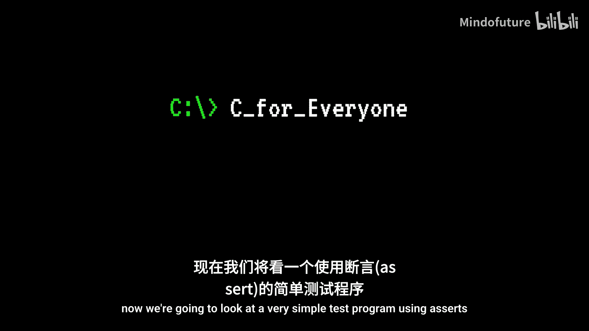
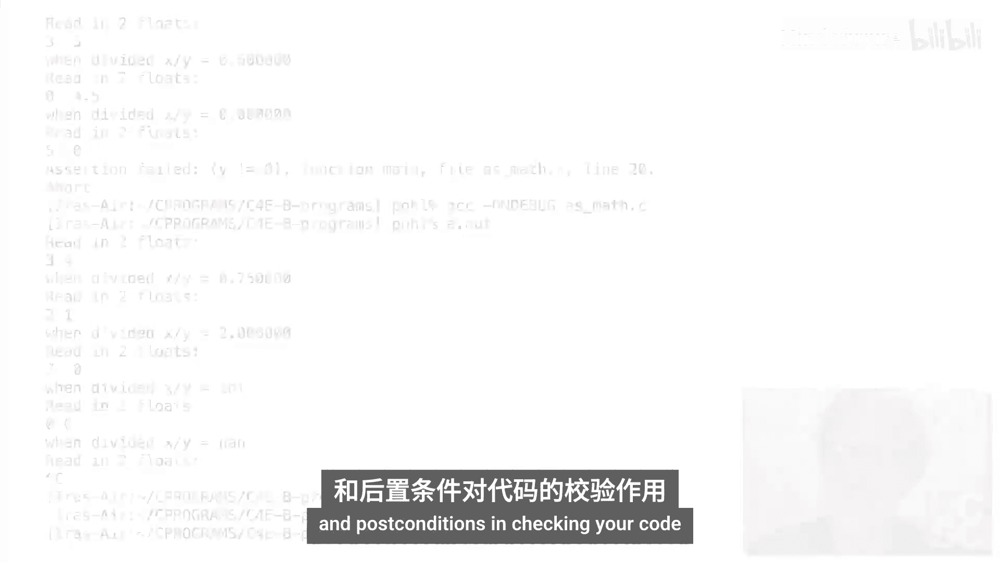

# 007：断言(assert)的使用



在本节课中，我们将学习C语言中一个非常有用的调试工具——断言（assert）。我们将通过几个简单的示例程序，了解断言如何工作，以及如何使用编译标志来控制它的开启与关闭。

## 概述

断言是一种在程序中嵌入检查点的方法，用于验证程序在运行时的状态是否符合预期。如果断言的条件为假（false），程序将终止并输出错误信息，这有助于开发者快速定位逻辑错误。

## 断言基础

上一节我们介绍了断言的概念，本节中我们来看看它的具体用法。要使用断言，首先需要包含头文件 `assert.h`。

```c
#include <assert.h>
```

断言的基本语法是一个宏，其形式为 `assert(expression)`。如果表达式 `expression` 的值为0（即假），则断言失败，程序会中止执行。

## 第一个示例：简单的断言失败

让我们看一个非常简单的测试程序。这个程序仅仅包含一个断言 `assert(0)`。记住，0在C语言中代表假（false）。

```c
#include <assert.h>

int main() {
    assert(0);
    return 0;
}
```

这个程序非常简单，它基本上就是在说“这个断言会失败”。当我们编译并运行它时，程序会失败。断言失败时，你会看到类似 `assert failed function main, file assert_test1.c, line 16` 的信息，然后程序会中止（abort）。断言的作用是指出程序的某个前置条件在该点不成立，并且它会告诉你失败发生的位置。

## 第二个示例：使用NDEBUG宏控制断言

现在，让我们看第二个测试程序。这个程序与之前的区别在于，我们定义了一个 `NDEBUG` 宏。

```c
#define NDEBUG
#include <assert.h>

int main() {
    assert(0);
    return 0;
}
```

`NDEBUG` 宏的作用是在编译时关闭所有断言。所以，现在这个程序（除了添加了 `NDEBUG` 宏之外，与前一个相同）会像根本没有 `assert(0)` 语句一样运行。从某种意义上说，`NDEBUG` 标志允许我们使用断言进行调试，然后在确认程序运行正确后，可以通过定义这个宏来“移除”它们。这是一种开发代码的方式：插入断言作为动态正确性证明，在你确信所有断言都不再需要后，可以暂时关闭它们。当然，如果你基于该源代码进一步开发，这些断言仍然存在，并且任何时候你没有定义 `NDEBUG` 宏，断言都会被重新启用。

## 第三个示例：在数学程序中使用断言

让我们再看一个使用断言的程序，这是一个简单的数学程序。

```c
#include <assert.h>
#include <stdio.h>

int main() {
    double x, y;
    while (1) { // 无限循环
        printf("Enter two floats: ");
        scanf("%lf %lf", &x, &y);
        assert(y != 0.0); // 断言y不等于0
        printf("%g divided by %g is %g\n", x, y, x / y);
    }
    return 0;
}
```

在这个程序中，我们断言了什么？我们有两个双精度浮点数 `x` 和 `y`。程序运行一个无限循环，要求输入两个浮点数，然后断言 `y` 不等于零。为什么？因为我们不想在这里除以零。否则，我们就打印 `x / y` 的结果。

如果我们运行这段代码，输入一些数字，比如4.54除以5.6，结果是0.714。再输入5除以3，结果是0.6。我们也可以输入0除以4.5，结果是0。程序在无限循环中。

但是，现在让我们尝试输入5除以0，看看会发生什么。这时断言会失败。所以，断言防止了我们进行除以零的操作。通常，我们会用某种方式（例如读取一个终止标记，或在大多数Unix操作系统中使用Ctrl+C）来退出这种无限循环。

## 关闭断言后的行为

最后，如果我们使用 `-DNDEBUG` 标志编译这个程序（即关闭断言），会发生什么？我们可以用GCC编译器这样操作：`gcc -DNDEBUG program.c`。

现在运行相同的程序，但断言已被关闭。我们可以输入3和4，结果是0.75。输入2和1，结果是2。但是，当我们输入7除以0时，我们不会得到断言错误，而是会得到 `x / y is INF`，这是系统提供的“无穷大”表示。

这很有趣。如果你输入0除以0呢？它也不会中止，而是会输出“not a number”（NaN）。这是当我们进行某些无法在常规实数集中解释的数学运算时，会出现的两个有趣的结构。现在，因为我们处于无限循环中，它正在等待输入浮点数，而我们无法像之前那样输入0来触发断言失败，我们只能使用Ctrl+C来退出。

## 总结



本节课中我们一起学习了C语言中的断言（assert）。我们看到了它在代码中的实际应用，它非常有用，尤其是如果你想成为一个严谨的程序员。它有助于你在逻辑上思考，将断言作为前置条件和后置条件来检查你的代码，从而提升代码的健壮性。