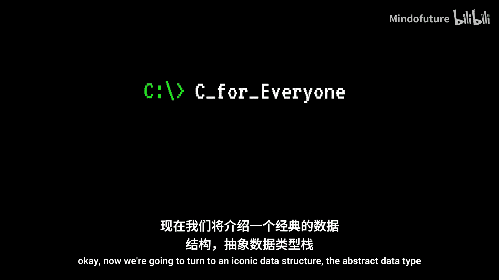
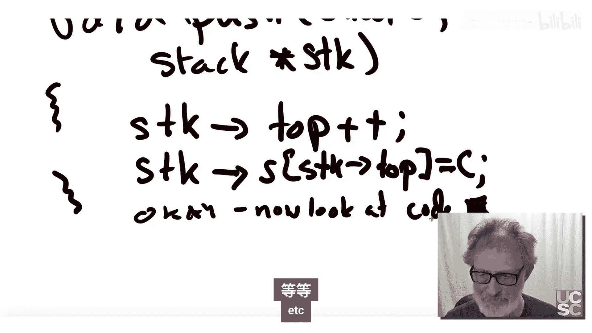

# 010：栈抽象数据类型介绍



## 概述
在本节课中，我们将要学习一种标志性的数据结构——栈抽象数据类型。我们将了解栈的基本概念、工作原理、常见操作，并初步探讨如何在C语言中实现它。

## 栈的基本概念与生活实例

上一节我们介绍了数据结构的重要性，本节中我们来看看一个经典的数据结构：栈。

栈是一种抽象数据类型。回想一下高中时去食堂的情景，那里会有一叠托盘放在弹簧上。你总是拿走最上面的托盘。如果你遵守规则，也会把托盘放回最上面。这被称为“后进先出”，因为最后放上去的托盘会最先被拿走。我们称之为LIFO。

这是一种典型的、非平凡的数据结构，在计算机算法乃至计算机体系结构中都非常常见，非常有用。

## 栈的操作（动词）

与数据结构相伴的是一组可以对其执行的操作。

以下是栈的常见操作：
*   **Push（压栈）**：将元素放入栈顶。
*   **Pop（出栈）**：从栈顶移除元素。Push和Pop是互逆的操作。
*   **Peek/Top（查看栈顶）**：查看栈顶元素但不移除它。
*   **IsEmpty（判空）**：检查栈是否为空。
*   **IsFull（判满）**：检查栈是否已满（对于有容量限制的栈）。
*   **Reset（重置）**：清空栈。

这些将是我们构建完整数据结构时要实现的操作。

## 栈的直观理解

我们可以看一些栈的例子。这是一摞书。同样，你不会从中间抽出一本书，你总是从顶部拿走或放回。这是一堆积木。你不会在中间连接，总是在顶部添加或移除。

从概念上看，栈是这样的：假设栈初始为 `[1]`。
1.  元素2被压入栈，栈变为 `[2, 1]`。
2.  元素3被压入栈，栈变为 `[3, 2, 1]`。
3.  继续压入4，5，6，栈变为 `[6, 5, 4, 3, 2, 1]`。

现在执行出栈操作。注意，当你按顺序 `2, 3, 4, 5, 6` 压入时，出栈的顺序是相反的：`6, 5, 4, 3, 2`。

我们马上会看到，如果你想反转某个列表、字符串或任何序列，栈是一个非常方便的抽象数据类型。你把元素依次压入，然后再依次弹出，就能得到它们的逆序。

## 在C语言中实现栈

那么如何在C语言中实现栈呢？

我们将回到使用 `typedef struct` 来定义。我们将把它构建成一个最大长度为 `MAXLEN` 的数组。我们将有一个元素数组。在这个例子中，我们放入字符 `char`。通常，栈中可以存放任意类型的元素。因此，对于每种元素类型，你都需要一个不同的栈实现。在一些非常高级的实现中，有处理泛型元素的方法，但我们暂不讨论。

然后，栈顶指针 `top` 将指向当前栈顶的下一个位置。

这就是我们的栈数据结构。其底层表示是一个数组。更高级的课程会介绍实现栈的其他方式。

我们的数据结构定义如下：
```c
typedef struct {
    char elements[MAXLEN]; // 存储栈元素的数组
    int top;               // 栈顶指针（指向下一个空闲位置）
} Stack;
```

## 压栈操作详解

让我们看看如何执行压栈操作。将某物放入栈中需要一个参数，即要压入的字符 `c`。为了修改栈，我们将通过指针来访问它，因为栈的内容会被改变。栈本质上是一个数组。

压栈操作 `push` 可以这样实现：
```c
void push(Stack *stack, char c) {
    stack->elements[stack->top] = c; // 将字符c放入当前栈顶位置
    stack->top++;                    // 栈顶指针加1，指向新的下一个空闲位置
}
```
代码解释：`stack->top` 指向当前栈顶（下一个空闲位置）。我们先将元素 `c` 存入该位置，然后将 `top` 索引加1，指向新的栈顶。

## 总结与预告

本节课中我们一起学习了栈抽象数据类型的基本思想，这是一个非平凡的抽象数据类型。我们看到了更多高级数据类型的雏形。



在下一节中，我将开发完整的代码库，实现包含所有不同操作（压栈、出栈、重置等）的栈的完整表示。