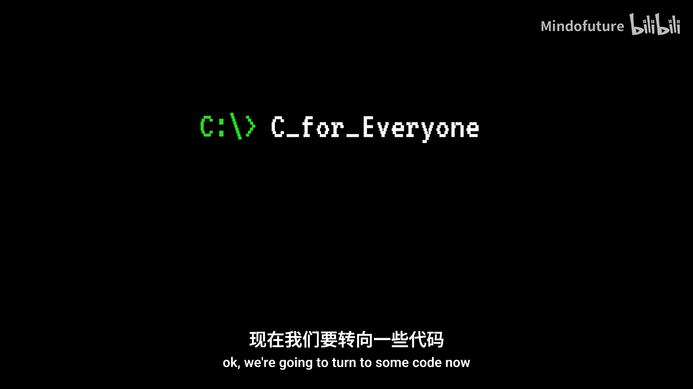
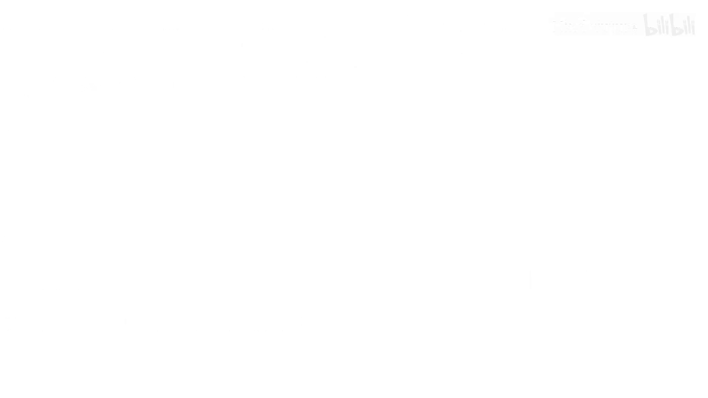

# 011：使用栈反转字符串



在本节课中，我们将学习如何使用栈（Stack）这一数据结构来反转一个字符串。我们将通过具体的代码实现，了解栈的基本操作，并应用这些操作完成字符串反转的任务。

---

## 🎼 栈的基本实现

上一节我们介绍了栈的抽象概念，本节中我们来看看如何在C语言中实现一个基本的栈。

首先，我们定义栈的最大容量和一些状态常量。

```c
#define MAX_LEN 1000
#define EMPTY -1
#define FULL (MAX_LEN - 1)
```

接下来，我们定义栈的数据类型。这里我们实现一个存储字符的栈。

```c
typedef struct stack {
    char s[MAX_LEN];
    int top;
} stack;
```

以下是栈的核心操作函数：

**1. 重置栈**
此操作将栈顶指针设置为`EMPTY`，表示栈为空。
```c
void reset(stack *stk) {
    stk->top = EMPTY;
}
```

**2. 压入元素**
此操作将一个字符放入栈顶，并更新栈顶指针。
```c
void push(char c, stack *stk) {
    stk->top++;
    stk->s[stk->top] = c;
}
```

**3. 弹出元素**
此操作从栈顶取出一个字符，并更新栈顶指针。
```c
char pop(stack *stk) {
    return (stk->s[stk->top--]);
}
```

**4. 查看栈顶元素**
此操作仅查看栈顶元素，而不改变栈的状态。
```c
char top(const stack *stk) {
    return (stk->s[stk->top]);
}
```

**5. 检查栈是否为空**
此操作检查栈顶指针是否等于`EMPTY`。
```c
int is_empty(const stack *stk) {
    return (stk->top == EMPTY);
}
```

**6. 检查栈是否已满**
此操作检查栈顶指针是否等于`FULL`。
```c
int is_full(const stack *stk) {
    return (stk->top == FULL);
}
```

---

## 🔄 使用栈反转字符串

现在，我们将使用上面实现的栈来反转一个字符串。算法思路是：先将字符串的每个字符依次压入栈中，然后再依次弹出，由于栈“后进先出”的特性，弹出的顺序就是原字符串的逆序。

以下是实现此功能的主要代码步骤：

1.  **初始化栈和字符串**
    我们声明一个栈和一个待反转的字符串。
    ```c
    stack s;
    char str[] = "I am O am I";
    char str_back[20];
    ```

2.  **打印原字符串并压入栈中**
    我们遍历原字符串，打印每个字符并将其压入栈中。
    ```c
    printf("Original string is: %s\n", str);
    printf("Individual letters pushed onto the stack: ");
    for (int i = 0; str[i] != '\0'; i++) {
        printf("%c ", str[i]);
        push(str[i], &s);
    }
    printf("\n");
    ```

3.  **弹出栈中元素以反转字符串**
    当栈不为空时，我们不断弹出栈顶元素，并将其存入新的字符数组中，从而得到反转后的字符串。
    ```c
    int i = 0;
    while (!is_empty(&s)) {
        str_back[i++] = pop(&s);
    }
    str_back[i] = '\0'; // 为反转后的字符串添加结束符
    ```

4.  **输出结果**
    最后，我们打印出反转后的字符串。
    ```c
    printf("The reversed string is: %s\n", str_back);
    ```

运行此程序，输出结果如下：
```
Original string is: I am O am I
Individual letters pushed onto the stack: I   a m   O   a m   I
The reversed string is: I ma O ma I
```

可以看到，字符串 `"I am O am I"` 被成功反转为 `"I ma O ma I"`。

---

## 📝 总结



本节课中我们一起学习了栈数据结构的C语言实现，并应用它完成了一个经典的算法任务——字符串反转。我们实现了栈的**重置**、**压入**、**弹出**、**查看栈顶**、**判空**和**判满**等基本操作。通过将字符串字符依次压栈再弹出的过程，我们直观地体会了栈“后进先出”的特性。栈是计算机科学中非常重要且广泛应用的非平凡数据结构，掌握其原理和实现是编程学习中的关键一步。