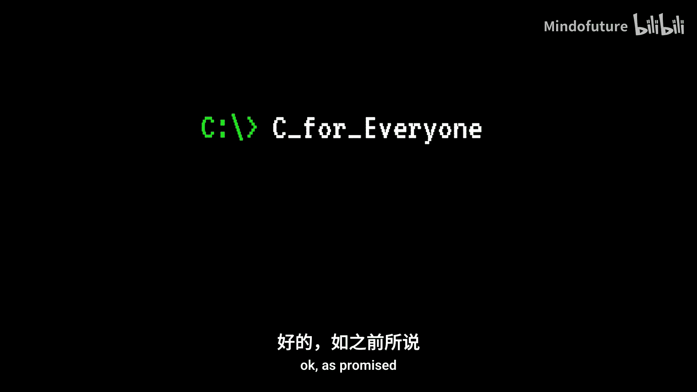

# 013：单个元素的列表代码实现



## 概述
在本节课中，我们将学习如何用C语言代码实现一个最简单的单链表。我们将重点分析链表的核心数据结构定义、基本操作（如判断链表是否为空、遍历打印链表），并观察一个仅包含单个元素的链表的创建与展示过程。通过这个简单的例子，你将掌握链表处理中最关键的模式。

## 链表数据结构定义
上一节我们介绍了链表的概念，本节中我们来看看其核心的数据结构在代码中如何定义。

```c
typedef struct list {
    int data;
    struct list *next;
} list;
```
在这个`typedef`定义中，`data`用于存储节点数据，本例中为`int`类型。`next`是一个指向`struct list`的指针，用于链接到下一个节点。`data`可以是任何类型，甚至是更复杂的结构体。

## 链表基本操作
定义了数据结构后，我们需要一些操作来使用它。以下是两个基础操作。

### 判断链表是否为空
对于任何抽象数据类型，我们都需要一些操作。这里是一个判断ADT链表是否为空的函数。

```c
int is_empty(const list *l) {
    return (l == NULL);
}
```
一个空链表的头指针指向`NULL`。这个函数通过测试传入的链表指针`l`是否为`NULL`来判断链表是否为空。它也可以用来判断是否到达链表尾部。

### 遍历并打印链表
接下来，我们看看如何迭代地遍历链表并打印其内容。

```c
void print_list(const list *h, char *title) {
    printf("%s", title);
    while (h != NULL) {
        printf("%d:", h->data);
        h = h->next;
    }
    printf("\n");
}
```
这个函数接收链表头指针`h`和一个标题字符串`title`。首先打印标题。然后进入循环，只要`h`不为`NULL`（即未到达链表尾部），就打印当前节点的`data`值，并将指针`h`前进到下一个节点（`h = h->next`）。这是一个需要牢记的关键模式。

以下是这个模式的核心要点：
*   **哨兵测试**：`while (h != NULL)` 是循环继续的条件。
*   **数据处理**：在循环体内对节点数据执行操作（本例为`printf`）。
*   **指针前进**：通过 `h = h->next` 移动到下一个节点。

尝试将此迭代版本改写为递归函数，将是一个很好的练习。递归的基准情况同样是测试指针是否为`NULL`。

## 创建单元素链表实例
理解了基本操作后，我们来看一个创建具体链表实例的`main`函数。

```c
int main() {
    list *head = NULL;
    printf("size of list is %lu\n", (long unsigned)sizeof(list));

    head = malloc(sizeof(list));
    head->data = 5;
    head->next = NULL;

    print_list(head, "single element list: ");
    return 0;
}
```
程序首先声明一个指向`list`的指针`head`，并将其初始化为`NULL`，这表示一个空链表。`malloc`函数从堆中分配一块大小为`sizeof(list)`的内存。创建链表时，一个常见的错误是忘记正确设置尾节点的`next`指针为`NULL`。这里我们将`data`设置为5，`next`设置为`NULL`，从而创建了一个单元素链表。最后调用`print_list`函数打印这个链表。

## 程序运行与输出
让我们编译并运行这段代码，验证其是否按预期工作。

使用命令 `gcc -o list_demo list_demo.c` 进行编译，然后执行 `./list_demo`。

程序输出如下：
```
size of list is 16
single element list: 5:
```
输出显示，`list`结构体的大小是16字节，这正是`malloc`需要分配的大小。创建的链表被成功打印为“single element list: 5:”。打印中的冒号是为了在后续的多元素链表程序中分隔各个数据项。


## 总结
本节课中我们一起学习了用C语言实现单链表的基础代码。我们分析了链表节点的结构定义，实现了判断链表为空和遍历打印链表的核心函数，并完成了一个单元素链表的创建与展示。其中，`while (h != NULL) { ... h = h->next; }` 是链表处理中至关重要的模式，理解它就能掌握大部分链表操作的核心逻辑。请仔细研究这段代码，它为理解更复杂的链表处理打下了坚实基础。