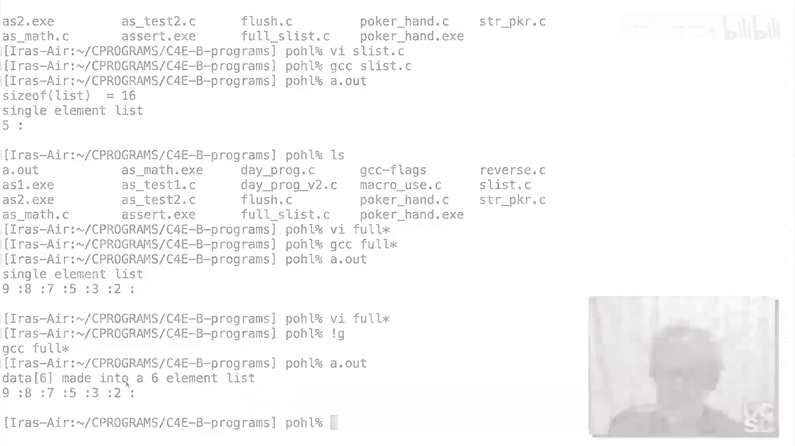

# 014：列表的完整实现与操作


在本节课中，我们将深入学习C语言中链表（List）的完整实现与基本操作。链表是理解指针和动态内存分配的关键数据结构。我们将通过具体的代码示例，详细讲解如何创建链表、向链表添加元素、将数组转换为链表以及如何遍历打印链表。

---

## 链表的基本结构

上一节我们介绍了链表的概念，本节中我们来看看如何用C语言代码定义链表的结构。

链表的核心是一个自引用的结构体。这意味着结构体中包含一个指向同类型结构体的指针。其定义如下：

```c
typedef struct list {
    int data;           // 存储的数据
    struct list *next;  // 指向下一个节点的指针
} list;
```

这个结构体包含两个部分：`data` 用于存储整型数据，`next` 是一个指针，指向下一个 `list` 类型的节点。当 `next` 指针为 `NULL` 时，表示这是链表的末尾。

---

## 判断链表是否为空

在操作链表之前，一个常见的需求是判断链表是否为空。以下是判断方法：

判断链表是否为空非常简单。我们只需要检查指向链表头部的指针是否为 `NULL`。

```c
int is_empty(list *head) {
    return head == NULL;
}
```

如果 `head` 指针为 `NULL`，则链表为空，函数返回 `1`（真）；否则返回 `0`（假）。

---

## 创建链表节点

要使用链表，首先需要能够创建单个的链表节点。以下是创建单个链表节点的函数：

这个函数接收一个数据值，动态分配内存来创建一个新的链表节点，并对其进行初始化。

```c
list *create_list(int d) {
    list *head = malloc(sizeof(list)); // 从堆中分配内存
    head->data = d;                    // 存储数据
    head->next = NULL;                 // 将next指针设为NULL
    return head;                       // 返回新创建的节点
}
```

函数 `create_list` 执行以下步骤：
1.  使用 `malloc` 函数在堆内存中分配一个 `list` 结构体大小的空间。
2.  将传入的数据 `d` 存储到新节点的 `data` 字段中。
3.  将新节点的 `next` 指针设置为 `NULL`，表示它是链表的最后一个节点。
4.  返回指向这个新节点的指针。

---

## 向链表头部添加元素

创建了节点之后，我们需要将它们连接起来形成链表。一种常见的方式是在链表头部添加新元素。

`add_to_front` 函数接收当前链表的头指针和新数据，将新数据创建为节点并置于链表的最前端。

```c
list *add_to_front(list *h, int d) {
    list *head = create_list(d); // 创建新节点
    head->next = h;              // 新节点的next指向原链表头
    return head;                 // 新节点成为新的链表头
}
```

该函数的工作流程如下：
1.  调用 `create_list(d)` 创建一个包含数据 `d` 的新节点。
2.  将这个新节点的 `next` 指针指向原来的链表头 `h`。
3.  返回这个新节点，它现在成为了链表的新头部。
通过这种方式，链表像一条链条，新元素总是被添加到链条的开头。

---

## 将数组转换为链表

在实际编程中，我们常常需要将其他数据结构（如数组）转换为链表。以下是将数组转换为链表的函数：

`array_to_list` 函数接收一个整型数组及其大小，并返回一个由数组元素构成的链表。

```c
list *array_to_list(int d[], int size) {
    list *head = create_list(d[0]); // 用数组第一个元素创建链表头
    for (int i = 1; i < size; i++) {
        head = add_to_front(head, d[i]); // 循环将后续元素添加到链表头部
    }
    return head; // 返回最终链表的头指针
}
```

转换过程分为两步：
1.  使用数组的第一个元素 `d[0]` 调用 `create_list` 函数，创建链表的初始头节点。
2.  使用一个循环，从数组的第二个元素开始，依次调用 `add_to_front` 函数，将每个元素添加到链表的头部。
需要注意的是，由于我们总是向“前端”添加，最终生成的链表顺序将与数组顺序相反。

---

## 遍历并打印链表

创建链表后，我们需要能够查看其中的内容。以下是遍历并打印链表所有元素的函数：

`print_list` 函数接收链表的头指针，并从头到尾依次打印每个节点的数据。

```c
void print_list(list *h) {
    while (h != NULL) {           // 当指针不为NULL时继续循环
        printf("%d ", h->data);   // 打印当前节点的数据
        h = h->next;              // 将指针移动到下一个节点
    }
    printf("\n");
}
```

这是一个遍历链表的经典模式：
1.  使用 `while` 循环，条件是指向当前节点的指针 `h` 不为 `NULL`。
2.  在循环体内，访问并打印当前节点 `h` 的 `data` 字段。
3.  将指针 `h` 更新为 `h->next`，即指向链表中的下一个节点。
4.  当 `h` 变为 `NULL` 时，表示已到达链表末尾，循环结束。

---

## 完整示例程序

现在，让我们将这些部分组合起来，看一个完整的示例程序，它演示了如何将数组转换为链表并打印出来。

以下程序定义了一个包含6个元素的数组，将其转换为链表，然后打印链表的内容。

```c
#include <stdio.h>
#include <stdlib.h>

typedef struct list {
    int data;
    struct list *next;
} list;

// 此处插入之前定义的所有函数：is_empty, create_list, add_to_front, array_to_list, print_list

int main() {
    int data_array[6] = {2, 3, 5, 7, 8, 9};
    int size = 6;

    list *head = array_to_list(data_array, size); // 将数组转换为链表
    printf("Data of six made into a six element list: ");
    print_list(head); // 打印链表

    // ... 后续应释放链表内存 (为简洁起见，此处省略)
    return 0;
}
```

程序执行流程：
1.  定义一个包含 `{2, 3, 5, 7, 8, 9}` 的数组。
2.  调用 `array_to_list` 函数将该数组转换为链表。由于是向前端添加，转换过程如下：
    *   初始头节点为 `2`。
    *   添加 `3`，新链表为 `3 -> 2`。
    *   添加 `5`，新链表为 `5 -> 3 -> 2`。
    *   ... 以此类推。
    *   最终链表顺序为 `9 -> 8 -> 7 -> 5 -> 3 -> 2`。
3.  调用 `print_list` 函数打印链表，输出结果为 `9 8 7 5 3 2`。

---

## 总结



本节课中我们一起学习了C语言链表的核心实现与操作。我们首先定义了链表的自引用结构体，然后逐步实现了创建节点、判断空链表、向头部添加元素、将数组转换为链表以及遍历打印链表的功能。这些代码模式是处理链表和更复杂指针结构的基础。请务必理解 `malloc` 如何分配内存、`next` 指针如何连接节点形成链式结构，并通过反复练习来掌握这些关键概念。