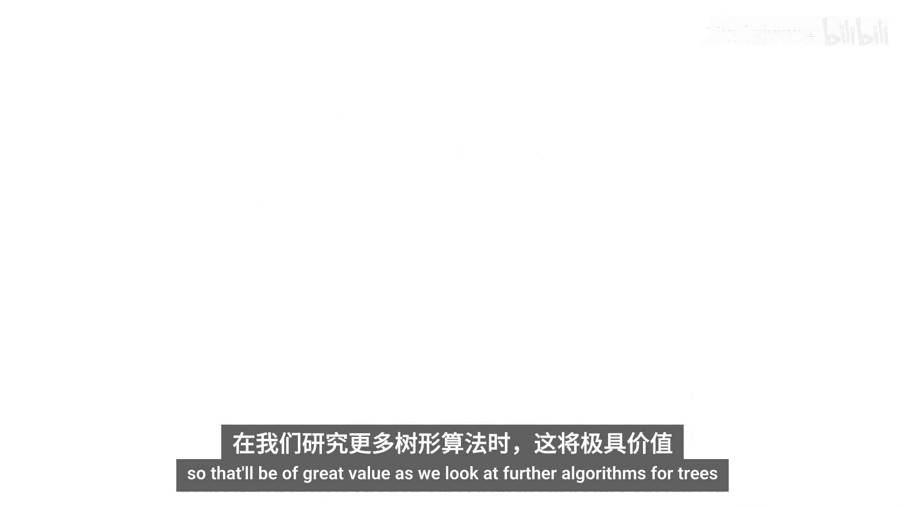

# 016：二叉树介绍


## 概述
在本节课中，我们将要学习一种重要的抽象数据结构——树，并重点介绍其特例：二叉树。我们将了解二叉树的基本结构、特性及其在高效存储和检索数据方面的应用。

---

## 树的基本概念
上一节我们介绍了数据结构的重要性，本节中我们来看看树这种结构。树是一种抽象数据结构，它包含一个根节点、若干分支以及叶子节点。这种结构类似于自然界中的树，有助于我们形象化地理解数据组织方式。

## 二叉树简介
在众多树结构中，二叉树是最重要且应用最广泛的一种。顾名思义，二叉树中的每个节点最多有两个后代，分别称为左后代和右后代。

以下是二叉树节点的典型C语言结构体表示：
```c
struct TreeNode {
    int data;               // 节点存储的数据
    struct TreeNode* left;  // 指向左子节点的指针
    struct TreeNode* right; // 指向右子节点的指针
};
```

## 二叉树的结构与特性
让我们更具体地观察二叉树。一个完整的二叉树意味着每个内部节点都有两个后代。

考虑一个具有两层的完整二叉树：
*   根节点为10。
*   其左后代为6，右后代为18。
*   6和18作为叶子节点，没有后代。

这样的树总共有 1（根）+ 2（第一层）+ 4（第二层）= 7 个节点。更一般地，对于一个有 `L` 层的完整二叉树，其节点总数可以通过以下公式计算：
**总节点数 = 2^0 + 2^1 + ... + 2^(L-1) = 2^L - 1**
由此可见，二叉树的规模随着层数呈指数级增长。

## 二叉树的排序特性与效率
二叉树的一个关键特性是可以在节点中存储值，并遵循特定的排序规则。例如，在上图的树中，左后代（6）的值小于其父节点（10），而右后代（18）的值大于父节点。

这种排序特性使得二叉树在存储和检索数据时非常高效。对于包含 `N` 个数据元素的排序二叉树，许多操作（如查找、插入）的时间复杂度可以达到 **O(log₂ N)**。这意味着随着数据量 `N` 的增大，所需操作步骤的增长速度远慢于线性增长，从而实现了高性能的数据管理。

---



## 总结
本节课中我们一起学习了二叉树的基本概念。我们了解到二叉树是一种每个节点最多有两个后代的树结构，常用结构体与指针实现。完整的二叉树其节点数随层数指数增长。当二叉树节点数据遵循排序规则时，它能以对数时间复杂度高效地进行数据操作，这是其在计算机科学中备受重视的原因。对于希望深入学习C++或从事专业开发的学者而言，掌握二叉树至关重要。