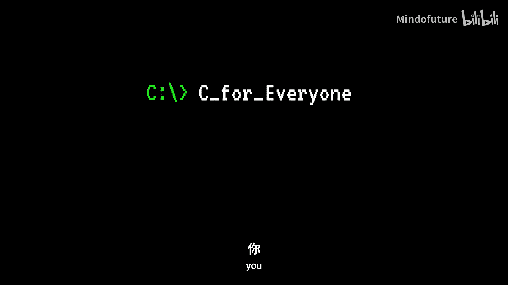

# 018：更高级的输入输出



## 概述
在本节课中，我们将学习C语言中更高级的输入输出功能，特别是`printf`函数的格式化输出。我们将超越基础的屏幕和键盘输入输出，探索如何通过格式说明符和修饰符来控制输出的外观，并理解其与操作系统文件I/O的联系。

## 从基础到进阶
上一节我们介绍了基础的`printf`和`scanf`函数。本节中，我们将深入了解`printf`的格式化能力。

`printf`函数总是包含一个控制字符串。这个字符串用引号括起，它既可以直接指定屏幕上打印的文本，也可以包含带有百分号`%`的转换说明符，用于转换后续逗号分隔的参数列表中的值。

一个典型的例子是：
```c
printf("sum of x and y is %d and %d equals %d", x, y, x+y);
```
如果`x`是3，`y`是5，那么屏幕上将显示：`sum of x and y is 3 and 5 equals 8`。其中，`%d`用于将整数参数转换为十进制格式输出。

## 格式说明符与修饰符
除了我们常用的`%d`（整数）、`%f`（浮点数）、`%c`（字符）和`%s`（字符串）之外，`printf`还支持更多转换说明符和修饰符，以提供更精细的输出控制。

例如，`%%`用于打印一个百分号字符本身，而不是进行转换。

以下是格式说明符修饰符和控制代码的一些示例，这些概念能极大地增强输出的可读性和格式。

### 宽度与对齐修饰符
宽度修饰符可以控制输出字段的最小宽度。如果输出内容短于指定宽度，则会用空格（或指定的填充字符）填充。

*   `%2c`：打印一个字符，并确保其占据至少2个字符的宽度。如果字符是`'A'`，输出为`" A"`（右对齐，左侧填充空格）。
*   `%-2c`：同样打印字符并确保2字符宽度，但使用`-`表示左对齐。对于`'A'`，输出为`"A "`。

### 整数填充与浮点数格式
修饰符也可以用于改变数字的呈现方式。

*   `%5d`：打印整数，并确保其占据至少5个字符的宽度。对于数字`123`，输出为`"  123"`。
*   `%05d`：打印整数，并确保其占据至少5个字符的宽度，不足部分用前导零填充。对于数字`123`，输出为`"00123"`。
*   `%12.5e`：以指数形式打印浮点数。字段总宽度为12个字符，其中小数部分保留5位精度。对于数字`0.123456789`，输出可能类似于`" 1.23457e-01"`（注意前导空格以满足宽度要求）。

清晰、格式良好的输出是高质量代码的标志。理解这些修饰符的最佳方式是通过实践。

## 代码示例与实践
让我们通过一个具体的程序来演示上述概念。

```c
#include <stdio.h>

int main() {
    double x = 0.123456789;
    printf("General printing ideas:\n");
    printf("x with %%12.5e format: %12.5e\n", x);
    printf("x with %%e format: %e\n", x);
    printf("x with %%10.5f format: %10.5f\n", x);
    printf("x with %%d (incorrect!): %d\n", x); // 错误用法
    return 0;
}
```

运行此程序，观察不同格式说明符下的输出：
1.  `%12.5e`：产生格式化的指数输出，宽度为12，精度为5。
2.  `%e`：产生默认的指数输出，通常具有更高的精度。
3.  `%10.5f`：产生固定小数点的浮点数输出，宽度10，小数点后5位。
4.  `%d`：这是一个错误用法，试图用整数格式打印浮点数。这会导致不可预测的输出（通常是无意义的数字），因为它错误地解释了浮点数在内存中的二进制表示。

### 修正类型不匹配的错误
要正确地将浮点数作为整数打印，需要先进行显式类型转换。

```c
printf("x cast to int with %%d: %d\n", (int)x); // 正确用法
```
这样修改后，程序将输出`0`，因为`(int)0.123456789`的结果是`0`。


## 总结
本节课中我们一起学习了`printf`函数更高级的格式化输出功能。我们探讨了如何使用各种格式说明符（如`%d`， `%f`， `%e`）以及宽度、精度、对齐等修饰符来控制输出的布局和外观。我们还通过实例看到了错误使用格式说明符（如用`%d`打印浮点数）会导致的问题，并学会了通过类型转换来修正它。掌握这些技巧将使你能够生成更清晰、更专业的数据输出。