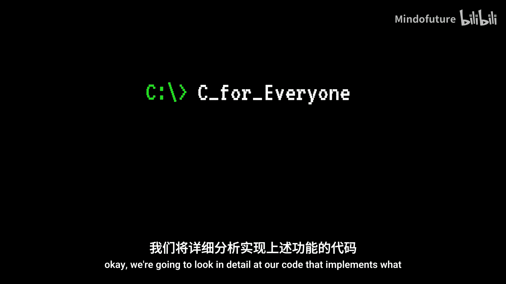
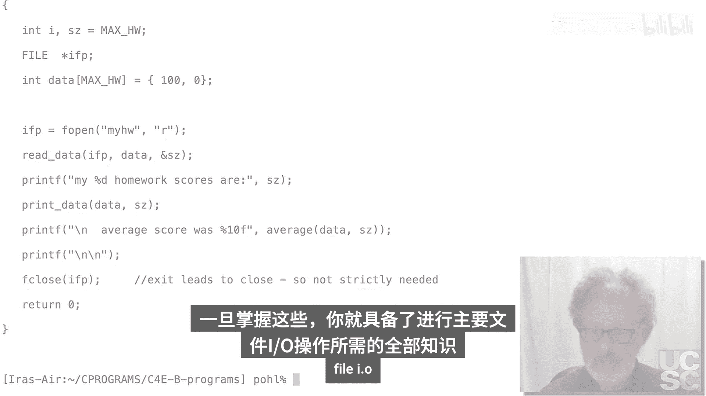

# 021：对文件进行双倍行距处理



在本节课中，我们将详细分析一段实现文件双倍行距处理的代码。我们将看到一些之前未涉及的元素，并学习如何通过命令行参数操作文件。

## 概述

我们将编写一个程序，读取一个输入文件，将其内容复制到输出文件，并在每个换行符后添加一个额外的换行符，从而实现双倍行距的效果。我们将学习使用标准库函数、处理命令行参数以及进行基本的文件输入输出操作。

## 代码详解

上一节我们介绍了双倍行距的基本概念，本节中我们来看看具体的实现代码。

首先，我们需要包含标准库，因为我们将使用一个名为 `exit` 的函数来退出程序。

```c
#include <stdlib.h>
```

### 一个简单的文件打印程序

以下是打印文件内容的程序，它展示了逐字符处理文件的标准模式。

```c
void printFile(FILE *fp) {
    rewind(fp); // 确保从文件开头开始
    int c;
    while ((c = getc(fp)) != EOF) {
        putchar(c); // 将字符输出到屏幕（标准输出）
    }
}
```

这个 `while` 循环非常标准，你应该习惯编写它。它允许你一次处理一个字符，这对于处理文本文件尤其有用。

### 双倍行距处理程序

现在，我们来看用于处理输入文件并生成输出文件的核心程序。其逻辑非常简单：复制每个字符，并在遇到换行符时额外输出一个换行符。

```c
void doubleSpaceFile(FILE *in, FILE *out) {
    rewind(in); // 确保从输入文件开头开始处理
    int c;
    while ((c = getc(in)) != EOF) {
        putc(c, out); // 将字符写入输出文件
        // 如果当前字符是换行符，则再写入一个换行符
        if (c == '\n') {
            putc('\n', out);
        }
    }
}
```

这就是实现双倍行距的全部逻辑。对于输入文件中的每一个换行符，我们在输出文件中写入第二个换行符。

### 处理命令行参数

我们的程序需要从命令行接收输入和输出文件名。以下是处理命令行参数的部分。

```c
int main(int argc, char *argv[]) {
    // 检查参数数量：程序名、输入文件名、输出文件名
    if (argc != 3) {
        printf("用法：需要可执行程序名、输入文件和输出文件。\n");
        exit(1);
    }

    // 打开输入文件用于读写（"r+"模式）
    FILE *inFile = fopen(argv[1], "r+");
    // 打开输出文件用于读写（"w+"模式）
    FILE *outFile = fopen(argv[2], "w+");

    // 打印输入文件内容（标题）
    printf("输入文件 %s 的内容：\n", argv[1]);
    printFile(inFile);
    printf("\n\n"); // 打印双倍空行分隔

    // 进行双倍行距处理
    doubleSpaceFile(inFile, outFile);

    // 打印输出文件内容（标题）
    printf("输出文件 %s 的内容（双倍行距）：\n", argv[2]);
    rewind(outFile); // 将输出文件指针重置到开头
    printFile(outFile);

    // 关闭文件，释放资源
    fclose(inFile);
    fclose(outFile);

    return 0;
}
```

以下是关于命令行参数和文件模式的关键点：
*   `argc` 表示参数数量，`argv` 是一个字符串指针数组。
*   文件模式 `"r+"` 允许读取和写入文件。
*   文件模式 `"w+"` 会创建新文件（或清空已有文件）并允许读取和写入。

## 运行示例

程序编译后，可以通过命令行运行。例如：
```bash
./a.out homework.c homework_double_spaced.c
```
程序会先显示原始文件内容，然后显示经过双倍行距处理后的新文件内容。你可以使用 `cat` 命令（Unix/Linux系统）来验证输出文件确实包含了双倍行距的文本。

## 总结

本节课中我们一起学习了如何用C语言实现文件的双倍行距处理。我们掌握了以下核心技能：
1.  使用 `getc` 和 `putc` 进行逐字符的文件读写。
2.  利用标准的 `while ((c = getc(fp)) != EOF)` 循环遍历文件。
3.  通过 `argc` 和 `argv` 处理命令行参数。
4.  使用 `fopen` 配合不同模式（如 `"r+"`， `"w+"`）打开文件。
5.  在程序结束时使用 `fclose` 关闭文件。



你所看到的这些代码模式可以反复使用。这个应用虽然简单，但其中包含了文件输入输出90%的核心操作。一旦掌握了这些，你就具备了进行主要文件I/O操作所需的所有知识。